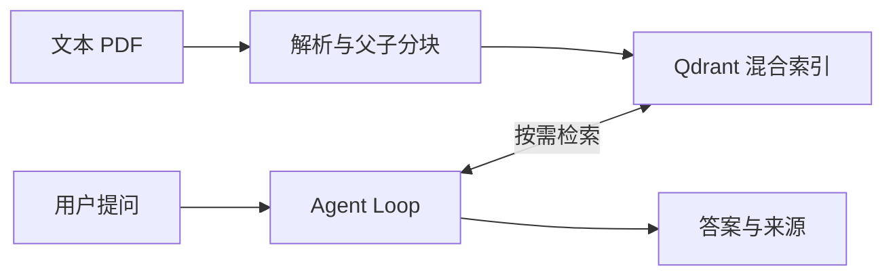
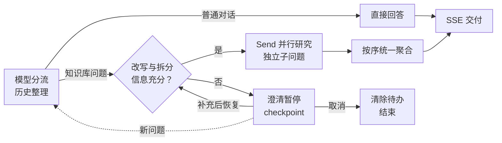
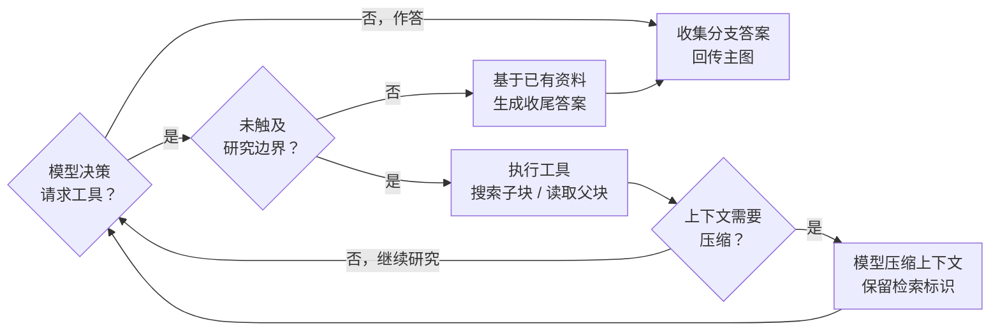

# 文脉 · PDF 知识工作台

上传 PDF，用自然语言提问。文脉会从文档里找相关段落，在答案旁列出来源，方便回看原文、继续追问。

**本地知识库** · OpenAI 兼容接口 · Qdrant 混合检索 · LangGraph 问答编排

[功能](#功能) · [技术栈](#技术栈) · [工作流程](#工作流程) · [Agent Loop](#agent-loop) · [项目结构](#项目结构) · [快速开始](#快速开始) · [项目文档](#项目文档)


*问答台实录。演示使用隔离环境中的合成测试 PDF。*

<details>
<summary>查看知识库界面</summary>


</details>

## 功能

| 能力 | 在工作台里可以做什么 |
| --- | --- |
| PDF 知识库 | 拖放上传文本型 PDF，按名称或状态筛选，查看文档是否已就绪。 |
| 多轮问答 | 普通对话直接回复。文档问题需要补充型号、对象或条件时，可以在同一会话继续说明。 |
| 证据回看 | 查看命中的文件、章节和原文片段。索引记录包含页码时，来源会带上页码。 |
| 执行过程 | 展开查看实际的模型调用和检索步骤，便于理解答案依据。 |

## 技术栈

**Agent 与检索**


LangGraph 编排模型与工具循环，Qdrant 融合 **Dense + BM25** 检索，fastembed 在本地运行 ONNX 嵌入模型。

**后端与文档**


FastAPI 提供 API 与 SSE，PyMuPDF4LLM 解析文本型 PDF，问答模型通过 **OpenAI 兼容接口**接入。

**前端界面**


React + TypeScript 构建问答台与知识库，Vite 负责开发和构建，Tailwind CSS 统一界面样式。

<details>
<summary>更多依赖与实现细节</summary>

| 模块 | 技术与实现 |
| --- | --- |
| 组件与交互 | Base UI · Motion · Lucide |
| 状态与渲染 | Zustand · react-markdown · remark-gfm |
| API 与认证 | Uvicorn · Pydantic · PyJWT · pwdlib |
| PDF 与分块 | PyMuPDF · PyMuPDF4LLM · Parent/Child 分块 |
| 嵌入与融合 | 多语言 MiniLM，默认 `paraphrase-multilingual-MiniLM-L12-v2`，384 维向量；DBSF 融合 |
| 模型适配 | langchain-openai · 结构化输出 · 原生工具调用 |
| 自动化测试 | pytest · Vitest · jsdom |

</details>

## 工作流程



## Agent Loop

文脉使用 **LangGraph 主图 + 研究子图**。模型负责工具需求判断、问题分析、研究和作答，程序负责分发子问题、执行工具、维护状态及检查研究边界。

### 主图：消息分流与任务编排



新消息先由模型判断工具需求，再按需摘要历史并重置本轮分支答案。待补充消息在同一会话恢复问题分析；开始新问题或取消会清除待办，取消不调用模型。直接回答的来源为空，单个子问题的研究结果也会经过最终聚合。

### 研究子图：模型与工具循环



- **两种检索工具**：`search_child_chunks` 通过 Dense + BM25 搜索子块；`retrieve_parent_chunks` 读取完整父块，补充章节上下文。研究提示要求首轮先搜索子块，后续由模型决定继续搜索、读取父块或回答。
- **两类摘要**：主图整理会话历史；研究子图在工具执行后检查上下文容量，超过动态阈值时压缩研究记录，再回到模型继续决策。
- **分支边界**：计数包含当前模型回复中的工具请求。存在工具请求时，若迭代数达到 **10** 或累计工具请求超过 **8**，本批工具不执行，转为收尾；没有工具请求时直接收集答案。摘要、压缩、收尾和聚合的模型调用另行发生。

<details>
<summary>图中步骤与源码节点</summary>

| 图中步骤 | 源码节点 |
| --- | --- |
| 模型分流 → 历史整理 | `select_tool` → `summarize_history` |
| 直接回答 / 改写与拆分 | `answer_direct` / `rewrite_query` |
| 澄清暂停与恢复 | `request_clarification` 前中断，补充后恢复改写 |
| 并行研究 → 统一聚合 | `Send("agent", ...)` → `aggregate_answers` |
| 模型决策 → 工具执行 | `orchestrator` → `tools`（ToolNode） |
| 上下文检查 → 模型压缩 | `should_compress_context` → `compress_context`，压缩后清理旧消息 |
| 收尾 → 收集分支答案 | `fallback_response` → `collect_answer`，携带已检索上下文回传 |

</details>

图与当前实现对应：[图装配](backend/app/rag/graph.py)、[节点](backend/app/rag/nodes.py)、[条件路由](backend/app/rag/edges.py)、[工具](backend/app/rag/tools.py)和[会话恢复](backend/app/core/reference_session.py)。

## 项目结构

```text
agentic-rag/
├── start.py            # 一键启动前后端
├── backend/
│   ├── app/
│   │   ├── api/         # 登录、文档管理、聊天 SSE
│   │   ├── core/        # 模型适配、会话与事件投影
│   │   ├── knowledge/   # PDF 解析、分块、索引与检索
│   │   └── rag/         # LangGraph、节点、提示与工具
│   ├── scripts/        # 冒烟验证与索引维护
│   └── tests/          # 单元、集成、契约与安全测试
├── frontend/src/       # 登录、问答台与知识库
└── docs/               # 架构、运行指南与开发进度
```

## 快速开始

需要 **Python 3.11+** 和 **Node.js 22+**。

### 一键启动

```powershell
git clone https://github.com/ifhgh666/agentic-rag.git
cd agentic-rag
python start.py
```

已有仓库时，在仓库根目录运行 `python start.py` 即可。启动器会自动准备依赖和本地嵌入模型，启动前后端。按 `Ctrl+C` 停止。

### 首次配置模型接口

第一次运行会创建 `backend/.env`。填写下面三项，再运行 `python start.py`。已有模型配置可直接复用。

| 配置 | 填写内容 |
| --- | --- |
| `LLM_BASE_URL` | OpenAI 兼容 API 地址 |
| `LLM_API_KEY` | 接口密钥 |
| `LLM_MODEL` | 服务商提供的模型名称 |

### 登录工作台

打开 [http://127.0.0.1:5173/](http://127.0.0.1:5173/)，使用本机演示账号 **`admin / 123456`** 登录。上传文本型 PDF（单文件上限 25 MB），等状态变为「已就绪」，再到问答台提问。

## 项目文档

- [架构与源码导航](docs/repository-guide.md) · 主图、检索、会话状态及公开事件
- [测试与运行操作](docs/testing-and-operations.md) · 回归命令、配置与索引维护
- [当前进度](docs/CURRENT_STATUS.md) · 阶段交接、已知失败与历史记录
- [编码代理开发流程](docs/agent-workflow.md) · 本地开发资料与阶段交接

`specs/`（功能规格、计划与阶段报告）和 `.specify/`（Spec Kit 配置、模板与脚本）作为本地开发资料保留，由 Git 忽略，不包含在新克隆的仓库中。运行应用无需这两个目录；恢复历史开发或评测前，需要另行准备对应的本地归档，详见开发流程与测试指南。

当前版本面向单管理员与文本型 PDF。扫描件需要先转成含文本层的 PDF。会话历史、摘要与待补充状态保存在进程内，重启后清空。
