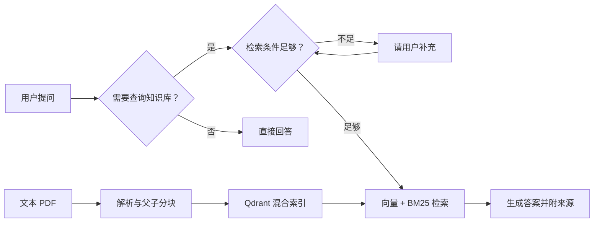

# 文脉 · PDF 知识工作台

上传 PDF，用自然语言提问。文脉会从文档里找相关段落，在答案旁列出来源，方便回看原文、继续追问。

**本地知识库** · OpenAI 兼容接口 · Qdrant 混合检索 · LangGraph 问答编排

[功能](#功能) · [工作流程](#工作流程) · [项目结构](#项目结构) · [快速开始](#快速开始) · [项目文档](#项目文档)


*问答台实录。演示使用隔离环境中的合成测试 PDF。*

<details>
<summary>查看知识库界面</summary>


</details>

## 功能

| 能力 | 在工作台里可以做什么 |
| --- | --- |
| PDF 知识库 | 拖放上传文本型 PDF，按名称或状态筛选，查看文档是否已就绪。 |
| 多轮问答 | 普通对话直接回复。文档问题需要补充型号、对象或条件时，可以在同一会话继续说明。 |
| 证据回看 | 查看命中的文件、章节和原文片段。索引记录包含页码时，来源会带上页码。 |
| 执行过程 | 展开查看实际的模型调用和检索步骤，便于理解答案依据。 |

## 工作流程



后端使用 **Python、FastAPI、LangGraph**，前端使用 **React、TypeScript、Vite**。PDF 经 PyMuPDF4LLM 解析后，使用 fastembed 的本地 ONNX 模型和 BM25 编码。问答模型由你配置的 OpenAI 兼容服务提供。

## 项目结构

```text
agentic-rag/
├── start.py            # 一键启动前后端
├── backend/
│   ├── app/
│   │   ├── api/         # 登录、文档管理、聊天 SSE
│   │   ├── core/        # 模型适配、会话与事件投影
│   │   ├── knowledge/   # PDF 解析、分块、索引与检索
│   │   └── rag/         # LangGraph、节点、提示与工具
│   ├── scripts/        # 冒烟验证与索引维护
│   └── tests/          # 单元、集成、契约与安全测试
├── frontend/src/       # 登录、问答台与知识库
├── docs/               # 架构、运行指南与开发进度
└── specs/              # 功能规格与阶段报告
```

## 快速开始

需要 **Python 3.11+** 和 **Node.js 22+**。

### 一键启动

```powershell
git clone https://github.com/ifhgh666/agentic-rag.git
cd agentic-rag
python start.py
```

已有仓库时，在仓库根目录运行 `python start.py` 即可。启动器会自动准备依赖和本地嵌入模型，启动前后端。按 `Ctrl+C` 停止。

### 首次配置模型接口

第一次运行会创建 `backend/.env`。填写下面三项，再运行 `python start.py`。已有模型配置可直接复用。

| 配置 | 填写内容 |
| --- | --- |
| `LLM_BASE_URL` | OpenAI 兼容 API 地址 |
| `LLM_API_KEY` | 接口密钥 |
| `LLM_MODEL` | 服务商提供的模型名称 |

### 登录工作台

打开 [http://127.0.0.1:5173/](http://127.0.0.1:5173/)，使用本机演示账号 **`admin / 123456`** 登录。上传文本型 PDF（单文件上限 25 MB），等状态变为「已就绪」，再到问答台提问。

## 项目文档

- [架构与源码导航](docs/repository-guide.md) · 主图、检索、会话状态及公开事件
- [测试与运行操作](docs/testing-and-operations.md) · 回归命令、配置与索引维护
- [真实前后端联调记录](specs/017-frontend-nova-workspace/phase-e-report.md) · 上传、问答、来源与退出
- [当前进度](docs/CURRENT_STATUS.md) · 阶段交接、已知失败与历史记录

当前版本面向单管理员与文本型 PDF。扫描件需要先转成含文本层的 PDF。会话历史、摘要与待补充状态保存在进程内，重启后清空。
