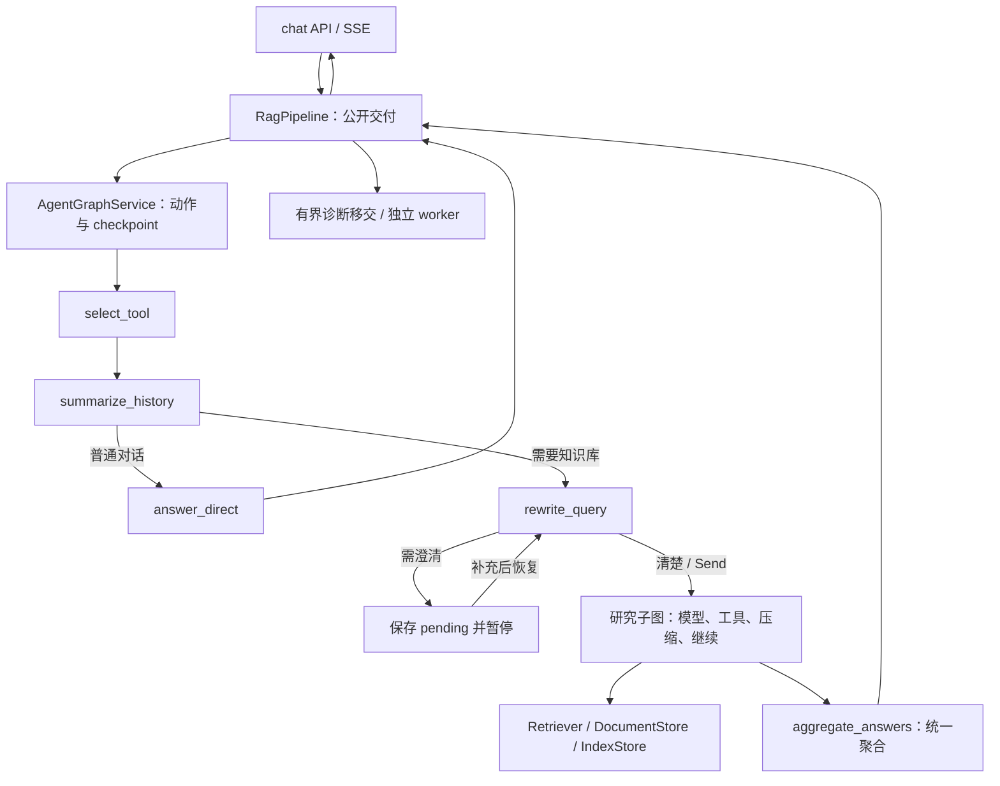

# Agentic RAG 仓库导航、架构与实现边界

适用：定位和修改代码、设计接口、理解当前架构。原则是**先确认现有实现，再做最小必要改动**；本文件不是运行代码的事实替代品。

## 1. 技术与产品概况

- 后端：Python 3.11+、FastAPI、LangGraph；前端：React 18、TypeScript、Vite。
- 默认本地优先：Ollama、本地 Qdrant、ONNX Dense 向量表示和 BM25 Sparse 混合检索。
- 文档主路径：文本 PDF → 解析/Markdown → Parent/Child 分块 → 嵌入与索引 → Agent 研究/检索工具 → 模型压缩与最终聚合 → 来源展示、观测与 API/SSE。
- 模块责任分离：PDF 解析、分块、嵌入、索引、检索、模型决策、生成、会话、观测和 API 传输分别负责各自工作。正常在线不生成核验卡；独立旧核验能力保留给原消费方。
- 当前不擅自增加 OCR、多模态、多用户权限和生产部署；此类变更先按新增批准规格执行。
- 本地模型失败不得自动切换云端；兼容接口仅在用户明确配置时使用。

## 2. 仓库路径地图

先根据任务定位模块，再读必要文件；搜索优先 `rg` / `rg --files`。当前正常在线采用 [016 参考执行语义](../specs/016-reference-agent-semantics/plan.md)，保留 015 建立的职责目录：`backend/app/rag/` 放八个 Agent 核心文件，`core/` 放模型、会话、交付及独立旧能力，`knowledge/` 放知识基础设施。015/014/011 的报告保留对应日期的事实，不能覆盖 016 的当前调用链。当前静态结构与源码位置见 [框架审阅](../specs/016-reference-agent-semantics/phase-framework-review-20261028-report.md)。

| 变更领域 | 优先核对的路径 |
|---|---|
| 配置、启动、认证 | `backend/app/config.py`、`backend/app/main.py`、`backend/app/auth/`、`backend/app/api/auth.py` |
| PDF、分块、文档生命周期 | `backend/app/knowledge/` |
| 嵌入、索引和混合检索 | `backend/app/knowledge/embeddings.py`、`index.py`、`retrieval.py` |
| Agent 图、节点、边、状态、提示、结构、工具 | `backend/app/rag/graph.py`、`nodes.py`、`edges.py`、`graph_state.py`、`prompts.py`、`schemas.py`、`tools.py` |
| 正常问题分析、模型研究、压缩与聚合 | `backend/app/rag/nodes.py` 的 rewrite_query、orchestrator、compress_context、aggregate_answers；路由在 edges.py |
| 正常模型创建与原生协议 | `backend/app/core/reference_model.py` 的 create_reference_model、CompatibleReferenceModel；入口 structured output、研究 bind_tools，沿用现有 SDK |
| 正常会话、历史与动作 | `backend/app/core/reference_session.py` 的 AgentGraphService；唯一 checkpoint 保存历史/摘要/pending，同线程互斥；历史摘要节点在 rag/nodes.py |
| 工具与研究上下文计数 | `backend/app/rag/tools.py` 的 create_rag_tools、estimate_context_tokens；固定参考常量在 graph_state.py |
| 公开交付、来源、日志和 API/SSE | `backend/app/core/pipeline.py` 的 RagPipeline；reference_observation.py 的被动观测；observability/ 与 api/chat.py 的诊断和传输 |
| 独立旧分析/生成/治理/会话能力 | `backend/app/core/query_analysis.py`、answering.py、model_call.py、model_provider.py、conversation.py、legacy_*.py；不接正常参考图 |
| 前端接口、待办、答案和过程面板 | `frontend/src/api/`、`frontend/src/types/api.ts`、`frontend/src/pages/Chat.tsx`、`frontend/src/components/ProcessPanel.tsx`；旧核验类型保留不代表正常在线发核验事件 |
| 验证、运行记录、需求 | `backend/tests/`、`backend/scripts/`、`frontend/src/**/*.test.*`、`specs/`、`output/` |

### 正常在线装配与调用链

`main.build_services` 装配 `RagPipeline(AgentGraphService(settings, retriever, documents), logger, diagnostics)`。HTTP 入口把动作与问题交给 pipeline；pipeline 只投影事件/可见答案/来源/用量，会话模块负责动作、锁和 checkpoint，实际语义节点与路由在 rag。正常参考图直接使用原生模型，不经 ModelCallRunner、旧 QueryAnalyzer/AnswerGenerator 或旧 ConversationMemory。

主图由 `create_agent_graph(llm, tools_list)` 构造。新消息先经过 select_tool，整理历史后进入 answer_direct 或 rewrite_query。改写后澄清暂停或 Send 分支研究，再经 aggregate_answers 统一聚合。研究子图显式包含 orchestrator、tools、should_compress_context、compress_context、fallback_response、collect_answer；工具之后检查容量，必要时模型压缩后继续研究。模型决定请求工具或作答，程序按图和工具契约执行。见 [018 聊天分流契约](../specs/018-tool-routing/contracts/chat-routing.md)。

每分支保留 8 个工具请求、10 次研究迭代，图递归 50、近期消息 4、压缩阈值 2000/0.9，以 `rag/graph_state.py` 为准。旧 8/12 总模型配额、300/120 秒应用截止及旧输入准入退出正常路径；不承诺替代墙钟上限。兼容模型入口显式 function_calling，Ollama 沿用当前 SDK 默认；精确 deepseek-flash 的正常实例默认关闭思考，见 [传输契约](../specs/016-reference-agent-semantics/contracts/model-transport.md)。

checkpoint 保存在线历史、摘要与 pending，auto/continue 直接恢复检索改写，new/cancel 清理待办；会话在进程内，重启会丢失。直接回答与最终聚合正文进入 answer，直接回答的来源为空。用量只统计，model_call_limit=null。既有消息与动作见 [聊天契约](../specs/016-reference-agent-semantics/contracts/chat.md)。

诊断由 `observability/diagnostics.py` 独立承担，lifespan 管理 worker；pipeline 仅移交有界快照。queued 不等于已保存，诊断失败不改变问答或 checkpoint。SSE 使用有界队列，断开后停止消费，当前 SDK 调用仍可能等待；不能承诺立即终止模型。

### 独立旧能力与历史资料

`core/model_call.py` 的 ModelCallRunner/ModelCallBudget、`model_provider.py` 的旧协议、query_analysis.py、answering.py、conversation.py、legacy_rag.py 和 legacy_* 冻结依赖仍供独立旧消费方使用；`knowledge/retrieval.py` 的 ContextBuilder 也保留。它们的 owner/lease、额度/期限、旧分析和核验约定按原调用路径及 [011 规格](../specs/011-model-call-governance/spec.md)核对，不应用于正常参考图。

012 的 `_build_model_subgraph`、兼容属性说明及 015 迁移报告属于各自历史版本，不能据此假定当前 AgentGraphService 仍公开旧 builder、query_generator 或 evidence_selector。修改独立旧能力时先查当前调用方和保存的契约，不按“未接主图”批量删除模块，也不把旧机制接回新图。

## 3. 实现和协议约定

1. 遵循相邻代码的命名、目录组织和测试方式；新增 Python 接口明确类型与返回值，前端保留 TypeScript `strict`，不得以关闭检查掩盖协议问题。
2. 修改请求字段、工具消息、失败原因或 SSE 事件时，同步核对后端 schema、序列化、前端类型、消费逻辑以及契约测试，不能仅修改生产端。
3. 优先复用当前原生模型工厂、图状态/reducer、工具及公开事件契约；预算/期限按所改路径的规格处理，避免将独立旧治理接回正常参考图。不夹带无关重构、格式化或依赖升级。
4. 必须升级依赖时说明理由，按受影响组件更新依赖清单和现存锁文件。前端脚本以 `frontend/package.json` 为准；本轮核对的 package.json 没有 `npm run lint` 脚本，不能凭空宣称运行。
5. 不擅自提交、推送、合并或发布；不重置工作区，不破坏用户与其他任务留下的文件。

## 4. 容易误判的边界

- 不能把首次资源下载、BM25 元数据访问等过程说成完全离线启动。
- 索引清单不匹配应明确报告 `index_ready`/索引未就绪，不擅自以重建正式知识库代替诊断。
- `README.md`、历史报告、当前功能规格及代码中的数值冲突时，核对最新授权、规格、`backend/app/config.py`、`backend/.env.example` 和可安全读取的实际生效值，只输出非敏感配置。
- 005 的模型决策边界是**该功能特定规格**，不是所有未来检索功能的默认约束；模型循环与评测细则见 [`evaluation-policy.md`](evaluation-policy.md)。
