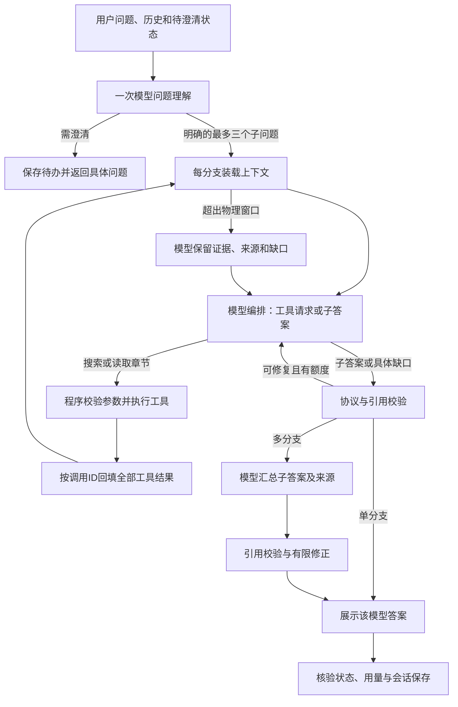

# 实施计划：模型驱动的 Agent Loop

**功能标识**：005-model-driven-agent-loop | **日期**：2026-10-08 | **规格**：[spec.md](spec.md)  
**状态**：保留2026-10-08原设计依据；2026-10-09仅执行C，工程检查通过、真实场景未通过，交付报告后停留C。证据见[阶段C报告](phase-c-report.md)，拟定质量门槛尚未验证。  
**实际分支**：codex/model-driven-agent-loop，既有未提交修改保留。  
**功能上下文**：规划脚本临时定位005目录，已恢复原004功能指针；既有未提交改动保留。

## 1. 目标与范围

把“搜什么、要不要读完整章节、证据缺什么、是否继续、是否回答”交给每轮大模型决定。程序只负责执行工具、协议/出处校验、预算、超时、取消、缓存和状态隔离，不再用非空结果、240字、型号正则或已有Parent代表证据充分。

首选与GitHub原项目相近的原生工具循环。单分支直接使用模型子答案；多分支再由模型汇总。证据选择、流程原文覆盖和题设数字拦截作为配套修复纳入范围，否则模型的判断仍可能在输出时丢失。登录、PDF解析、索引格式、Qdrant Dense+BM25/DBSF、数据管理和页面布局沿用现有能力。

最初规划轮只交付文档；随后A/B已实施，本轮仅执行C工程与两次单题运行验证。未下载模型、未重建索引，未开展D阶段30题评测。

## 2. 当前事实与参考

- 参考仓库`GiovanniPasq/agentic-rag-for-dummies`，2026-10-08只读查询HEAD：`f0d9a3c89adc7ebd146ffe173057fe013dd41739`。设计依据为该版本的[主图](https://github.com/GiovanniPasq/agentic-rag-for-dummies/blob/f0d9a3c89adc7ebd146ffe173057fe013dd41739/project/rag_agent/graph.py)、[节点](https://github.com/GiovanniPasq/agentic-rag-for-dummies/blob/f0d9a3c89adc7ebd146ffe173057fe013dd41739/project/rag_agent/nodes.py)、[提示词](https://github.com/GiovanniPasq/agentic-rag-for-dummies/blob/f0d9a3c89adc7ebd146ffe173057fe013dd41739/project/rag_agent/prompts.py)。
- 当前`nodes.py`用条件分支构造工具请求，`graph.py`虽有回边，但不逐轮调用编排模型。
- `model_provider.py`已有tools输入/tool_calls输出；Ollama却把消息压成(role, content)，丢工具调用元数据。两提供者输出形状也不同，需统一完整协议。
- 多工具执行后，状态主要摄取最后一个ToolMessage，需按调用ID合并全部结果。
- `EvidenceSelector`按词面重合筛文本；流程答案被替换成原文；题设数字因不在引文中可能被拒。不能仅改编排提示词。
- 基线：[30题报告](../../output/rag30-20261008/report.md)、[原始采集](../../output/rag30-20261008/capture.json)。54/100，场景3.5/20；平均63.31秒，P95 148.25秒；66次本地调用，预算超限0、云调用0。六道有依据题在生成校验环节失败，不能统称检索失败。

## 3. 技术上下文

| 项目 | 决定 |
|---|---|
| 平台与语言 | Windows、Python 3.11+、React/TypeScript |
| 依赖 | 复用现有FastAPI、LangGraph、langchain-ollama、Pydantic、Qdrant；不整体升级依赖 |
| 模型 | 本地Ollama qwen3:4b-instruct；真实工具协议和中文行为在阶段A验证 |
| 检索与存储 | 现有PDF/Markdown、父子块和本地混合索引；只读知识库工具 |
| 决策协议 | 原生工具调用优先；需要兼容时显式使用模型结构化动作，不能暗退程序规则 |
| 验证 | pytest、Vitest/构建；脚本协议测试、真实冒烟、同协议30题分开报告 |
| 性能/质量目标 | 拟总分≥75、场景≥14/20；平均≤94.97秒、P95≤222.37秒；目标不代表已经达到 |
| 边界 | 最多三个子问题；不新增联网工具、在线Judge、计算执行器或持久化记忆 |

现场模型能力和真实上下文窗口不是本轮已验证事实，列为阶段A的运行验证项；设计采用明确主方案，不留下未选的架构路线。完整取舍见[research.md](research.md)。

## 4. 目标流程

每轮模型收到：原始问题和解析子问题、用户题设、已找到证据、全部工具返回、已执行查询/Parent、剩余时间/次数。模型可调用`search_child_chunks(query, limit)`、`retrieve_parent_chunks(parent_id)`，或无工具请求时给结构化答案/具体资料缺口。request_id等系统身份由执行器注入。

不存在“有结果即转回答”的路由；由模型终态决定正常退出。模型无依据作答、无内容、参数/格式错误，返回具体协议反馈让模型修正，不由程序偷偷搜索。硬上限结束执行时明确标记资源原因，不声明证据够。

### 必须删除或替换的规则

| 当前规则 | 改造结果 |
|---|---|
| 首轮程序直接发搜索 | 模型提出查询及工具调用；提示词要求查证，程序不代发 |
| 少于240字自动读Parent | 模型判断是否缺上下文 |
| 有结果/取得Parent即停止 | 全部结果交回模型选择下一步 |
| 型号正则不符就清空重搜 | 模型看到型号和内容后修正；参数/出处合法性仍校验 |
| 空结果才改写、固定两次搜索 | 针对缺口由模型换查询，服从统一资源上限 |
| 中文二字重合排序、截句替模型排除证据 | 原始候选完整装载；超窗时模型选证据，程序记录删减和容量 |
| 无历史单问恢复原句覆盖有效改写 | 同时保存原始问题，采用模型的有效检索问题 |
| procedure标记强制展示原文 | 模型写结论和步骤，原文作为依据附后 |

程序继续验证工具白名单、参数类型、已返回且有权限的Parent ID、文档/索引状态、调用配对、引用位置。重复工具请求可用缓存，仍计模型轮次和逻辑工具次数，不能因此宣布资料足够。

## 5. 证据与答案

原始证据注册表保留所有工具结果及文档/页码/章节身份，稳定引用ID不因压缩改变。所有ToolCall，包括被拒绝或失败者，都有对应ToolMessage，不能只读最后一条结果。

答案区分文档事实（198 V、500 ms）、用户条件（195 V、300 ms）和推导结论（时间不足）。取消“所有数字必须在选中引文里”的统一检查；用户条件允许用于比较，不得冒充设备阈值。保留引用逐字定位；确定性数值/单位检查指出具体问题再反馈模型，不以正则作最终语义裁决。未独立计算审核的推导，核验状态仍为未评估。

流程题保留模型的直接结论、有序步骤、条件和原文依据；不再以完整Markdown段落资格决定可答，也不整段替换成原文。表格和跨段证据可共同支撑回答。故障专属步骤和同章通用要求都要覆盖；不足由模型说明。

每个候选至多一次格式/引用修正，计入当前编排或汇总预算；失败标`verification_failed`，不回退单条原文假装完成。没有独立在线Judge，模型“证据充分”只是模型声明。详细契约见[contracts/agent-loop.md](contracts/agent-loop.md)。

## 6. 拟定预算与成本

旧004简单2次/复杂4次限制不能容纳新Loop；本功能拟替换如下，但当前配置不改。基线没有预算超限，不能把旧拒答改称预算失败。

| 预算 | 单分支 | 两分支 | 三分支 |
|---|---:|---:|---:|
| 全请求模型调用硬上限 | 8 | 12 | 12 |
| 问题理解 | 1 | 1 | 1 |
| 每分支编排上限（含终态/修正） | 5 | 4 | 3 |
| 最终汇总预留 | 0，直接采用子答案 | 1 | 1 |
| 压缩或汇总格式修正共享预留 | 1 | 1 | 1 |
| 历史摘要 | 仅用剩余额度，可延期 | 同左 | 通常延期 |

原子共享预算先预留各分支终态和汇总机会。每分支最后一个编排额度用于基于现有证据回答/说明缺口，不再执行新检索。工具总上限16；每分支`min(8, floor(16/分支数))`。一次模型返回多个工具请求只计一次模型调用，工具分别计数；缓存请求也计逻辑次数。

请求总截止300秒（2026-10-09按用户要求从240秒调整，配置不得大于300）。API独立限制等待，向图传递同一个绝对截止时间，不在节点或分支重置；到期返回failed/timeout，迟到结果不进入答案和正常会话。单次模型超时仍为120秒且不超过请求剩余时间。修正、压缩、摘要全部计费/计时，不另设隐藏调用。暂定输出预留768 tokens、安全余量256；若真实窗口为4096，全部输入（系统/工具定义/问题/历史/证据）最多3072 tokens。按现场确认的窗口计算，图递归上限按实际节点数校准。

阶段A校准能力与成本；无法达标时提交观测及计划修订，不自动提高预算、下载模型、切云或恢复旧规则。正式30题前冻结参数并记录与基线差别。模型时间在旧批约占99.75%，逐轮模型化可能增加耗时，不承诺提速。

## 7. 分阶段实施

| 阶段 | 工作 | 验收与交付 |
|---|---|---|
| A：协议/预算 | provider完整消息往返、统一ToolCall、状态契约、共享预算；隔离模型能力探测 | mock覆盖两个提供者；真实中文搜索→工具返回→模型续轮有记录；fake不证明本机能力；phase-a-report.md |
| B：模型循环 | 重写nodes/graph编排、多结果合并、删除语义分支、每轮上下文管理 | 同一证据不同模型动作产生不同路径；短而充分可回答、长而不足可补搜；无隐式规则回退；phase-b-report.md |
| C：答案/事件 | 证据选择、有效改写、用户数字、流程结论、有限修正；SSE和前端显示真实决策 | 场景结论、Q24人工恢复、Q25换题、出处和失败原因正确；记忆/澄清/API回归；phase-c-report.md |
| D：评测 | 冻结协议/配置、正式库前后哈希、30题首次结果、关键题补测单列 | 质量与成本分别达标；保留全部失败与原始轨迹；phase-d-report.md及新旧对比报告 |

阶段逐个验收、写报告并暂停，下一阶段需用户明确指令。当前C工程交付但真实运行未通过，停止于C，不自动推进D。工作区既有差异已保留。

## 8. 验收协议

沿用旧30题分组：Q1—Q20共用聊天，Q21—Q25新聊天，Q26—Q30另一个新聊天；顺序提交、action=auto、首次结果计分、不提供标准答案、不注入历史、不自动重试或跟进澄清。独立会话、变体、重复结果单列，不能替换主结果。

新报告逐题保存标准答案、实际回答、分数与失分原因、原始检索结果、送入模型的证据、动作链、失败原因、模型/工具用量与时间。在线核验、模型声明与人工评分分栏。保留54分旧报告，完整答案不改写。

拟质量门槛：总分≥75/100，场景≥14/20，事实≥16/20，边界10/10；无编造关键操作步骤或与来源冲突的动作。拟成本门槛：平均≤94.97秒、P95≤222.37秒、云调用0、预算不越界。质量过而成本不过仍不能宣称全面完成；一次成绩不是稳定准确率。

记录模型版本、实际上下文/输出、硬件与冷启动状态；配置变化明确列出。真实冒烟先≤6请求、各≤8调用；主30题最多360模型调用、各≤300秒（最坏约150分钟，时间预算已按10月9日用户要求修改）。主批后Q16/Q17/Q19各重复3次，最多9个独立请求，全部单列；不能无限补跑挑最好成绩。步骤见[quickstart.md](quickstart.md)。

## 9. 宪章检查

| 原则 | 设计前及设计后结果 |
|---|---|
| 阶段边界 | 用户明确新增模型循环目标，005独立规格承接；A—D逐阶段，本轮仅文档 |
| 单一职责 | 协议、编排、工具、证据、答案、事件各自契约；不重写解析和数据库 |
| 基于证据 | 原始注册表、定位引用、具体缺口；用户题设不是文档事实，模型自评不充当正确率 |
| 数据一致性/凭据 | 正式索引沿用；无下载/删除/重建，无凭据写入 |
| 可观察可验证 | 决策→模型调用→工具请求→结果→终态关联；协议、真实冒烟、质量三级验收 |
| Spec Kit | 已读取宪章、执行计划初始化，研究/数据模型/契约/验证指南齐全 |

无宪章例外。004旧功能的2/4次预算在本功能明确拟替换，不能继续宣称相同成本。不新增在线Judge、最终答案审核后无限回检索、实时SSE重构、联网检索或持久化会话；现有SSE仍按完成后的实际轨迹回放，不能标成实时流。

## 10. 文件与交接

本功能文档：spec.md、plan.md、research.md、data-model.md、contracts/agent-loop.md、quickstart.md。tasks.md属于后续任务拆分，本轮不生成或执行实现任务。

拟修改：backend/app/rag的model_provider.py、model_schema.py、graph_state.py、nodes.py、graph.py、tools.py、cost_control.py、evidence.py、model_compression.py、generator.py、query_analysis.py、pipeline.py；config.py、.env.example、schemas/chat.py；相应单元/集成/契约测试；前端ProcessPanel、ScoreCard、事件类型和SSE测试。详细状态见[data-model.md](data-model.md)。
