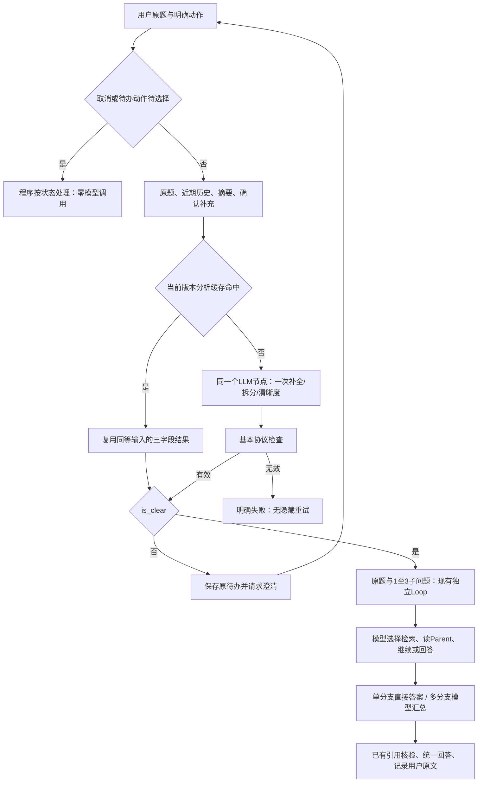

# Implementation Plan: 问题补全、改写与拆分 V1

**Branch**: `codex/model-driven-agent-loop`（沿用，未切换） | **Date**: 2026-10-10 | **Spec**: [spec.md](spec.md)
**Input**: [源设计 V1](source-design-v1.md)
**Status**: 2026-10-11：A–D工程完成；用户要求E遇错继续，新版完整输入17题首答已采齐，10通过、7失败、0未运行。见[完整E报告](phase-e-completed-all-20261011-report.md)。采集器继续模式26项scripted工程检查通过；产品prompt未改，原补全失败及F失败保留。T031质量仍未通过，T034及005 T018不变，本轮未执行F。报告后暂停，等待用户验收。

## Summary

复用当前一次 `QueryAnalyzer` 调用，改成三字段问题改写节点，一次完成必要补全、按需拆分和清晰度判断。完整单问保留原文；模糊问题澄清；最多三个检索目标继续使用当前独立 Agent Loop 分支，单分支直接回答、多分支模型汇总。原题始终同时传递。

目前已经只有一次入口模型调用，本次不会把“分析+改写”两个调用合并成一个虚构的优化收益。变化在于输出契约、提示职责、状态适配、缓存与历史保真。实施必须逐阶段验收，每阶段报告后暂停。

### 已批准的设计取舍与验证边界

1. **入口数字硬拦截已取消**：A 阶段已移除 `_analysis_literals_supported` 对问题改写触发的 `constraint_mismatch`。保留结构检查、摘要已有保真检查、工具合法性和答案引文定位。数字改错仍判真实质量失败；取消拦截不等于解决模型失真。
2. **三字段与待澄清动作**：不再让模型输出 `relation`。有待办且 `action=auto` 时请用户选择继续补充/开始新题，零入口模型调用；已有三个按钮沿用。明确补充和新题分别进入同一个改写节点。
3. **一次调用与异常**：当前入口没有自动重试，V1继续零自动重试。模型/JSON失败明确停止，不添加猜测式降级。用户再次提交算新请求。
4. **单问原文的保证边界**：用同一个模型的提示约束和真实验收观察，不能用“问题数为一就强制原句”恢复，否则会破坏单个代词追问。V1没有运行时语义保证。
5. **多问方式**：继续 `Send` 独立分支，不新增统一Loop或依赖DAG。共享条件完整传到各相关子问；真正无法独立表达的需求留在一个分支。

## Technical Context

| 项目 | 选择与基线 |
|---|---|
| 语言/平台 | Python 3.11+、React 18/TypeScript、Windows |
| 主要依赖 | 复用 FastAPI、LangGraph、Pydantic、现有模型提供者；不升级或新增依赖 |
| 模型 | 现有 Ollama `qwen3:4b-instruct`；不下载模型、不自动切云 |
| 存储/检索 | 现有内存会话、Parent/Child、ONNX Dense + BM25 Sparse、本地Qdrant/DBSF |
| 入口契约 | `is_clear: bool`、`questions: list[str]`、`clarification_needed: str`；严格三个必填字段 |
| 测试 | pytest、现有fake提供者与临时索引；Vitest/构建；真实入口人工核对与API补测分别执行 |
| 性能目标 | 入口最多一次模型调用；不承诺提速，保存首次端到端耗时及冷启动/用量来源 |
| 硬约束 | 请求≤300秒，模型等待≤120秒且≤剩余时间；不增加节点、不重建库、不导入标准答案 |
| 规模 | 本地单管理员、文本PDF；最多三个子问题 |

2026-10-10只读取非敏感生效配置：单/多分支总模型预算8/12，入口1，工具总16，窗口4096、输入3072、输出768、安全余量256，缓存300秒/256条。现有分支5/4/3及汇总预留沿用。旧README的2/4不是本方案预算依据。尚未执行模型能力或时延测试。

## Constitution Check

| 原则 | 设计前与设计后检查 |
|---|---|
| 阶段边界 | 用户已明确接受RW03普通空格变化并授权继续E；本轮只续测E未运行项，RW07实质失败后停止；A–F报告后暂停，不自动恢复F或005 C/D |
| 单一职责 | 一个入口模型节点、状态/缓存适配、现有Loop与生成/引用核验分离 |
| 基于证据 | 补全历史用于理解而非PDF依据；循环仍检索原文；数值保真人工验收与引用定位分开 |
| 数据安全一致 | 不动正式PDF/索引或.env；测试临时数据；公共事件保持脱敏 |
| 可观察可验证 | 原题、模型输出、实际工具/耗时来源关联；fake与真实结论分别记录 |

无宪章例外。宪章中的V1范围允许后续批准规格扩展；006 已获准分阶段实施，只调整入口及相关契约，不删除005检索/引用/预算能力。

## Project Structure

### Documentation (this feature)

```text
specs/006-query-rewrite-split/
├── source-design-v1.md
├── spec.md
├── plan.md
├── research.md
├── data-model.md
├── quickstart.md
├── acceptance-matrix.md
├── contracts/query-rewrite.md
├── checklists/requirements.md
├── tasks.md
└── planning-report.md
```

### Source Code (repository root)

```text
backend/app/rag/
  query_analysis.py       # 现有入口，保留query_analysis预算键
  model_schema.py         # 严格三字段QueryAnalysis
  graph.py                # 动作路由、原题分发、历史保存
  graph_state.py          # 原题/子问题/兼容元数据
  conversation_memory.py  # 复用现有待办与回滚
  generator.py            # 多分支汇总覆盖原题目标
  pipeline.py             # 过程事件及用量
backend/tests/{unit,integration,contract,security}/
backend/scripts/          # 后续有限真实采集脚本
frontend/src/{pages,components,types,api}/
```

**Structure Decision**: 修改现有职责，不新增独立分析/语义Judge模块。`agent_loop.py`工具决策、检索算法及索引格式不重写。详情见[研究](research.md)与[数据模型](data-model.md)。

## 1. 目标流程



所有调用共享现有绝对deadline。较早历史摘要沿用已有完成后预算机制，不在本次入口之前加摘要模型调用；摘要调用单独记账，不能冒充入口一次调用。

## 2. 模型和程序职责

| 模型负责 | 程序负责 |
|---|---|
| 是否需要最少上下文补全、是否独立需求、是否清楚 | 明确动作与待办状态、输入封装、基本结构/类型/空值/数量约束 |
| 单问原句、多问完整条件、具体澄清 | 原题保存、缓存隔离、预算、超时、调用/事件关联 |
| Loop搜索什么、何时继续/读Parent、如何回答 | 现有只读工具执行、参数权限与引用位置核验 |

撤去入口数字硬停止，不加入新的语义检查或模型自检重试。保留 `conversation_summary.py` 调用的 `_literal_constraints_preserved`，不得误删共享helper。格式正确但改错数字可以进入下游，因此必须把原题同时交给Loop并在真实验收中判失败，不能仅看请求完成状态。

## 3. 状态、缓存与兼容

- API `question/thread_id/action` 沿用。模型只输出三字段；`source/failure_reason/model_call_id/relation` 等为程序运行元数据，不是隐藏的模型第四字段。
- `analysis_relation` 依据显式动作填入兼容值；待办auto为`uncertain`，明确继续为`clarification`，新题为`new_question`。前端说明其动作来源，不称为模型意图判定。
- `requires_procedure` 从入口协议移出，不新增分类规则。当前Loop不消费此标记；流程完整性仍靠Loop提示与真实验收，历史直接调用接口按最小范围适配。
- `original_query` 保留本次真实消息；明确补充时另存原题及确认补充的原始组合，不用模型生成文字覆盖。
- 修复 `graph.py` 当前向普通历史优先写`rewritten_query`的路径，改存真实用户问题/确认补充。失败/timeout保留现有事务回滚。
- 入口缓存使用原题精确哈希、上下文/动作/线程/索引/提供者模型身份及`query-rewrite-v1`策略版本；不折叠内部空白或大小写。严格解析正文仅trim首尾，判重使用独立规范化副本。
- 公共SSE保留现有事件与版本1兼容字段，更新显示名及元数据来源；如实现发现不得不破坏结构，先报告再改规格版本，不暗改协议。SSE仍是完成后轨迹回放。

## 4. 分阶段实施与停止点

| 阶段 | tasks.md映射 | 目标/范围 | 验收方式 | 报告与停止点 |
|---|---|---|---|---|
| A：入口契约与完整单问 | Phase 1–3，T001–T011 | 基线、三字段、运行适配、精确缓存、原文保存、一次调用 | schema/入口/缓存/回滚针对性测试；fake不代表真实保真 | `phase-a-report.md`；保存后暂停 |
| B：上下文与澄清 | Phase 4，T012–T016 | 最少补全、明确动作、待办隔离、前端选择提示 | 固定历史与动作契约/集成/前端检查 | `phase-b-report.md`；保存后暂停 |
| C：拆分与原题完整回答 | Phase 5，T017–T021 | ≤3问、共同条件、依赖条件、比较目标、现有分支汇总 | 分支契约/生成/引用与覆盖工程检查 | `phase-c-report.md`；保存后暂停 |
| D：观测与工程回归 | Phase 6–7，T022–T029 | 事件、用量、安全、全量工程回归、运行文档 | 后端unit/contract/integration/security；前端test/build | `phase-d-report.md`；保存后暂停 |
| E：真实入口验收 | Phase 8，T030–T032 | 固定17次入口真实首次采集，含16主场景与明确换题 | 本地模型原始输出、人工保真/拆分核对、耗时与调用数 | `phase-e-report.md`；首次顺序失败保存并暂停 |
| F：真实端到端补测 | Phase 9，T033–T035 | 原Q16、C-UV与比较题各一次，分开记录入口与完整答案 | 正常平台API、独立线程、无标准答案；原库指纹核对 | `phase-f-report.md`；首次顺序失败保存并暂停 |

每次只执行一个明确获准阶段。用户未点名阶段而要求整体执行时，只执行首个尚未完成阶段。E不得顺手启动F；F不得启动005 D或30题。当前T031在新版RW08完整问题误判不清楚后停止，保持未完成，见[新版E首次报告](phase-e-completed-first-20261011-report.md)；原RW07代词补全失败见[E续测报告](phase-e-resume-20261011-report.md)。普通空格容许依据[用户验收澄清](phase-e-whitespace-acceptance-20261011.md)，不改变生产prompt。T034原Q16失败和另两题未运行不变；[E首批](phase-e-report.md)、[F首次真实](phase-f-first-20261011-report.md)及[F待测](phase-f-report.md)报告均保留。报告后暂停待验收。

## 5. 验收与成本

2026-10-11用户已明确覆盖本轮E失败停止条件：按[继续规则](phase-e-continue-policy-20261011.md)记录错误并继续，新增仅运行完整输入题集RW09–RW16、RW18。一次调用、冻结配置和首答保护不变，最终保存 `phase-e-completed-all-20261011-report.md` 后暂停。F范围与停止规则不变；这项调整不修改产品语义行为。

[验收矩阵](acceptance-matrix.md)定义24组场景，分为真实入口、工程异常/状态和端到端；[quickstart](quickstart.md)列未来命令。E最多17个入口模型调用，F最多三个请求、总模型≤36、每请求≤300秒；这些是上限，不是时长承诺。入口阶段单次模型等待仍≤120秒。真实300秒到期压力验证没有纳入本次新批次，已有mock期限回归必须保留，不能把普通请求在期限内结束称为到期截断已实测。

质量门槛：完整单问、上下文、数字/否定/比较/共同条件全部满足固定案例；出现`400→40`即不通过，即使本次不再报`constraint_mismatch`。同一失败不自动追问、改prompt重跑并挑最好输出；修复/复验需下一次明确授权，另存文件。

原Q16是否需要澄清要结合对象是否明确判断；正确澄清只能说明入口行为合理，不能计为完整保护/恢复答案通过。两道旧题保留原文，显式PX-200变体不能替代Q16。现有PDF包含推荐问答，补测不作为无泄漏检索质量评分，也不导入尚未准备/未上传的新PDF。

## 6. 范围变化与风险

- 与005旧“采用模型有效改写”相比，完整独立单问现在要求原句；006获批后这部分以新规格为准，旧报告和任务不覆盖。
- 删除入口硬拦截会失去该项运行保护；三字段/提示词不提供数值正确性保证。严格真实验收与原题保留是本版验证措施，若仍失真则报告失败，不恢复规则或新增Judge。
- 待办auto需选择会改变当前自动关系推断交互，已在故事、契约、前端任务明确列出。
- 4B模型可靠性、最终比较/条件推导仍未知；不承诺本方案一定解决历史两题。
- 阶段E/F真实模型可能耗时较长；固定有限批次、300秒单请求、失败停止，禁止后台续做。

## Complexity Tracking

无新增宪章违规或需豁免的复杂度。复用当前入口、Send分支、记忆和汇总；不引入新依赖、额外模型节点或新检索架构。
