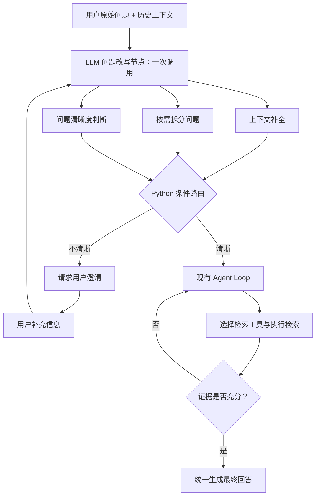

# Agentic RAG 问题改写与拆分模块设计方案（V1）

> 设计参考：[GiovanniPasq/agentic-rag-for-dummies](https://github.com/GiovanniPasq/agentic-rag-for-dummies/tree/main/project/rag_agent) 的问题改写思路。  
> 适用范围：现有 Agentic RAG 系统的问题预处理与检索衔接。  
> 状态：设计草案，待评审。

## 一、设计目标

在现有 Agentic RAG 系统中，优化用户问题进入检索 Agent 之前的处理流程。

采用**单个大模型节点**，在一次模型调用中完成**上下文补全、问题拆分和问题清晰度判断**。

本次改造**不引入独立的问题分析节点，也不增加独立的语义校验节点**。

主要目标：

1. 解决多轮对话中代词、主语省略及上下文引用问题。
2. 将包含多个独立信息需求的复杂问题按需拆分。
3. 保证改写与拆分后的问题尽可能忠实于用户原意。
4. 对无法确定上下文指代的问题，支持向用户请求澄清。
5. 保持现有 Agent Loop 的检索规划、工具调用、证据判断与回答能力。

## 二、整体架构



**职责分界：**

- **问题改写 LLM：** 解决“用户要问什么”，包含必要的上下文补全、按需拆分和清晰度判断。
- **Python 条件路由：** 根据结构化结果进入检索或请求澄清，不承担额外的语义分析。
- **现有 Agent Loop：** 负责“怎么检索”，包含工具选择、检索策略、证据评估与必要的再次检索。
- **回答生成：** 始终围绕原始问题统一回答，而不是简单拼接各子问题的结果。

## 三、问题改写节点设计

### 3.1 输入数据

| 输入 | 说明 |
| --- | --- |
| `original_query` | 用户原始问题，始终保留 |
| `recent_messages` | 最近的对话消息，用于理解代词与省略 |
| `conversation_summary` | 可选的较早对话摘要 |
| `pending_query` | 可选，尚未解决的待澄清原问题 |
| `clarifications` | 可选，用户此前提供的补充信息 |

优先复用现有的对话记忆机制，不为这次改造新建一套记忆系统。

### 3.2 核心职责一：上下文补全

利用历史对话，消除问题中影响独立理解的代词、主语省略及上下文引用。**只补充必要信息，不为了改写而改写。**

**示例 A：代词补全**

历史对话：

> 用户：PN8733 有哪些保护功能？

当前问题：

> 它的恢复条件是什么？

改写结果：

> PN8733 的保护恢复条件是什么？

**示例 B：省略的条件补全**

历史对话：

> 用户：设备输入 245 V 持续 400 ms，会触发什么保护？

当前问题：

> 那恢复条件呢？

改写结果：

> 对于设备输入 245 V 持续 400 ms 的情况，如果触发保护，相应的恢复条件是什么？

注意：历史上下文没有确定保护已经触发时，不能擅自断言保护已触发。

**示例 C：独立问题保持原文**

用户问题：

> PN8733 的启动电压是多少？

改写结果：

> PN8733 的启动电压是多少？

### 3.3 核心职责二：按需拆分问题

先理解并补全问题，再判断是否包含多个相对独立的信息需求。

拆分原则：

1. 简单问题不拆分。
2. 只有存在多个独立信息需求时才拆分，第一版最多 **3 个子问题**。
3. 每个子问题尽可能能够独立理解。
4. 保留数值、单位、型号、时间、否定、比较关系与完整条件。
5. 对共同生效的条件，不能拆成互不相关的查询。
6. 对依赖前一个结论的子问题，必须保留其条件性或依赖关系。
7. 拆分是为了明确检索需求，而不是将每个自然语言分句都机械拆开。

**示例 A：无需拆分**

用户：

> PN8733 的启动电压是多少？

输出一个问题：

> PN8733 的启动电压是多少？

**示例 B：条件问题拆分**

用户：

> 输入 245 V 持续 400 ms，会触发什么保护？如果触发，恢复条件是什么？

输出两个问题：

1. 输入 245 V 持续 400 ms，会触发什么保护？
2. 输入 245 V 持续 400 ms 如果触发保护，相应的恢复条件是什么？

**错误拆分示例：**

- 245 V 会触发什么保护？
- 400 ms 会触发什么保护？
- 设备的恢复条件是什么？

以上拆法破坏了 `245 V` 与 `400 ms` **共同成立**的条件，不应采用。

**示例 C：比较问题拆分**

用户：

> 设备 A 和设备 B 的过压保护阈值分别是多少？哪个更高？

可以拆为：

1. 设备 A 的过压保护阈值是多少？
2. 设备 B 的过压保护阈值是多少？

原问题中的“哪个更高”仍须保留为最终回答目标，由回答整合阶段完成比较，不一定额外启动第三次检索。

### 3.4 核心职责三：清晰度判断

判断当前问题是否具备足够明确的对象和上下文，能够进入检索。

**清晰：**“PN8733 是什么？”无需历史对话，直接进入检索。

**不清晰：**“它的参数是多少？”若历史中存在多个可能对象且未明确参数，则应请求澄清，例如：

> 你想查询哪一个设备的什么参数？

用户补充信息后，重新调用**同一个问题改写节点**，不新增澄清分析 LLM 节点。

## 四、结构化输出

参考 GitHub 项目的 `QueryAnalysis`，使用三个字段：

```python
from pydantic import BaseModel

class QueryAnalysis(BaseModel):
    is_clear: bool
    questions: list[str]
    clarification_needed: str
```

| 字段 | 类型 | 含义 |
| --- | --- | --- |
| `is_clear` | `bool` | 当前问题是否清晰、可进入检索 |
| `questions` | `list[str]` | 完成必要补全及拆分的问题列表 |
| `clarification_needed` | `str` | 向用户请求澄清的内容；不需要时为空字符串 |

**正常输出示例：**

```json
{
  "is_clear": true,
  "questions": [
    "输入 245 V 持续 400 ms，会触发什么保护？",
    "输入 245 V 持续 400 ms 如果触发保护，相应的恢复条件是什么？"
  ],
  "clarification_needed": ""
}
```

**需要澄清时：**

```json
{
  "is_clear": false,
  "questions": [],
  "clarification_needed": "你指的是哪一个设备？"
}
```

使用 Pydantic 或现有的结构化输出机制解析结果。**不设置独立的语义校验节点**；基础格式解析、空值保护和异常处理仍应保留，以保证程序稳定运行。

## 五、大模型 Prompt 设计原则

问题改写节点使用专门的系统提示词，明确模型仅承担问题预处理职责。

### 角色

你是 RAG 系统中的问题改写专家。你需要根据用户当前问题与必要的历史上下文，生成清晰、独立且适合后续检索的问题，但不回答问题本身。

### 行为要求

1. 保留完整的原始语义；只有必要时才补充上下文。
2. 根据历史对话解析代词和省略信息，不能凭空猜测。
3. 判断是否存在多个独立信息需求，按需拆分，最多三个。
4. 保留型号、数字、单位、时间、文件名、版本、否定条件及比较关系。
5. 不得破坏多个条件共同成立的逻辑关系。
6. 简单完整的问题直接保持原文，不做无意义改写。
7. 不执行检索，不回答问题，不选择检索工具，不制定检索策略。
8. 仅在必要信息确实无法确定时请求澄清。
9. 不对陌生术语、缩写或型号擅自纠错。
10. 严格按 `QueryAnalysis` 的字段返回结构化结果。

> 以上是 Prompt 的**设计约束**，并非保证模型永远不会改错。V1 通过测试与运行日志观察改写质量，暂不添加独立语义校验节点。

## 六、与现有 Agent Loop 的衔接

问题改写节点将**原始问题与子问题列表**传递给现有 Agent Loop，而不是用改写结果覆盖原始问题。

推荐状态字段：

```python
original_query: str
rewritten_questions: list[str]
question_is_clear: bool
clarification_needed: str
```

### 6.1 组件职责

- `original_query`：保留真实用户意图，供最终回答和日志追踪使用。
- `rewritten_questions`：提供一个或多个清晰的检索目标。
- Agent Loop：决定工具调用方式、检索顺序、是否需要再次检索。
- 最终回答：汇总证据，保证覆盖用户的完整请求。

### 6.2 多子问题执行方式

存在两种可选方式：

| 方式 | 优点 | 代价 |
| --- | --- | --- |
| 每个子问题独立运行 Agent Loop | 与 GitHub 项目的分发思路接近，隔离清晰、易并行 | 可能增加模型调用与重复检索 |
| 一个 Agent Loop 接收子问题列表 | 便于统一规划、复用证据和合并搜索 | 需要 Agent 能追踪各子问题是否已解决 |

**V1 建议：优先采用与现有 Agent Loop 接口兼容、改动最小的方式。** 暂不为这个选择重构整个检索系统。实施时根据已有代码确认具体集成方式。

无论采取哪一种方式，都必须避免遗漏子问题，最终对用户输出一份围绕原始问题的完整回答。

## 七、异常处理

### 7.1 问题不清晰

向用户询问澄清问题，保存未解决的原问题与补充信息。用户回答后，再次进入同一个问题改写节点。

### 7.2 模型调用失败

沿用系统已有的调用超时、有限重试和错误处理机制。仍失败时，不将未经处理的问题冒充成功改写的结果；若可安全使用原问题与上下文则降级，否则返回明确错误。

### 7.3 结构化输出解析失败

按已有异常处理机制重试或安全降级。此处属于基本程序健壮性处理，不是独立语义校验节点。

### 7.4 问题列表为空

若 `is_clear=true` 但 `questions=[]`，视为无效输出，进行有限重试或安全降级，不能把空任务列表直接交给检索 Agent。

## 八、测试与验收

| 测试场景 | 预期结果 |
| --- | --- |
| 普通独立问题 | 保持原文，不拆分 |
| 多轮对话中的代词 | 正确补全指代对象 |
| 省略主体或条件的追问 | 只补充必要上下文 |
| 单个复杂但不可分的问题 | 不强行拆分 |
| 多个独立信息需求 | 合理拆分，最多三个 |
| 数值、单位及共同条件 | 保留原始值与完整逻辑关系 |
| 比较问题 | 分别检索对象，保留最终比较目标 |
| 多个可能指代对象 | 请求用户澄清，不猜测 |
| 澄清信息补充后 | 重新改写，并继续进入检索 |
| 模型输出格式错误 | 正常异常处理，不造成流程崩溃 |
| 子问题检索成功 | 最终完整回答原始问题 |

建议记录以下日志字段：

- 原始问题及引用的历史上下文范围
- 问题改写模型的输出与耗时
- `is_clear` 与子问题数量
- 是否发生澄清、重试或降级
- Agent Loop 实际执行的检索查询和耗时
- 最终答案是否覆盖所有信息需求

本次验收主要聚焦**补全是否正确、拆分是否合理、是否改变用户约束、以及是否能与现有 Agent Loop 顺利衔接**。

## 九、实施范围与非目标

### 本次包含

- 复用已有历史对话上下文与记忆能力。
- 合并原有问题改写和前置问题分析职责。
- 使用一次结构化大模型调用完成补全、拆分和清晰度判断。
- 建立 Python 条件路由与必要的澄清交互。
- 接入现有 Agent Loop。
- 增加针对性测试和运行日志。

### 本次不包含

- 独立语义校验模块。
- 额外的问题类型分类模型。
- 新的检索算法。
- 重写现有 Agent Loop。
- 新建记忆存储系统。
- 与本次问题预处理无关的架构重构。

## 十、实施建议与待确定事项

**优先实施顺序：**

1. 确认现有问题入口、记忆状态和 Agent Loop 输入接口。
2. 用单个 `QueryAnalysis` 结构化 LLM 节点替代原有前置拆分职责。
3. 接入“清晰 → Agent Loop / 不清晰 → 用户澄清”的条件路由。
4. 优先沿用现有 Agent Loop 的子问题处理方式，避免无关重构。
5. 使用上述测试集验证改写与拆分质量、模型调用次数和端到端耗时。

**唯一需要结合现有代码决定的关键事项：** 多个子问题是分别分发给 Agent Loop，还是由一个 Agent Loop 统一处理。这个选择取决于当前代码接口、调用开销和检索能力，不影响问题改写节点的设计。

## 十一、最终结论

本方案采用 **一个 LLM 问题改写节点，在一次调用内完成上下文补全、按需问题拆分与清晰度判断** 的设计。

- 问题改写节点负责明确：**用户需要查询什么？**
- 现有 Agent Loop 负责决定：**如何检索并取得足够证据？**
- Python 负责条件路由和基础异常处理，不额外承担语义分析。

在满足功能需求的前提下，优先复用现有实现，减少重复模型节点、无关重构和维护成本。
