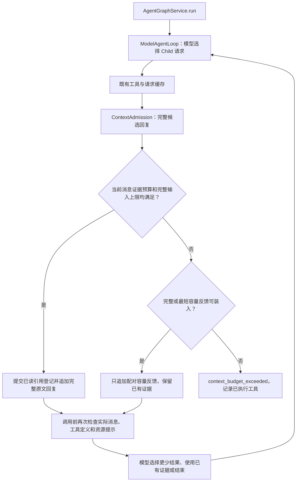

# P1 / T1：Child 容量反馈闭环实施报告

日期：2026-10-21。状态：**T1 工程闭环完成，待用户验收；完整后端套件仍有两项既有失败。**

## 授权与范围

用户在四项任务发布后明确要求“可以，继续”，并在实施中再次要求“继续”。本轮仅执行 [T1 / issue #2](https://github.com/ifhgh666/agentic-rag/issues/2)，依据已确认的 [规格 #1](https://github.com/ifhgh666/agentic-rag/issues/1) 和本地 [任务拆分](ticket-breakdown.md)。沿用用户仅为此次 P1 指定的 Matt implement / TDD / code-review 流程，未生成新的 Spec Kit 计划或修改全局规则。

T2 Parent 分窗、T3 同决策多工具回复、T4 多分支和汇总交付均未实施。本轮没有提交、推送、关闭 issue、更新 GitHub 标签、启动服务、修改 `.env`、重建正式索引或运行真实问答模型。`.specify/feature.json` 仍指向 009；当前失败清单及历史真实问答结论保持不变。

**执行偏差：首次宽范围回归误纳入了显式启用本地 FastEmbed 的既有集成测试。** 这次运行不能声称全程 fake-only。发现后中止并保留记录，随后排除真实嵌入相关测试，加入进程内保护再回归。详情见下文，不用后续成功覆盖这次偏差。

## 完成文件与行为

工作区原先已有大量已修改和未跟踪文件。本轮实施前保存了 159 个源文件的 [快照清单](../../output/context010/t1-20261021/before-manifest.json) 和 [Git 状态](../../output/context010/t1-20261021/before-git-status.txt)。本轮七个 Python 文件的实际差异见 [t1.diff](../../output/context010/t1-20261021/t1.diff)，不将 HEAD 以来的历史未提交工作归入此次实现。

| 文件 | 本轮变更 |
|---|---|
| `backend/app/rag/context_admission.py`（新增） | 集中 Child 候选结果的证据计量、完整输入计量、整体准入与已读引用登记；拒绝时只生成安全容量反馈 |
| `backend/app/rag/agent_loop.py` | 在消息追加和引用登记前调用准入；发送前继续检查真实完整输入；容量拒绝与预算、超时分别结束；最小反馈无法装入时仍记录已执行工具及用量 |
| `backend/app/rag/prompts.py` | 新增容量反馈模板，保持生产提示唯一来源；改写入口 v6 及其他提示未改 |
| `backend/tests/unit/test_context_admission.py`（新增） | 12 项图运行行为检查：恢复、边界、原文、重复计量、已读隔离、预算、期限及阈值增长 |
| `backend/tests/contract/test_context_admission_stream.py`（新增） | 2 项 SSE 契约：恢复和失败、单一终态、调用标识及公开遥测脱敏 |
| `backend/tests/unit/test_graph.py` | 将“动态阈值不影响循环”的旧断言改为已批准的新准入行为 |
| `backend/tests/unit/test_model_agent_loop.py` | 将“超限文字已进入引用登记”的旧断言改为拒绝后未读、未发送 |

另更新任务拆分中的 T1 工程勾选与本报告。前端源码、检索算法、分块、模型/工具额度、超时、默认阈值和估算算法未变。输出证据位于 `output/context010/t1-20261021/`。

## 当前结构



动态预算计量当前工具消息中的证据文本，每次出现都计量；引用登记可以去重，但不能借此少算消息占用。完整输入单独计量 JSON 消息结构、原文、元数据、工具定义、资源提示和反馈，不再额外加一遍证据用量，也不累加历史调用 Token。物理上限仍取现有配置计算出的较小值。

Child 结果先暂存候选引用，整体可装入才提交；拒绝时整批候选不取得已读资格，不自动筛选、摘要、裁剪或重放。反馈按完整说明、紧凑元数据和最小原因依次尝试；都无法装入就停止，不再调用模型。准入计量和实际消息追加复用同一个消息构造函数。

## T1 验收证据

| 要求 | 已验证行为 |
|---|---|
| 两种容量限制 | 分别构造只超证据预算和只超完整输入；证据恰好 200 Token 接受、201 拒绝 |
| 当前快照与重复计量 | 同一 100 Token Child 连续出现两次可装入，第三次按 300 Token 拒绝；引用身份仍只有一个 |
| 原文与未读隔离 | 接受后原文不变；拒绝的 sentinel 不进入模型输入、引用登记、来源或公开 SSE/日志；已有证据保持 |
| 模型显式缩小请求 | 模型先选 limit=2，收到拒绝后选 limit=1，最终有依据回答；3 次模型、2 次工具调用 |
| 无法缩小的单条 Child | 仅有拒绝结果时，模型再输出不足也不能冒充已读后的资料不足；终态为容量失败 |
| 反馈自身容量 | 完整反馈过大时使用紧凑反馈；连最小反馈都不适配时只有首次模型调用，仍记录已执行工具和用量 |
| 增长与原有额度 | 阈值增长后必须有模型新的搜索决策才再次准入；缓存不会自动重放；重复拒绝耗尽原分支额度后报告预算失败 |
| 截止时间 | 容量反馈后推进同一请求时钟，后续迟到结果报告 timeout，未进入正常历史 |
| SSE 和隐私 | 恢复/失败均只有一个 complete，原因和来源一致，容量事件配对工具 ID，只公开安全元数据 |

这些是 scripted/fake provider 与临时数据的工程证明，不能证明真实模型会主动选择合适的 limit，也不能改判 005 或 009 的历史质量失败。

## 实际命令与结果

后端工作目录：`C:/Users/ifhgz/Desktop/agentic-rag/backend`，Python：`D:/newsoft/python.exe`。运行器对全局 app 启动设置独立 DATA_DIR、fake LLM、deterministic Dense、Sparse 离线回退、独立 Qdrant 路径，pytest 禁用缓存并使用每次独立 basetemp。首次宽回归中的显式 FastEmbed 例外另记，不能仅凭环境变量断言无真实嵌入。

| 运行/命令 | 退出码与实际结果 | 原始证据 |
|---|---|---|
| TDD `red-01` / `red-02` / `red-04` 对应单用例 | 均为 1；分别暴露未拒绝结果、拒绝被写成模型不足、终止前漏记工具轨迹 | 各同名 `.json` 命令元数据与 `.log` 均保留在证据目录 |
| `green-04`：`python -m pytest -q tests/unit/test_context_admission.py ...` | 0；当时 10 passed / 2.23s | [日志](../../output/context010/t1-20261021/green-04.log) |
| `focused-01`：九个相关测试模块 | 1；54 passed、2 failed；两项旧断言与新规格相反，之后按批准语义更新 | [日志](../../output/context010/t1-20261021/focused-01.log) |
| `focused-02`：同九模块 | 0；57 passed / 10.06s | [完整命令](../../output/context010/t1-20261021/focused-02.json)、[日志](../../output/context010/t1-20261021/focused-02.log) |
| `growth-deadline-01`：新增增长与截止时间两用例 | 0；2 passed / 0.63s | [日志](../../output/context010/t1-20261021/growth-deadline-01.log) |
| `final-focused-01`：准入 unit/SSE、model loop、graph、protocol 五模块 | 0；36 passed / 6.92s；包括最终消息构造复用改动 | [完整命令](../../output/context010/t1-20261021/final-focused-01.json)、[日志](../../output/context010/t1-20261021/final-focused-01.log) |
| `full-01`：未排除例外的完整后端套件 | 4294967295；进程被终止，缺最终汇总，不能报告通过数或 fake-only | [日志](../../output/context010/t1-20261021/full-01.log)、[范围更正](../../output/context010/t1-20261021/full-01-scope-correction.json) |
| `full-02`：排除两项并使用第一版保护 | 1；516 passed、20 failed、67 errors、2 deselected / 163.83s；主要额外失败来自保护脚本误拦 Windows socketpair | [日志](../../output/context010/t1-20261021/full-02.log) |
| `guard-smoke-01`：SSE、离线评测 stub、pipeline 三模块 | 0；34 passed / 2.60s；修正 socketpair 保护后无拦截尝试 | [日志](../../output/context010/t1-20261021/guard-smoke-01.log)、[保护记录](../../output/context010/t1-20261021/guard-smoke-01-guard.json) |
| `full-03`：最终完整后端套件，排除两项真实嵌入相关用例并加载修正保护 | 1；**601 passed、2 failed、2 deselected / 146.18s**；没有新增产品失败 | [完整命令](../../output/context010/t1-20261021/full-03.json)、[日志](../../output/context010/t1-20261021/full-03.log)、[保护记录](../../output/context010/t1-20261021/full-03-guard.json) |
| Python `compile()` 编译三个生产模块，不执行模块 | 0；语法编译通过；没有宣称为后端静态类型检查 | [命令](../../output/context010/t1-20261021/backend-compile.json)、[日志](../../output/context010/t1-20261021/backend-compile.log) |
| `git diff --check`（仓库根目录） | 0；没有空白错误，已有 LF/CRLF 提示保留；未跟踪文件另由快照差异审查 | 本轮工具执行记录 |

最终后端命令为下列结构，绝对 basetemp 和运行器环境见上表的 JSON：

```powershell
python -m pytest -q tests/unit tests/contract tests/integration tests/security --deselect=tests/integration/test_v3_1_retrieval.py::test_four_baseline_questions_have_facts_in_top5_child_or_parent --deselect=tests/unit/test_embeddings.py::test_missing_real_model_does_not_silently_fall_back_to_hash -p context010_no_real_models --basetemp=C:/Users/ifhgz/Desktop/agentic-rag/output/context010/t1-20261021/pytest-full-03 -p no:cacheprovider
```

`context010_no_real_models` 是本次临时运行器插件，不是项目依赖或生产文件。修正版本保存为证据目录的 `context010_no_real_models-v2.py`，对应运行器为 `context010_t1_runner-v2.py`。它禁止 `EmbeddingService._load_model` 和普通 `socket.connect`；仅允许 Windows 在 `socket.socketpair` 同步创建内部唤醒对时的连接。最终保护记录为 `blocked_attempts: []`。两项被排除用例没有被改写成通过。

前端工作目录为 `C:/Users/ifhgz/Desktop/agentic-rag/frontend`，使用已安装 Node 和依赖，不安装或升级包：

| 实际命令（Node 执行） | 退出码与结果 |
|---|---|
| `node node_modules/vitest/vitest.mjs run` | 0；8 文件、26 tests passed / 22.25s；[日志](../../output/context010/t1-20261021/frontend-test.log) |
| `node node_modules/typescript/bin/tsc --noEmit --incremental false` | 0；应用类型检查通过 |
| `node node_modules/typescript/bin/tsc --project tsconfig.node.json --noEmit --tsBuildInfoFile C:/Users/ifhgz/Desktop/agentic-rag/output/context010/t1-20261021/frontend-config.tsbuildinfo` | 0；构建配置类型检查通过，输出隔离 |
| `node node_modules/vite/bin/vite.js build --outDir C:/Users/ifhgz/Desktop/agentic-rag/output/context010/t1-20261021/frontend-dist` | 0；92 modules，生产构建成功 / 4.40s；[日志](../../output/context010/t1-20261021/frontend-build.log) |

前端命令的完整绝对运行时、cwd 与退出码分别保存在同名 JSON 中；构建只写本轮 output 目录。

## 保留失败、执行偏差与限制

最终套件的两项失败均与 A2/A3 已记录的旧 v4 提示原句断言一致：

- `tests/unit/test_query_rewrite_v1.py::test_stage_c_prompt_explains_shared_dependencies_comparison_and_capacity` 要求“共享型号、电压、持续时间”。
- `tests/unit/test_v4_query_analysis.py::test_context_prompt_limits_history_and_preserves_unconfirmed_conditions` 要求“只使用必要历史”。

本轮没有修改这些测试或当前 v6 改写提示来掩盖失败。A3 中曾在全量出现的 deadline 时序失败，本轮最终套件未复现；不覆盖历史记录。

`full-01` 的例外用例直接指定 `embedding_backend="fastembed"`，读取本地模型缓存，并在临时文档与索引上执行真实嵌入检索路径。发现后核对准确命令行并停止对应 pytest 进程。原始进度已到 100%，但未留下最终摘要及逐用例推理计数，因此不能证明停止发生在真实嵌入推理前，也不能给出其独立通过/失败或模型调用数。运行器原始 JSON 的 `fake_only: true` 因这一覆盖而不准确，保留原文件并新增更正记录。未调用真实问答模型，未据此进行质量验收或改判旧失败。

`full-02` 的首版 socket 保护误拦 Windows asyncio 用于内部唤醒的 loopback socketpair，导致 18 项额外失败及 67 项 setup 错误；产品源码未因此更改。修正后先以 34 项检查验证，再执行 `full-03`，相关额外错误消失。两次失败与更正前后的保护脚本均保存，未删除原始证据。紧凑反馈测试的早期 padding 夹具校准失败（red-03 / red-03b / green-03）也保留在证据目录。

## Standards

按 Matt code-review 分别进行两项只读审查，审查固定点使用实施前文件快照，而非混有大量用户历史修改的 Git HEAD 差异。规范轴没有硬性违反；初次提出一项可能的 Duplicated Code：准入和追加消息各自序列化。已统一使用 `ContextAdmission.tool_message()`，审查者复核关闭。最终 0 项未解决建议。

## Spec

规格轴没有发现 T1 缺失、错误实现或范围扩张。Parent、同决策多回复、多分支按批准的 T2–T4 边界排除。最终 0 项发现。两项审查的记录见 [code-review.md](../../output/context010/t1-20261021/code-review.md)。

## 阶段状态与停止点

T1 的八条工程验收条件已勾选；这不等于用户阶段验收。GitHub #2 仍保持 OPEN，T2–T4 未实施。`CURRENT_FAILURES.md`、历史报告和 009 指针未改。

后续首先需要用户验收 T1。获得明确继续指示后，下一阶段范围才是 T2：Parent 窗口准入、范围身份和未读引用排除；不自动连做 T3/T4，也不自动复测真实模型。

**报告后暂停，等待用户验收。**
