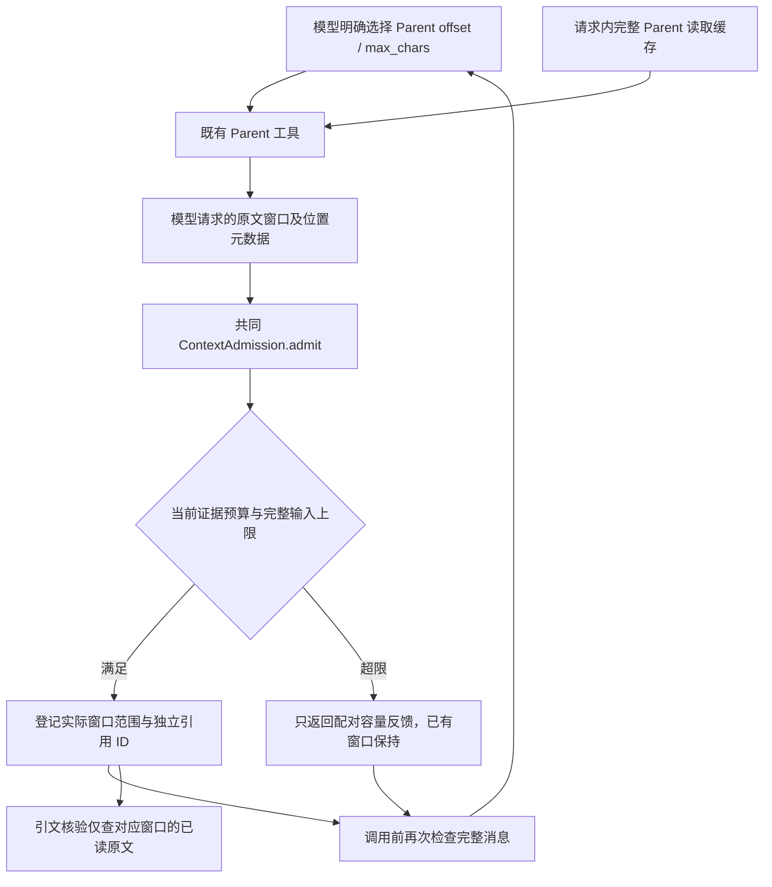

# P1 / T2：Parent 分窗与引用范围实施报告

日期：2026-10-21。状态：**T2 工程完成，待用户验收；完整套件保留两项既有失败。**

## 范围与授权

用户在 [T1 报告](phase-t1-20261021-report.md)交付后明确指示“继续”。本轮只实施 [issue #3：T2：Parent 分窗读取与引用范围保持一致](https://github.com/ifhgh666/agentic-rag/issues/3)，已用 `gh issue view 3 --json number,title,body,labels` 核对远端正文。沿用本次 P1 已批准的 Matt implement / TDD / code-review 流程，以及 `AgentGraphService.run` 主行为 seam、必要 SSE 契约 seam。没有重新制定实施计划或更改全局流程规则。

T3 同一决策多工具回复、T4 多分支交付未实施；没有调用真实问答模型或真实嵌入模型，没有访问正式文档/索引、修改 `.env`、变更默认预算、启动服务、提交或推送。GitHub issues、标签和阻塞关系未修改；#2 仍为 OPEN 不代表本轮缺少用户继续 T2 的直接授权，工程前置事实见 T1 报告。功能指针仍是 009，没有推进该功能。

本轮从第一次测试起使用 T1 修正后的进程内保护，并显式排除两项真实嵌入相关用例，没有复现 T1 首次宽回归误纳入 FastEmbed 的执行偏差。

## 问题证据与完成文件

实施前 Parent 引用按整个 Parent ID 去重，`raw_text` 登记工具私有的完整 `_raw_content`，即使模型只收到一个窗口，也可引用未读全文；继续读取其他窗口时还会覆盖同一记录的 `content`。新增 `red-01` 证明未读 sentinel 被旧代码接受为有效引用，`red-02` 证明过大的 Parent 回复仍被旧代码标为 completed。

本轮开始前保存 [162 个源文件快照清单](../../output/context010/t2-20261021/before-manifest.json)、[Git 状态](../../output/context010/t2-20261021/before-git-status.log)和 [Git diff](../../output/context010/t2-20261021/before-git-diff.log)，保留所有原有改动。实际触及四个 Python 文件，见 [t2.diff](../../output/context010/t2-20261021/t2.diff)：

| 文件 | 变更 |
|---|---|
| `backend/app/rag/context_admission.py` | 将 Child 专用入口扩为共同 `admit`；Parent 候选窗口、证据预算、完整输入检查、反馈和已读登记集中处理 |
| `backend/app/rag/agent_loop.py` | 移除旧 Parent 登记逻辑，Child/Parent 均走共同准入；容量反馈事件使用既有 `tool` 字段标识具体工具 |
| `backend/tests/unit/test_parent_context_admission.py`（新增） | 11 项图运行行为检查 |
| `backend/tests/contract/test_parent_context_admission_stream.py`（新增） | 2 项 Parent SSE 契约检查 |

另更新本报告和 [任务拆分](ticket-breakdown.md)的工程状态。没有修改工具参数/schema、SourceRef、前端源码、模型提示、Token 估算算法、默认阈值或原有引用校验规则；T1 的 Child 行为保持。

## 实际结构与范围语义



- 窗口身份为 `parent:<Parent UUID>:<offset>:<end_offset>`；`end_offset` 是实际返回字符范围的排他末端，不是请求的最大末端。记录保留 `offset`、`end_offset`、`total_chars`、来源、页码和章节。
- 不同窗口取得不同引用 ID；同一窗口再次装入可复用引用身份，但每条实际工具消息的证据仍重复计量。
- 候选窗口先在本地暂存，完整满足两种容量限制才提交。拒绝时不登记、不覆盖已读窗口，不自动改参数或挑选部分文字；原文切窗仅执行模型明确给定的现有参数。
- 完整 Parent 仍可存在于读取缓存和工具私有 `_raw_content` 中；准入在计量和发送前剔除该私有字段，引用记录的 `raw_text` 只保留实际窗口。仅本地存在全文不取得引用资格。
- Parent 与 Child 共用完整/紧凑/最小容量反馈和最终输入检查。最小反馈也装不下时直接容量失败，已执行工具照常记账。原有 Parent 读取授权、调用标识、调用额度和总截止时间保持。
- 字符范围保存在图运行结果的已读记录中。SSE 继续使用已有来源、页码和章节字段，本轮没有新增前端范围展示功能。

## T2 六项工程验收

| 条件 | 通过证据 |
|---|---|
| 两种限制与原文完整性 | 分别触发 evidence_budget_exceeded / input_budget_exceeded；已有 10 Token Child 加 200 Token Parent，阈值 210 接受、209 拒绝 |
| 拒绝不登记、模型缩小继续 | 模型请求 1000 字符窗口被拒绝，显式改为 200 后引用已读窗口完成；4 次模型、3 次工具调用 |
| 引用与范围一致 | 未读 sentinel 两次候选均被拒绝；已读第二窗口也不能使用第一窗口 ID；两个窗口分别引用可通过；末尾 30 字符窗口登记 [200,230)，不会伪装成 [200,400) |
| 缓存重新检查 | 首个窗口装入后，完整 Parent 缓存命中的第二个窗口仍因当前 410 Token 占用超过 250 被拒绝，首个窗口保持 |
| 重复消息、授权与配对 | 相同窗口三次回复按 210/410/610 的当前证据占用处理，第三次拒绝，登记身份保持；原有 unknown Parent 和协议测试随完整套件通过 |
| 图运行与 SSE | 恢复路径与未读引用失败均只有一个终态；容量反馈与工具 ID 配对，来源页码正确，公开事件/日志不含未读 sentinel、`_raw_content` 或模型输入消息 |

上述 13 项新增检查均为 scripted/fake、临时文档的工程证明，不能证明真实模型一定主动选择合适窗口，也不表示原有 005/009 真实问题已通过。

## 实际验证、退出状态与证据

后端 cwd：`C:/Users/ifhgz/Desktop/agentic-rag/backend`；Python：`D:/newsoft/python.exe`。运行器始终使用独立 DATA_DIR、Qdrant 路径和 basetemp，fake LLM、deterministic Dense、Sparse 离线回退、禁用 pytest 缓存。运行器和保护插件保存于本轮 [证据目录](../../output/context010/t2-20261021/)。

| 运行 | 退出码和结果 | 原始记录 |
|---|---|---|
| `red-01`：未读全文引用 | 1；1 failed / 1.51s，旧代码错误地 completed | [日志](../../output/context010/t2-20261021/red-01.log)、同名 JSON 完整命令 |
| `green-01`：同一用例 | 0；1 passed / 0.42s | [日志](../../output/context010/t2-20261021/green-01.log) |
| `red-02`：超限 Parent 后缩小窗口 | 1；1 failed / 1.75s，旧回复仍 completed | [日志](../../output/context010/t2-20261021/red-02.log) |
| `green-02`：Parent + T1 unit/SSE | 1；15 passed、1 failed / 5.90s；夹具未提供页码，触发既有定位核验规则 | [日志](../../output/context010/t2-20261021/green-02.log) |
| `green-02b`：同组补充夹具页码后 | 0；16 passed / 4.94s；产品核验器未改 | [日志](../../output/context010/t2-20261021/green-02b.log) |
| `windows-01`：Parent 窗口检查 | 0；3 passed / 1.06s | [日志](../../output/context010/t2-20261021/windows-01.log) |
| `physical-01`：只超完整输入 | 0；1 passed / 0.55s | [日志](../../output/context010/t2-20261021/physical-01.log) |
| `cache-window-01`：缓存的第二窗口拒绝 | 0；1 passed / 0.71s | [日志](../../output/context010/t2-20261021/cache-window-01.log) |
| `boundaries-01`：当时全部 Parent unit | 0；9 passed / 2.85s | [日志](../../output/context010/t2-20261021/boundaries-01.log) |
| `contracts-01`：最终 Parent unit/SSE、rag tools、model loop 四模块 | 0；**30 passed / 7.17s** | [日志](../../output/context010/t2-20261021/contracts-01.log)、[完整命令](../../output/context010/t2-20261021/contracts-01.json) |
| `full-01`：unit / contract / integration / security | 1；**614 passed、2 failed、2 deselected / 157.12s** | [日志](../../output/context010/t2-20261021/full-01.log)、[完整命令](../../output/context010/t2-20261021/full-01.json) |
| `compile()` 编译 loop/admission/prompts 三个模块，不执行模块 | 0；语法编译通过；没有宣称运行后端静态类型检查 | [命令](../../output/context010/t2-20261021/backend-compile.json)、[日志](../../output/context010/t2-20261021/backend-compile.log) |
| `git diff --check`（仓库根目录） | 0；无空白错误，既有 LF/CRLF 提示保留；未跟踪文件另通过快照差异审查 | [退出状态](../../output/context010/t2-20261021/git-diff-check.json)、[输出](../../output/context010/t2-20261021/git-diff-check.log) |

最终后端实际命令（运行环境与绝对 cwd 见 JSON）：

```powershell
python -m pytest -q tests/unit tests/contract tests/integration tests/security --basetemp=C:/Users/ifhgz/Desktop/agentic-rag/output/context010/t2-20261021/pytest-full-01 -p no:cacheprovider -p context010_t2_guard --deselect=tests/integration/test_v3_1_retrieval.py::test_four_baseline_questions_have_facts_in_top5_child_or_parent --deselect=tests/unit/test_embeddings.py::test_missing_real_model_does_not_silently_fall_back_to_hash
```

所有后端测试命令均加载 `context010_t2_guard`，禁止真实 Dense 加载和普通 socket.connect；只允许 Windows socketpair 同步创建内部唤醒对。最终 [保护记录](../../output/context010/t2-20261021/full-01-guard.json)为 `blocked_attempts: []`，pytest 退出码 1 来自两项既有断言。两项真实嵌入相关用例明确排除，没有算作通过。该插件仅在临时测试进程生效，不改生产文件或依赖。

前端 cwd：`C:/Users/ifhgz/Desktop/agentic-rag/frontend`；Node：`C:/Users/ifhgz/nvm/nodejs/node.exe`：

| 实际命令 | 退出码与结果 |
|---|---|
| `node node_modules/vitest/vitest.mjs run` | 0；8 文件、**26 tests passed / 4.59s**；[日志](../../output/context010/t2-20261021/frontend-test.log) |
| `node node_modules/typescript/bin/tsc --noEmit --incremental false` | 0；前端类型检查通过；[命令和退出状态](../../output/context010/t2-20261021/frontend-typecheck.json) |

本轮没有修改前端源码或构建配置，未重复生产构建，不将 T1 的构建记录冒充为本轮运行。

## 保留失败与限制

完整回归的两项失败与 T1/A3 已记录的旧提示原句断言相同：

- `tests/unit/test_query_rewrite_v1.py::test_stage_c_prompt_explains_shared_dependencies_comparison_and_capacity`。
- `tests/unit/test_v4_query_analysis.py::test_context_prompt_limits_history_and_preserves_unconfirmed_conditions`。

这些测试和当前 v6 提示均未修改；没有新增产品失败。`green-02` 的夹具页码错误及全部红绿日志保留，没有覆盖原失败。`CURRENT_FAILURES.md`、T1 的嵌入误入/保护误拦记录、009 的真实容量失败以及其他历史报告保持原状，本轮没有复测真实题目或改变质量验收结论。

## Standards

只读规范审查：0 项硬性违反、0 项可行动维护性发现。Parent 准入和登记集中在共同 module，拒绝前不改变已读记录，测量和实际发送继续复用同一序列化。没有无关重构或推测性抽象。

## Spec

只读规格审查：0 项可行动偏差或范围扩张。两种容量、实际范围、已读隔离、缓存重检、重复消息和 SSE 均在 T2 范围内；T3/T4 未计为缺失。两轴记录见 [code-review.md](../../output/context010/t2-20261021/code-review.md)。审查固定点为实施前快照，不使用混有用户历史修改的 HEAD 差异；没有新提交。

## 交付与停止点

任务拆分中的 T2 六项工程条件已勾选，用户阶段验收仍待确认。没有 Spec Kit tasks.md 更新，因为本次 P1 已获准使用 Matt 任务产物。GitHub #2/#3 均未关闭；不自动修改远端状态或把工程勾选当成真实模型验收。

用户验收并明确继续后，下一阶段范围是 T3：同一模型决策中的多工具回复、整体容量配对及缓存重检组合，不连做 T4、不自动运行真实模型。

**报告后暂停，等待用户验收。**
