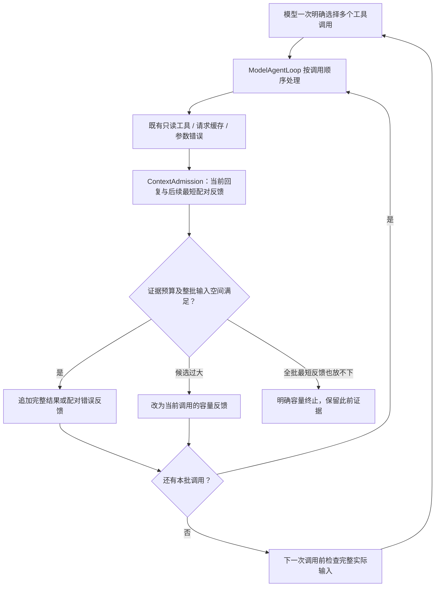

# P1 / T3：多工具回复与缓存容量实施报告

日期：2026-10-21。状态：**T3 工程完成，待用户验收；完整套件保留两项既有失败。**

## 范围与授权

用户在 [T2 报告](phase-t2-20261021-report.md)交付后明确要求“继续”。本轮仅实施 [issue #4：T3：多工具回复与缓存命中仍满足同一输入容量](https://github.com/ifhgh666/agentic-rag/issues/4)，已运行 `gh issue view 4 --json number,title,body,labels` 核对远端正文。沿用本次 P1 已批准的 Matt implement / TDD / code-review 流程和已确认的图运行、必要 SSE seam。

本轮未实施 T4 多分支和汇总交付，没有新增实施计划、修改全局规则、关闭/评论 GitHub issues、修改依赖、提交或推送。没有调用真实问答模型或真实嵌入模型，没有访问正式知识库文档/索引、改写 `.env`、修改默认额度/超时、启动服务或进行真实质量评测。功能指针仍指向 009。

## 问题证据与完成文件

原先逐条准入仅检查当前候选回复，没有给同批尚未回复的调用预留空间；非法调用的错误回复则直接追加。新 `red-02` 证明：首个候选单独可装入时会先登记，追加后一条错误回复后却无法继续调用模型。`red-03b` 证明：全部为非法调用的超大批次仍会消耗八次工具额度后才因完整输入超限结束。`red-01` 另证明参数校验错误会在错误字段回显原始非法参数。

本轮开始前保存了 [164 个源文件的快照清单](../../output/context010/t3-20261021/before-manifest.json)、[Git 状态](../../output/context010/t3-20261021/before-git-status.log)和 [Git diff](../../output/context010/t3-20261021/before-git-diff.log)。本轮实际只改四个 Python 文件，见 [t3.diff](../../output/context010/t3-20261021/t3.diff)，不把 T1/T2 或用户原有未提交改动算入本次实现。

| 文件 | 变更 |
|---|---|
| `backend/app/rag/context_admission.py` | 接收尚未回复的调用列表；统一预留最短容量反馈空间；失败回复也检查当前完整输入；最短反馈的构造由同一函数维护 |
| `backend/app/rag/agent_loop.py` | 逐条传递剩余调用；非法调用反馈也进入准入；参数 ValidationError 映射为安全的 `INVALID_TOOL_ARGUMENTS`，保留额度和事件记账 |
| `backend/tests/unit/test_batch_context_admission.py`（新增） | 8 项图运行行为检查 |
| `backend/tests/contract/test_batch_context_admission_stream.py`（新增） | 2 项批次 SSE 契约检查 |

另更新本报告与 [任务拆分](ticket-breakdown.md)的 T3 工程状态。工具参数/schema、provider、前端源码、原文读取方式、提示词、Token 估算、默认阈值和额度均未修改。

## 当前结构与计量语义



每次检查将尚未回复调用的最短容量反馈纳入物理空间预留，使用两种容量原因中较长的原因字符串。这些占位回复只参与估算，不实际发送、不取得已读资格、不计作工具调用。后续实际结果仍逐条重检；最终发送前的检查仅针对实际消息，没有占位回复。

因此，多工具容量事件中的候选 `input_tokens_estimate` 可以包含尚未回复调用的空间预留；它是候选装载估算，不是提供商实测 Token，也不是累计用量。动态证据预算仍只计算当前实际消息中的已装入证据文本，失败反馈不算证据，重复出现的原文按份计量。

如果候选结果加后续最短反馈不能装入，拒绝该候选，不删除此前证据。完整、紧凑、最短的当前容量反馈也都按同样预留检查。连最短反馈集合都装不下时直接终止，不发送缺少配对的下一次模型输入，不执行后续调用或伪造它们的完成事件。已消耗额度和已发生事件仍保留。

非法参数错误字段统一为 `INVALID_TOOL_ARGUMENTS`，避免原始 ValidationError 的参数原值和校验详情挤占输入或回显；既有工具决策参数展示结构未扩大。其他既有工具错误码、缓存来源、调用 ID 和最终失败原因保持各自含义。

## T3 六项工程验收

| 条件 | 实际验证 |
|---|---|
| 批次合法配对与完整输入 | 模型一次请求多个调用，结果/错误回复按原 ID 配对；2200 Token 物理边界下，为后续回复留空间后拒绝当前大候选，模型可用先前证据完成 |
| 接受/容量拒绝/非法混合 | 同批包含完整 Child、过大结果拒绝、非法参数反馈；拒绝不登记引用，整个结果不被程序挑选或截断 |
| 最短回复仍无法装入 | 已有证据后收到二十调用批次，仅首项尝试后终止；全部为非法调用的超大批次也在首项反馈不适配时终止，不追加超限输入继续调用模型 |
| 缓存与重复占用 | 同批两次请求同一个 120 Token Child，首次接受、缓存命中第二次按 240 Token 拒绝；实际读取一次、工具额度两次、引用身份仍一个 |
| 新模型决策与原预算 | 阈值增长后，只有模型再次明确请求才重新接受缓存结果；连续拒绝批次在原单分支 5 次模型/8 次工具额度边界报告 budget_exceeded；推进原时钟后报告 timeout，历史未污染 |
| 图运行、SSE 与遥测 | SSE 混合批次的调用 ID、failed/completed、cached、错误码及单一 complete 一致；容量终止只记录实际尝试；公开事件/日志无未装入原文 sentinel 或模型输入消息 |

全部新增检查使用 scripted/fake provider、受控检索和临时数据。工程通过不证明真实模型的多工具决策、真实检索质量或旧失败问题已通过。

## 实际命令、退出状态与记录

后端 cwd：`C:/Users/ifhgz/Desktop/agentic-rag/backend`；Python：`D:/newsoft/python.exe`。所有 pytest 运行均使用独立 DATA_DIR、Qdrant 路径、basetemp，fake LLM、deterministic Dense、Sparse 离线回退、禁用 pytest 缓存，并加载 `context010_t3_guard`。

| 运行 | 退出码与结果 | 证据 |
|---|---|---|
| `red-01`：混合批次 | 1；1 failed / 1.53s，原错误字段回显参数 | [日志](../../output/context010/t3-20261021/red-01.log) |
| `green-01`：同一用例 | 0；1 passed / 0.51s | [日志](../../output/context010/t3-20261021/green-01.log) |
| `red-02`：后续反馈预留边界 | 1；1 failed / 1.66s，原代码最终容量失败 | [日志](../../output/context010/t3-20261021/red-02.log) |
| `green-02`：上述两项 | 0；2 passed / 0.76s | [日志](../../output/context010/t3-20261021/green-02.log) |
| `boundaries-01` | 1；26 passed、1 failed / 8.03s；超大批次夹具最初仍可装入，后续 scripted 输出耗尽 | [日志](../../output/context010/t3-20261021/boundaries-01.log) |
| `red-03` | 1；1 failed / 1.68s；同样是八调用夹具未实际触及容量边界 | [日志](../../output/context010/t3-20261021/red-03.log) |
| `red-03b`：夹具明确改为二十调用 | 1；1 failed、1 passed / 1.91s，非法回复仍绕过准入、消耗八次额度 | [日志](../../output/context010/t3-20261021/red-03b.log) |
| `green-03`：批次、T1/T2 unit、原 model loop | 0；**41 passed / 9.35s** | [日志](../../output/context010/t3-20261021/green-03.log)、[完整命令](../../output/context010/t3-20261021/green-03.json) |
| `budgets-01`：最终批次 unit | 0；**8 passed / 2.20s** | [日志](../../output/context010/t3-20261021/budgets-01.log) |
| `contracts-01`：批次 unit/SSE、T1/T2 SSE、protocol、budget 六模块 | 0；**22 passed / 6.31s** | [日志](../../output/context010/t3-20261021/contracts-01.log)、[完整命令](../../output/context010/t3-20261021/contracts-01.json) |
| `full-01`：完整后端工程套件 | 1；**624 passed、2 failed、2 deselected / 157.07s** | [日志](../../output/context010/t3-20261021/full-01.log)、[完整命令](../../output/context010/t3-20261021/full-01.json) |
| Python compile() 编译 loop/admission/prompts 三模块，不执行模块 | 0；语法检查通过；未声称进行了后端静态类型检查 | [命令](../../output/context010/t3-20261021/backend-compile.json)、[日志](../../output/context010/t3-20261021/backend-compile.log) |
| `git diff --check`（根目录） | 0；无空白错误，既有 LF/CRLF 提示保留；未跟踪文件另通过本轮快照差异审查 | [退出状态](../../output/context010/t3-20261021/git-diff-check.json)、[日志](../../output/context010/t3-20261021/git-diff-check.log) |

完整后端实际命令：

```powershell
python -m pytest -q tests/unit tests/contract tests/integration tests/security --basetemp=C:/Users/ifhgz/Desktop/agentic-rag/output/context010/t3-20261021/pytest-full-01 -p no:cacheprovider -p context010_t3_guard --deselect=tests/integration/test_v3_1_retrieval.py::test_four_baseline_questions_have_facts_in_top5_child_or_parent --deselect=tests/unit/test_embeddings.py::test_missing_real_model_does_not_silently_fall_back_to_hash
```

进程内保护禁止真实 Dense 加载与普通 socket.connect，仅允许 Windows socketpair 同步创建内部唤醒对。[最终保护记录](../../output/context010/t3-20261021/full-01-guard.json)为 `blocked_attempts: []`；两项真实嵌入相关用例被明确排除，没有记作通过。运行器与插件保存在同一证据目录，仅作用于临时测试进程，不改项目依赖或生产运行。

另在仓库根目录运行 `python output/context010/t3-20261021/batch-boundary-probe.py`，退出码 0；[脚本](../../output/context010/t3-20261021/batch-boundary-probe.py)和 [输出](../../output/context010/t3-20261021/batch-boundary-probe.json)保留。在独立数据目录及模型保护下扫描 25 个物理窗口配置，使用 fake 图运行选择固定验收夹具的 2200 Token 边界。它不是验收测试数、真实模型评测或重试选优记录；验收红绿日志单独保留。

前端 cwd：`C:/Users/ifhgz/Desktop/agentic-rag/frontend`；Node：`C:/Users/ifhgz/nvm/nodejs/node.exe`：

| 实际命令 | 退出码与结果 |
|---|---|
| `node node_modules/vitest/vitest.mjs run` | 0；8 文件、**26 tests passed / 3.56s**；[日志](../../output/context010/t3-20261021/frontend-test.log) |
| `node node_modules/typescript/bin/tsc --noEmit --incremental false` | 0；类型检查通过；[命令与退出状态](../../output/context010/t3-20261021/frontend-typecheck.json) |

前端源码和构建配置未改，本轮没有重跑生产构建，不将 T1 的构建结果冒充为本轮记录。

## 保留失败与限制

完整套件的两项失败仍为既有旧 v4 提示原句断言，与 T1/T2/A3 一致：

- `tests/unit/test_query_rewrite_v1.py::test_stage_c_prompt_explains_shared_dependencies_comparison_and_capacity`。
- `tests/unit/test_v4_query_analysis.py::test_context_prompt_limits_history_and_preserves_unconfirmed_conditions`。

本轮没有修改这两项测试或当前 v6 改写提示来制造通过，没有新增产品失败。早期夹具校准失败、红绿结果、T1 的执行偏差和所有历史真实问答失败均保留；`CURRENT_FAILURES.md` 及 009 状态没有改判。

剩余调用的预留属于容量保守检查，不承诺最大化可装入证据，也不改变模型的语义选择。请求无法继续时，未执行调用没有下一次模型回复，这是明确终止路径，不能把它说成正常完成的配对批次。实际 provider/真实模型接收及答题质量没有在本轮评测。

## Standards

只读规范审查：0 项硬性违反、0 项可行动维护性发现。空间预留集中于准入，正常与错误回复都经过完整输入检查，执行、预算、事件职责仍由循环持有。未发现无关重构或抽象。

## Spec

只读规格审查：0 项可行动偏差或范围扩张。配对、批次预留、不能继续时的诚实终止、缓存重检、当前消息计量、原有预算和 SSE 均在 T3 范围内；T4 不计为本轮缺失。审查记录见 [code-review.md](../../output/context010/t3-20261021/code-review.md)。固定点使用本轮实施前快照，排除用户原有未提交更改，没有新提交。

## 交付与停止点

任务拆分中的 T3 六项工程条件已勾选，仍等待用户验收。没有生成 Spec Kit tasks.md，因为本次 P1 已批准使用 Matt 任务产物；没有关闭 GitHub #4 或改变原生阻塞关系。

用户验收并明确继续后，下一阶段才是 T4：组合 Child、Parent、多工具与缓存行为，验证多分支隔离、部分失败、最终汇总及 SSE 交付。不会自动执行 T4 或真实模型复测。

**报告后暂停，等待用户验收。**
