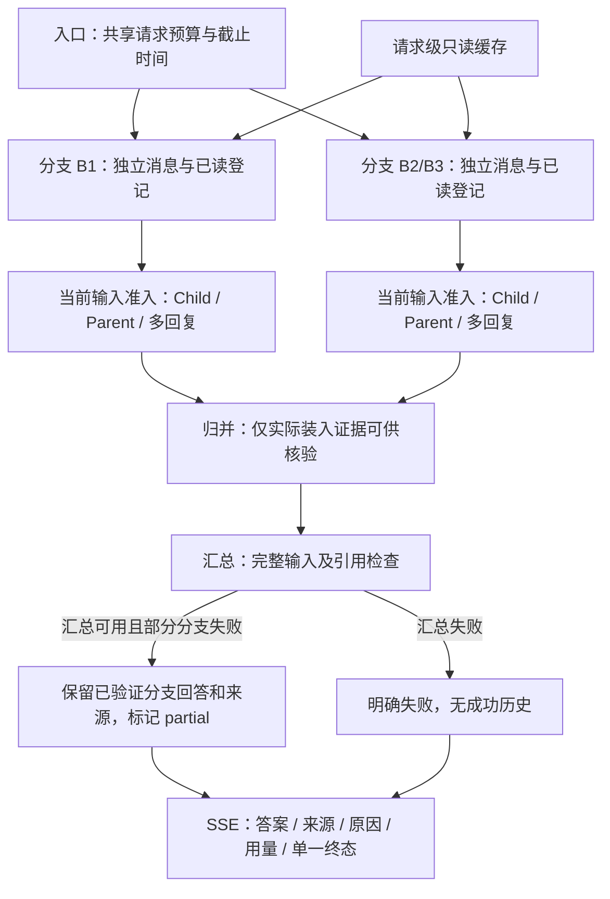

# P1 / T4：多分支容量与最终交付报告

日期：2026-10-21（America/Tijuana）。状态：**T4 工程完成，待用户验收；完整套件保留两项既有失败。**

## 范围与授权

用户在 [T3 报告](phase-t3-20261021-report.md)交付后明确要求“继续”。本轮只实施 [issue #5：多分支容量受阻时，正确交付部分回答或失败](https://github.com/ifhgh666/agentic-rag/issues/5)，已用 `gh issue view 5 --json number,title,body,labels` 核对正文，保存在 [issue-5.json](../../output/context010/t4-20261021/issue-5.json)。沿用本次 P1 已批准的 Matt implement / TDD / code-review 流程及图运行、SSE seam。

没有新增实施计划、修改全局规则、关闭或评论 GitHub issue、调整默认预算/超时、改写 .env、修改依赖、提交或推送。没有运行真实问答模型、真实嵌入或正式知识库检索，没有启动服务或推进真实评测。功能指针仍指向 009。可选摘要用例显式启用既有摘要路径，但注入的仍是 scripted provider。

## 问题证据及修改

原归并仅在汇总返回 completed 时把执行失败标为 partial；汇总返回 partial 或 insufficient 时，最终原因和历史可能掩盖分支执行失败。修补初版进一步暴露：只对 insufficient 保留成功原答仍不够；合法的 answered / partial 汇总也可能遗漏成功分支正文。

- `red-01b`：汇总 partial 保留 model_answered 原因，insufficient 直接成为资料不足状态；2 failed、1 passed。
- `red-02`：汇总只给出合法 Child 概述，遗漏已经完成的 Parent 操作答复；answered / partial 两种情况失败。
- 最终修复：只要存在执行失败且汇总本身未失败，保留各 completed / partial 分支已经通过引用校验的原答复及来源，列出未完成分支，统一使用 runtime_guard / branch_execution_failed。没有成功分支且汇总 insufficient 时明确 failed，不进入正常成功历史。汇总本身超限、超时或引用失败仍明确失败。

开始前保存 [166 个源文件快照清单](../../output/context010/t4-20261021/before-manifest.json)、[Git 状态](../../output/context010/t4-20261021/before-git-status.log)及 [完整 Git diff](../../output/context010/t4-20261021/before-git-diff.log)。按该固定点审查本轮差异，保留用户及 T1–T3 已有工作；见 [t4.diff](../../output/context010/t4-20261021/t4.diff)。

| 文件 | 本轮内容 |
|---|---|
| `backend/app/rag/nodes.py` | 归并阶段统一暴露失败分支，保留已验证成功原答及来源，按实际终态记录保护事件 |
| `backend/tests/unit/test_multi_branch_context_admission.py`（新增） | 15 项图运行检查：组合行为、两/三分支隔离、最终汇总、预算、摘要及超时历史保护 |
| `backend/tests/contract/test_multi_branch_context_admission_stream.py`（新增） | 7 项 SSE 检查：三种汇总状态、全部失败、引用失败、超时及汇总超限 |

另更新本报告和任务拆分状态。未修改工具参数、准入规则、提示词、估算算法、默认阈值、模型/provider、API schema 或前端源码。本轮没有需要改写的旧阈值断言；T1–T3 原用例保持。

## 当前结构与交付



缓存共享读取结果，不共享证据容量；同一个缓存 Child 可以在一个分支接受、在另一分支因其既有占用被拒绝。所有分支继续共享原请求调用与时间预算，保留既有各分支额度、终答与汇总槽。成功内容的保留只复用已经验证的分支答复，不增加模型调用或把拒绝原文补回消息。

## T4 七项工程验收

| 条件 | 验证结果 |
|---|---|
| 分支隔离 | 相同缓存 Child 在 B1 以 120 Token 接受，在 B2 的另一份 120 Token 已读证据后按 240 Token 拒绝；实际读取一次；已读登记各保留正确 B1/B2 引用 |
| Child / Parent / 多回复 / 缓存组合 | B1 同批接受 Child、拒绝大结果，随后同批接受 200 字 Parent 窗口、拒绝重复窗口；B2 共享缓存仍独立拒绝；原文不裁剪、拒绝项不登记 |
| 部分与全部失败 | answered、partial、insufficient 汇总都不能掩盖容量失败；三分支保留两份成功原答；全部容量失败跳过汇总且无成功历史；无成功且汇总不足仍明确失败 |
| 最终汇总 | 引用拒绝 Child 的 ID 或 Parent 未读范围均在有限修复后 verification_failed；大分支答案使汇总完整输入超限时，在调用前 context_budget_exceeded；已读证据不删减 |
| 原请求预算和期限 | 真实预算路径的 scripted 入口 1 次、分支 7 次、汇总 1 次，合计 9/12；分支耗尽不窃取另一分支及汇总槽；可选 scripted 摘要也计入同一请求；反馈后、汇总后、摘要阶段越期均恢复旧历史 |
| SSE 与消费兼容 | 七种情形各一个 complete；答案、来源、错误、reason、stop_origin 和实际模型/工具次数一致；公开事件和普通日志无拒绝载荷、未读 Parent sentinel、模型输入或分支候选正文；现有前端接受 partial 和失败原因 |
| 回归与历史 | 最终 22 项新增检查及相关旧用例通过；完整工程套件仍记录两项既有提示措辞失败；旧真实失败、T1 执行偏差和前阶段记录均未改判 |

## 实际命令与证据

后端 cwd：`C:/Users/ifhgz/Desktop/agentic-rag/backend`，Python：`D:/newsoft/python.exe`。所有 pytest 使用独立 DATA_DIR、Qdrant 路径、basetemp，fake / scripted LLM、deterministic Dense、Sparse 离线回退，禁用 pytest 缓存并加载 `context010_t4_guard`。

| 记录 | 退出码与实际结果 |
|---|---|
| [red-01.log](../../output/context010/t4-20261021/red-01.log) | 1；3 failed / 2.05s，其中 answered 项最初误读 SourceRef 为带 citation_id 的类型；纠正夹具断言，原日志保留 |
| [red-01b.log](../../output/context010/t4-20261021/red-01b.log) | 1；2 failed、1 passed / 2.28s，复现实际状态问题 |
| [green-01.log](../../output/context010/t4-20261021/green-01.log) | 0；6 passed / 1.73s |
| [boundaries-01.log](../../output/context010/t4-20261021/boundaries-01.log) | 0；12 passed / 3.79s |
| [contracts-01.log](../../output/context010/t4-20261021/contracts-01.log) | 0；33 passed / 9.29s |
| [red-02.log](../../output/context010/t4-20261021/red-02.log) | 1；2 failed、1 passed / 2.32s，复现汇总遗漏成功内容 |
| [green-02.log](../../output/context010/t4-20261021/green-02.log) | 0；**35 passed / 10.56s**；[完整命令](../../output/context010/t4-20261021/green-02.json) |
| [full-01.log](../../output/context010/t4-20261021/full-01.log) | 1；644 passed、2 failed、2 deselected / 160.77s；审查补充修复前的完整回归，非最终版本结论 |
| [full-02.log](../../output/context010/t4-20261021/full-02.log) | 1；**646 passed、2 failed、2 deselected / 169.22s**；[完整命令](../../output/context010/t4-20261021/full-02.json) |
| [Python compile 检查](../../output/context010/t4-20261021/backend-compile.json) | 0；编译 nodes.py、不执行模块；仅语法检查，不宣称后端静态类型检查 |
| [git diff --check](../../output/context010/t4-20261021/git-diff-check.json) | 0；未跟踪 Python 文件另通过快照差异、语法和空白检查 |

完整后端实际命令：

```powershell
python -m pytest -q tests/unit tests/contract tests/integration tests/security --basetemp=C:/Users/ifhgz/Desktop/agentic-rag/output/context010/t4-20261021/pytest-full-02 -p no:cacheprovider -p context010_t4_guard --deselect=tests/integration/test_v3_1_retrieval.py::test_four_baseline_questions_have_facts_in_top5_child_or_parent --deselect=tests/unit/test_embeddings.py::test_missing_real_model_does_not_silently_fall_back_to_hash
```

两项真实嵌入相关测试明确排除，没有计作通过。沿用 T1 修正后的进程内保护，禁止真实 Dense 加载及普通 socket.connect，仅允许 Windows socketpair 的内部唤醒对。[最终保护记录](../../output/context010/t4-20261021/full-02-guard.json)为 `blocked_attempts: []`。所有本轮运行记录均保留，未覆盖红测或前阶段日志。

七个隔离 SSE 请求的 request_id、模型/工具次数、耗时、估算用量及已读范围元数据汇集于 [delivery-observations.json](../../output/context010/t4-20261021/delivery-observations.json)。例如 `c52041eb-3bd1-4d90-a02b-4ee0e5674892` 为 partial / branch_execution_failed，模型 6 次、工具 5 次、请求缓存命中 2 次，图运行 102ms，usage_source 为 estimate；这些是 scripted 工程数据，不是模型质量或生产延迟成绩。

前端 cwd：`C:/Users/ifhgz/Desktop/agentic-rag/frontend`，Node：`C:/Users/ifhgz/nvm/nodejs/node.exe`：

- `node node_modules/vitest/vitest.mjs run`：退出 0，8 文件、**26 tests passed / 4.21s**；[日志](../../output/context010/t4-20261021/frontend-test.log)。
- `node node_modules/typescript/bin/tsc --noEmit --incremental false`：退出 0；[命令](../../output/context010/t4-20261021/frontend-typecheck.json)。

前端源码和构建配置未改，本轮没有重跑生产构建，也没有把先前构建记为本轮结果。

## Standards

最终只读规范审查：**0 项硬性违反、0 项未解决维护性发现**。生产逻辑集中于归并，未新增无关抽象或预算变更。

## Spec

首次发现 **1 项 P2**：非 insufficient 汇总仍可能遗漏成功分支。已红测复现、修复并复核关闭，最终 **0 项未解决规格偏差或范围扩张**。两个审查轴及固定点见 [code-review.md](../../output/context010/t4-20261021/code-review.md)。

## 保留失败与限制

完整后端仍失败的两项为既有 v4 提示原句断言，与 T1–T3/A3 一致：

- `tests/unit/test_query_rewrite_v1.py::test_stage_c_prompt_explains_shared_dependencies_comparison_and_capacity`。
- `tests/unit/test_v4_query_analysis.py::test_context_prompt_limits_history_and_preserves_unconfirmed_conditions`。

本轮没有修改这些断言或当前 v6 提示来制造通过。CURRENT_FAILURES.md 中原真实模型失败、009 的真实容量失败及历史评测结果保持；T1 首次宽范围误纳入真实 FastEmbed 测试和保护误拦的旧记录不改写。本轮没有实际模型接收、真实检索或回答质量结论。

在混合失败时保留分支原答会使部分回答可能重复汇总中的内容，这是明确保留已核验成果的交付取舍。引用定位通过只表示已读原文匹配，不证明语义、数值条件或步骤完整性。Token 容量仍使用既有估算，不冒充提供商精确 tokenizer。

## 交付与停止点

T4 七项工程条件已勾选，[任务拆分](ticket-breakdown.md)同步为本地工程完成、待用户验收。P1 的 T1–T4 工程工作至此交付；没有自动关闭 #1–#5、改变 GitHub 原生阻塞关系或推进功能指针。

没有自动进入 P2/P3 或真实模型复测。若用户随后单独授权真实复验，需要冻结模型、输入、预算和首次输出记录，继续保留原失败；本报告不构成该执行授权。

**报告后暂停，等待用户验收。**

