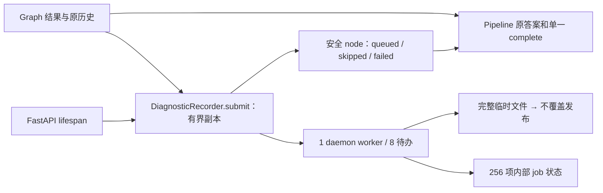

# P2 / A：诊断故障隔离阶段报告

日期：2026-10-21（America/Tijuana）。授权：用户在任务拆分交付后要求“继续”，本轮仅实施 A / T001–T010。状态：**A 工程完成，定向检查通过，完整回归保留两项既有失败；等待用户验收。**

## 交付行为与结构

图结果不再由 pipeline 同步写诊断文件。请求线程只做受限快照复制、非阻塞入队和安全 node 回执；worker 保存失败、队列满或迟到，均不负责改写答案、来源、原原因、用量或历史。没有 recorder 的直连 pipeline 安全跳过，不回退同步写盘。

实现新增 `observability/diagnostics.py`，提供 DiagnosticSnapshot、Receipt/Status、DiagnosticStore、LocalDiagnosticStore 和 DiagnosticRecorder。构造不启动 worker、不访问文件系统；lifespan 启停，关闭停止接收、丢弃待办、最多 join 1 秒。启动 worker 异常安全禁用诊断。

快照限定原 10 个顶层字段，只接受精确内建值；容器与业务对象分离。字符 2,000,000、节点 100,000、深度 64，测试包含刚好边界与超出一项。非法类型、子类、自定义 key、循环、超限和已过期限整体跳过，避免调用对象自定义转换/复制/迭代；不裁剪后宣称完整。私有原始输入与首答保持本地，密钥及私有 reasoning 字段不进入新快照。

状态以唯一 job_id 为键，重复 request_id 的任务独立。worker 完成 JSON 序列化（拒绝 NaN 等非有限数值）、独占创建同目录临时文件、写入/flush/close 后发布：Windows rename；POSIX hard link 后清理本次临时链接。已存在正式文件保持原字节；不做 exists()+replace，也不扫描删除历史临时文件。发布成功后的清理失败仍记 saved。

close 时 writing 的 I/O 返回、且尚未进入发布，则 skipped/closed；已经进入发布调用的任务按真实结果记 saved/failed，不能撤回系统调用。worker 无 graph、memory、SSE 或同步 logger 回调。

## 改动文件

相对本轮前快照，9 个源码/测试文件有变化，清单及逐行差异见 [changed-files.json](../../output/governance011/engineering/phase-a-20261021/changed-files.json)、[phase-a.diff](../../output/governance011/engineering/phase-a-20261021/phase-a.diff)。保留仓库大量既有已修改/未跟踪文件，没有还原或清理。

| 文件 | 作用 |
|---|---|
| [diagnostics.py](../../backend/app/observability/diagnostics.py) | 新增独立快照、队列、状态和存储发布 |
| [pipeline.py](../../backend/app/rag/pipeline.py) | 移除同步诊断 I/O，安全回执不经 execution/logger |
| [main.py](../../backend/app/main.py) | Services 注入，lifespan 启停 |
| [conftest.py](../../backend/tests/conftest.py) | TestClient 使用上下文，真实执行测试 lifespan |
| [test_diagnostics.py](../../backend/tests/unit/test_diagnostics.py) | 新增快照、存储、冲突与故障测试 |
| [test_diagnostics_lifecycle.py](../../backend/tests/unit/test_diagnostics_lifecycle.py) | 新增饱和、关闭、启动及发布竞态测试 |
| [test_diagnostics_stream.py](../../backend/tests/contract/test_diagnostics_stream.py) | 新增实际图故障红测与配对 SSE 结果验证 |
| [test_query_rewrite_log_privacy.py](../../backend/tests/security/test_query_rewrite_log_privacy.py) | 显式管理 recorder，测试经 status 有界等待文件 |
| [sse.test.ts](../../frontend/src/api/sse.test.ts) | 验证既有 node 回执与唯一终态顺序 |

另更新本功能 spec/plan/tasks 的实施状态，保存本报告；不改需求、额度、模型/provider、索引、依赖、提示业务规则或前端产品 UI。requirements 清单仅作只读 gate，16/16 checked；不将它当实现验收。

## 实际验证与证据

本轮均为 scripted/fake provider、deterministic embedding、临时存储或受控存储 adapter。没有运行真实问答、真实嵌入加载或真实模型传输，未评估语义回答质量。

先保存 168 个源文件副本/hash、完整 Git 状态和 diff，见 [before-manifest.json](../../output/governance011/engineering/phase-a-20261021/before-manifest.json)、[before-git-status.log](../../output/governance011/engineering/phase-a-20261021/before-git-status.log)、[before-git-diff.log](../../output/governance011/engineering/phase-a-20261021/before-git-diff.log)。失败清单另存副本，原文件保持。

运行器实际调用位置为 `C:/Users/ifhgz/AppData/Local/Temp/context011_a_runner.py`，最终版本另存 [context011_a_runner-final.py](../../output/governance011/engineering/phase-a-20261021/context011_a_runner-final.py)；每个 `<label>.json` 保存展开后的完整 command、cwd、exit_code，原始输出为同名 `.log`。pytest cwd 为 `C:/Users/ifhgz/Desktop/agentic-rag/backend`；所有 basetemp/bootstrap 位于本阶段 output，各轮标签独立，不覆盖红测。

| 标签 / 实际调用 | 退出 | 结果 |
|---|---:|---|
| `.specify/scripts/powershell/check-prerequisites.ps1 -Json -RequireTasks -IncludeTasks`（根目录） | 0 | 定位 011，所需文件齐全 |
| `runner.py red-sse tests/contract/test_diagnostics_stream.py` | 1 | 1 failed：图完成、历史已提交，目录异常使 SSE failed；[原始红测](../../output/governance011/engineering/phase-a-20261021/red-sse.log) |
| `runner.py green-first` + 诊断 SSE/unit/lifecycle 三模块 | 0 | 22 passed |
| `runner.py green-matrix` + 三模块及隐私 | 1 | 38 passed / 11 failed：测试把 insufficient 误当 failed；改用实际容量拒绝构造原失败，未放宽产品断言；[原始记录](../../output/governance011/engineering/phase-a-20261021/green-matrix.log) |
| `runner.py green-matrix-v2` + 同四模块 | 0 | 52 passed |
| `runner.py red-start tests/unit/test_diagnostics_lifecycle.py::test_worker_start_failure_disables_diagnostics_without_failing_the_app` | 1 | 1 failed：worker 启动异常未隔离；保留红测 |
| `runner.py green-lifecycle` + 四模块及两个 deadline 模块 | 0 | 62 passed |
| `runner.py green-storage-final` + 诊断两个 unit 模块 | 0 | 32 passed |
| `runner.py red-close-failed-write tests/unit/test_diagnostics_lifecycle.py::test_close_during_failed_write_discards_the_unpublished_job` | 1 | 1 failed：关闭与失败写入竞态误记 write_failed，修复后为 skipped/closed |
| `runner.py guard-proof-v2 ../output/governance011/engineering/phase-a-20261021/test_guard_proof.py` | 0 | 4 passed：故意验证两项拦截、socketpair/asyncio 与 dotenv 禁用 |
| `runner.py green-final-v2` + 下述六模块 | 0 | 67 passed / 15.08 秒；[命令](../../output/governance011/engineering/phase-a-20261021/green-final-v2.json)、[结果](../../output/governance011/engineering/phase-a-20261021/green-final-v2.log) |
| `runner.py backend-full tests/unit tests/contract tests/integration tests/security` | 1 | 701 passed / 2 failed / 2 deselected / 179.97 秒；初版 guard，保留原记录 |
| `runner.py backend-full-v2 tests/unit tests/contract tests/integration tests/security` | 1 | 702 passed / 2 failed / 2 deselected / 178.05 秒；[完整命令](../../output/governance011/engineering/phase-a-20261021/backend-full-v2.json)、[原始输出](../../output/governance011/engineering/phase-a-20261021/backend-full-v2.log) |
| `node node_modules/vitest/vitest.mjs run`（frontend） | 0 | 8 文件 / 27 passed；[原始输出](../../output/governance011/engineering/phase-a-20261021/frontend-test.log) |
| `node node_modules/typescript/bin/tsc --noEmit --incremental false`（frontend） | 0 | 类型检查通过，未覆盖 buildinfo |
| `python -c ...compile(...)`（backend） | 0 | 三个改动生产模块编译、不执行；最终重新核对见实际命令记录 |

定向六模块：`tests/unit/test_diagnostics.py`、`test_diagnostics_lifecycle.py`、`tests/contract/test_diagnostics_stream.py`、`tests/security/test_query_rewrite_log_privacy.py`、`tests/contract/test_chat_request_deadline.py`、`tests/unit/test_request_deadline.py`。

全后端两轮均显式 deselect 两项真实嵌入相关用例，不算通过：`test_v3_1_retrieval.py::test_four_baseline_questions_have_facts_in_top5_child_or_parent`、`test_embeddings.py::test_missing_real_model_does_not_silently_fall_back_to_hash`。精确路径/参数见各轮 JSON。没有为了绿测修改这两项或既有提示词断言。

POSIX 分支在当前 Windows NTFS 上通过替换本模块平台引用、执行实际 os.link 验证，不等同于已在 Linux 或所有文件系统运行。前端只新增测试，无产品源码/构建配置变化，因此未做产品构建。

### 隔离脚本修正与流程偏差

初版 guard 复用 P1 保护，阻止真实 Dense 加载和普通 socket.connect，允许 Windows 内部 socketpair；但没有禁用 Settings 默认 dotenv 路径，应用初始化仍可能读取 `backend/.env`。因此不能声称本轮从未经过默认配置读取。没有主动展示密钥、修改 `.env`、连接真实模型或使用正式索引。此遗漏已在聊天中说明，保留 [isolation-correction.txt](../../output/governance011/engineering/phase-a-20261021/isolation-correction.txt)。

修正版 [context011_guard-v2.py](../../output/governance011/engineering/phase-a-20261021/context011_guard-v2.py) 在应用导入前设置 `Settings.model_config["env_file"] = None`；最终定向与完整回归均用 v2，命令 JSON 含 guard hash。保护自检中故意触发 Dense/连接拦截各一次；最终定向和完整产品测试的 blocked_attempts 均为空，见 [定向 guard](../../output/governance011/engineering/phase-a-20261021/green-final-v2-guard.json)、[完整 guard](../../output/governance011/engineering/phase-a-20261021/backend-full-v2-guard.json)。

测试先行的有效行为红测是原 SSE 故障、worker 启动失败和关闭中写入失败；T003 的部分 recorder 公共 interface 用例是在初版模块后补齐，未严格遵循该任务在 T004 前的顺序。不把不存在的 import/collection 失败或上述测试场景构造错误冒称产品红测。未启动子代理。

## 验收证据、保留失败与限制

实际图红测确认两次受控模型调用已完成且历史已提交；最终测试断言 SSE 单一 complete，答案和来源仍可交付。配对矩阵先运行一次真实 scripted 图，再复用该固定图结果隔离比较交付，保证引用标识、原测量用量和历史不因重复业务调用变化；这部分不能冒充多次真实模型问答。

矩阵覆盖成功/原容量失败，分别配对关闭、保存、存储异常、序列化/写入安全失败、慢写、队列满、未提供 recorder、submit 异常、告警构造失败和诊断已过期。原 answer/sources/status/reason/usage 与历史逐项一致；慢 worker 尚未释放时已收到唯一 complete，释放后不会追加 SSE。原期限和迟到保护另由现有 deadline 测试验证。

存储覆盖实际不可写目录、非法容器、完整发布、重复 job、两个 recorder 同名竞争、写入半截中断、只清理自身临时文件、POSIX 发布后清理失败、关闭前/后发布及有界 close。私有原始首答/输入保留，公开 node、模型事件和普通日志不包含预置 sentinel。

已知两项旧工程失败继续保留：

- `test_query_rewrite_v1.py::test_stage_c_prompt_explains_shared_dependencies_comparison_and_capacity`：断言旧提示原句“共享型号、电压、持续时间”。
- `test_v4_query_analysis.py::test_context_prompt_limits_history_and_preserves_unconfirmed_conditions`：断言旧提示原句“只使用必要历史”。

它们在 P1 已存在，不属于诊断变更，本轮不修改。`CURRENT_FAILURES.md` 的两项真实问答问题未复验、未改判。此次 fake 工程检查不证明真实模型语义质量。

诊断为尽力保存：queued 不等于 saved；状态表仅最近 256 个 job，淘汰返回 None，不代表文件已删除。复制工作量受限，不承诺精确 RSS/极短墙钟时延。阻塞文件 I/O 无法安全强杀，daemon 进程退出可能丢失未完成诊断并留下未发布临时文件。完整发布不保证断电持久性。普通 StructuredLogger 的全局同步故障仍不在本阶段范围内。

## 下一阶段与停止点

[tasks.md](tasks.md) 中 T001–T010 已按实际工程完成勾选，余下 T011–T039 共 29 项保持未勾选；任务完成不等于用户验收。A 只交付 US2 诊断隔离，不能宣称整个 P2 或模型调用治理完成。B / T011–T024 将处理 runner、发送前 guard、核心 loop/汇总/修复与原额度/期限；C–D 仍未实施。没有提交、推送、合并、GitHub 写入或真实模型运行。

**报告后暂停，等待用户验收。**
