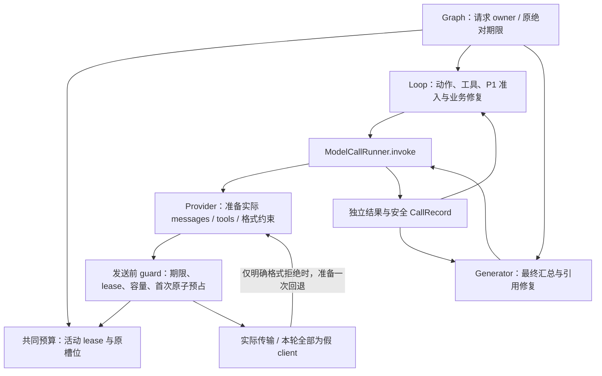

# P2 / B：核心模型调用治理阶段报告

日期：2026-10-21（America/Tijuana）。授权：A 报告交付后，用户要求“继续”；本轮仅实施 B / T011–T024。

**结论：B 工程完成，核心定向检查通过；完整后端回归保留两项既有提示词断言失败。等待用户验收。C、D 未实施，不能宣称所有模型调用都已治理或整个 P2 完成。**

## 交付与结构

新增 [model_call.py](../../backend/app/rag/model_call.py)，提供 CallContext、CallSpec、CallRecord、CallOutcome、共同物理计量、owned operation scope 和 ModelCallRunner.invoke。runner 不拥有 AgentState、会话、工具选择或日志文件；业务仍负责答案解析、有限修复和逐字引用校验。

### 当前实现

- **原约束集中**：Graph 与 standalone budget 使用同一构造策略，保留 8/12、分支 5/4/3、节点/工具额度和回答/汇总/辅助槽。新工厂总期限最多 300 秒；单次调用期限取原请求 deadline 与配置单次等待上限的较早者，排队、准备和格式回退均在该期限内。
- **活动代次**：每次 start 产生新 lease；严格 reserve 在同一预算锁内核验 request 存在、lease、期限和额度。后续 attempt 仍检查活动 lease，不再次收费。finish、分支释放和工具预占可携带 lease，旧 scope 不得结束或消费新请求。保留旧直接预算 interface 的兼容默认，不声称 C 的所有消费者已接入。
- **核心接入**：loop、最终汇总及其有限引用修复经 runner。汇总不再构造伪 loop/state 或借用 `_invoke`。Graph 持有 owner，分支通过 MainState → Send → AgentState 传递原 lease；独立 loop 能力保持。grounded helper 的答案与修复共用一个 owned operation，调用结束才 finish。
- **真实 adapter 准入**：Ollama、OpenAI compatible 接受明确的 before_attempt/PreparedAttempt；旧 complete-only scripted adapter 在真正调用前由内部适配过 guard。能力按签名判断，不使用 Mock 动态 hasattr。工具/schema 互斥；格式回退只限原先允许的 json_schema → json_object，一次逻辑计费。鉴权、超时、普通传输异常或非法答复不会触发该回退。
- **物理计量**：ContextAdmission 仅委托共同物理计量，原证据准入、原文、阈值和批次规则不变。native/plain 保持原 `messages/tools` 估算包；strict 约束和 fallback 实际附加指令均计入，不重复把 fallback 消息内的完整 schema 再加一次。
- **结果与统计**：拒绝前不发送、不计已发生用量，不回放为 model_call；已准入失败保留一次逻辑计费。CallRecord 保留最后获准发送输入的完整估算，修复原 messages-only 覆盖。实测 Token 缺失为 None；fallback 首次格式拒绝的用量不可得时标 mixed，不冒称完整 provider 实测。
- **迟到隔离**：退出先关闭 guard，再形成独立记录；worker 不再获得新发送许可、预占或修改已返回记录。已获许可的 SDK/I/O 无法撤回，不声称强杀线程。原始首答保留给业务层，runner 不自动语义修复。
- **安全消费**：公开 model_call 只增安全 attempted/attempt_count metadata；原始输入、候选和 tool definitions 仍只在原私有诊断范围。attempts 只有模式、估算、状态和时间标记，无认证、路径、HTTP 正文或 schema fallback 原文；不公开整个 attempts 列表。

### 文件范围

相对本轮开始的快照，16 个 Python 文件变化（11 个生产文件、5 个测试文件），新增 5 个：model_call.py、test_model_call_governance.py、test_model_call_attempts.py、test_model_call_stream.py、test_model_call_privacy.py。

其余接入文件为 agent_loop、context_admission、cost_control、model_provider、generator、graph、graph_state、edges、nodes、pipeline；旧 test_prompt_consumers 只补显式合法预算，保留原 prompt/payload 断言。完整清单和逐行差异见 [changed-files.json](../../output/governance011/engineering/phase-b-20261021/changed-files.json)、[phase-b.diff](../../output/governance011/engineering/phase-b-20261021/phase-b.diff)。

另更新本功能 spec/plan/tasks 的实施状态及本报告。前端产品源码、A 的 diagnostics.py、配置文件、依赖、模型、正式文档/索引均未修改。保留既有 dirty/untracked 工作，不清理或还原；未提交、推送、合并、发布或写 GitHub。

## 流程与隔离

按项目内 speckit-implement 执行，服从单阶段限制。前置脚本 `.specify/scripts/powershell/check-prerequisites.ps1 -Json -RequireTasks -IncludeTasks` 从根目录运行，退出 0，定位 011。requirements 清单只读检查 16/16 checked、0 unchecked；没有额外目录 AGENTS；`.specify/extensions.yml` 在前后均不存在，无 before/after hooks。现有 ignore 已覆盖测试/构建/本地配置产物，无新增发布或基础设施需求。

修改前保存 172 个源码副本/hash、完整 Git 状态与 diff、失败清单副本，见 [before-manifest.json](../../output/governance011/engineering/phase-b-20261021/before-manifest.json)、[before-git-status.log](../../output/governance011/engineering/phase-b-20261021/before-git-status.log)、[before-git-diff.log](../../output/governance011/engineering/phase-b-20261021/before-git-diff.log)。A 的 702 passed 等仅为历史对照，不算本轮运行。

本轮从首个产品测试起使用 A 修正版 guard：应用导入前禁用 Settings 默认 dotenv，fake provider、deterministic embedding、sparse fallback，DATA_DIR/Qdrant/basetemp 均为本阶段独立 output。未读取 backend/.env 内容、启动真实服务或访问正式知识库。所有产品测试 guard 的 blocked_attempts 为 []；自检故意触发 Dense/普通连接保护各一次，允许 Windows asyncio socketpair，并确认 dotenv 禁用，共 4 passed。见 [guard-summary.json](../../output/governance011/engineering/phase-b-20261021/guard-summary.json)。未启动子代理。

## 实际命令、结果与失败记录

pytest cwd：`C:/Users/ifhgz/Desktop/agentic-rag/backend`。入口实际为 `python C:/Users/ifhgz/AppData/Local/Temp/context011_b_runner.py <label> <test paths>`；运行器与 guard 已另存本阶段 output。每个标签的 `.json` 保存展开后的完整 command、cwd、退出码和 guard hash，`.log` 保存原始输出；各轮 basetemp 和证据标签独立，不覆盖初次失败。

| 标签 / 检查 | 退出 | 实际结果 |
|---|---:|---|
| guard-proof / 保护自检 | 0 | 4 passed |
| red-core / 两个新核心行为用例 | 1 | 2 failed：完整估算应为 1004，实际被覆盖为 615；格式回退发送两次，第二次没有 guard；[原始红测](../../output/governance011/engineering/phase-b-20261021/red-core.log) |
| green-core / 新核心、原 loop/provider、多分支 | 0 | 46 passed |
| green-runner / runner、attempt、预算、证据和 prompt 消费 | 1 | 42 passed / 1 failed：旧 prompt 用例直接使用未注册 request_id，按新契约被拒绝；补合法预算后原断言保持 |
| p1-regression / 四组准入 unit、对应四组 SSE、新 core/attempt、prompt | 0 | 88 passed / 19.80 秒；[命令](../../output/governance011/engineering/phase-b-20261021/p1-regression.json)、[输出](../../output/governance011/engineering/phase-b-20261021/p1-regression.log) |
| contracts-privacy / 新 SSE、隐私、原隐私、core/attempt | 0 | 27 passed |
| core-final / 核心、预算、prompt、隐私/SSE、期限 | 1 | 54 passed / 1 failed：测试未消耗入口槽，summary 实际可用剩余额度；补真实入口已计费前提，不改产品额度策略 |
| core-final-v2 / 上述范围及原 provider | 0 | 72 passed / 16.78 秒；[命令](../../output/governance011/engineering/phase-b-20261021/core-final-v2.json)、[输出](../../output/governance011/engineering/phase-b-20261021/core-final-v2.log) |
| backend-full / unit、contract、integration、security | 1 | **733 passed / 2 failed / 2 deselected / 167.42 秒**；[命令](../../output/governance011/engineering/phase-b-20261021/backend-full.json)、[输出](../../output/governance011/engineering/phase-b-20261021/backend-full.log) |
| attempts-evidence-final / adapter 明确证据补测 | 0 | 11 passed / 1.61 秒；包括补充的 401 和非法结构首答两个用例；[命令](../../output/governance011/engineering/phase-b-20261021/attempts-evidence-final.json)、[输出](../../output/governance011/engineering/phase-b-20261021/attempts-evidence-final.log) |
| frontend / `node node_modules/vitest/vitest.mjs run` | 0 | 8 文件 / 27 passed；[输出](../../output/governance011/engineering/phase-b-20261021/frontend-test.log) |
| frontend / `node node_modules/typescript/bin/tsc --noEmit --incremental false` | 0 | 类型检查通过；[命令](../../output/governance011/engineering/phase-b-20261021/frontend-typecheck.json) |
| 根目录 Python compile / 不执行源码 | 0 | 16 个改动 Python 文件全部编译；[最终检查](../../output/governance011/engineering/phase-b-20261021/static-verification-final.json) |

完整回归后仅补两项 adapter 测试、边界数字产物和类型标注，无运行语义调整；733 通过不包含随后补充的两项测试，不把它们重复计入完整回归。没有重跑无关范围或构建未变更的前端产品；未运行 lint（项目没有该脚本）。

完整命令均排除两项真实嵌入相关用例，排除不算通过：

- `tests/integration/test_v3_1_retrieval.py::test_four_baseline_questions_have_facts_in_top5_child_or_parent`
- `tests/unit/test_embeddings.py::test_missing_real_model_does_not_silently_fall_back_to_hash`

本轮所有 LLM、adapter 传输和嵌入均为 scripted/fake/mock/deterministic；真实 adapter 指使用生产 adapter 代码配假 client，并未调用真实端点。这些是工程约束检查，不是语义回答质量或真实耗时验收。

## 可核验行为证据

原图接口验证成功、容量拒绝和 provider 失败；SSE request_id/model_call_id、attempted、attempt_count、完整估算与用量关联，单一 complete 不变。拒绝不形成 model_call，不发起 provider 调用。失败异常中的预置正文/路径 sentinel 不进入 SSE 或普通日志；原始输入/首答保留私有范围。

并发与迟到用例证明：20 个竞争调用只能占用 B1 的 3 个槽，B2/汇总槽保持；排队过期无发送；准备中关闭后无许可；旧 lease 同 ID 重用不能复活；迟到 strict 拒绝不能继续 fallback；慢 Ollama 绑定不会调用 invoke；返回记录不被迟到线程追加。grounded 首答与修复共用 request_id、使用不同 model_call_id，并在操作结束清理 owner。

schema 临界用例使用同一静态限额，实际记录见 [schema-boundary.json](../../output/governance011/engineering/phase-b-20261021/schema-boundary.json)：

| 字段 | 实际值 |
|---|---:|
| strict 当前输入估算 | 967 |
| fallback 当前完整输入估算 | 1054 |
| 本用例输入限额 | 967 |
| 实际假传输发送 | 1 |
| 逻辑调用计费 | 1 |

strict 获准后端点明确拒绝格式，fallback 因完整输入超限返回 context_budget_exceeded；没有发送第二次，没有扩大窗口或裁剪证据。估算仍是原算法，不冒充 tokenizer 精确值或 HTTP 字节数。正常 fallback 成功为两次底层尝试、一次逻辑计费；已返回 Token 保留，第一尝试未提供的用量不伪造。

## 保留失败、限制与下一阶段

完整回归仅有两项既有失败，未修改其断言或 prompt：

- `test_query_rewrite_v1.py::test_stage_c_prompt_explains_shared_dependencies_comparison_and_capacity`，旧原句“共享型号、电压、持续时间”。
- `test_v4_query_analysis.py::test_context_prompt_limits_history_and_preserves_unconfirmed_conditions`，旧原句“只使用必要历史”。

CURRENT_FAILURES.md 原字节保持；其中两项真实问答问题未复验、未改判。没有真实模型、正式题集或新总体质量成绩。

当前只接入核心 loop、最终汇总/引用修复及共用 grounded helper。QueryAnalyzer、普通 generate_with_result、旧 ModelQueryGenerator 和 summarize_conversation 的迁移，以及全部独立服务 shared/owned scope 的收敛，属于 **C / T025–T033，尚未实施**；不能据 B 宣称现有生产用途全部无旁路。complete_model 保留原低层用途和这些待迁移调用。

guard 阻止关闭后新获许可，不能撤回关闭前已授权的 SDK/I/O，不能安全强杀线程；沿用既有 executor，未重构全局进程退出治理。Ollama 在许可后为当前剩余时间构建独立 transport，不修改共享客户端。纯估算和准备自身仍消耗请求时间，不承诺精确墙钟时延。A 的诊断尽力保存及普通 logger 范围限制保持。

T011–T024 按实际工程结果勾选，连同 A 共 24/39 项；C、D 15 项保持未勾选。下一阶段仅在用户后续指示下进入 C，不自动执行 D、P3、真实复验、提交或推送。

**报告后暂停，等待用户验收。**
