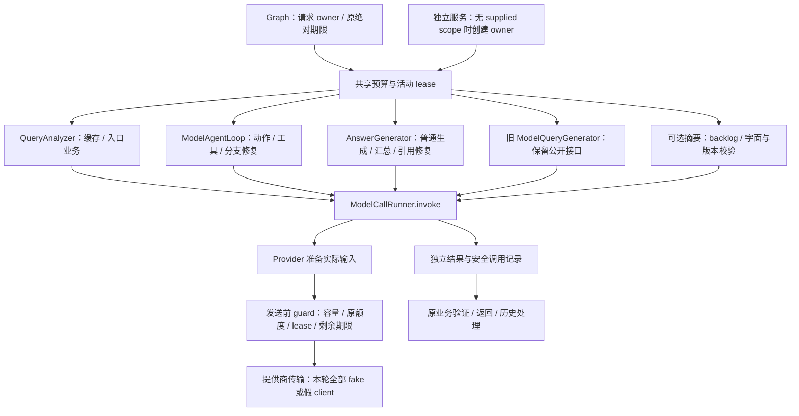

# P2 / C：全部模型调用者接入阶段报告

交付日期：2026-10-22（America/Tijuana）；本阶段跨日执行，原始证据目录沿用开始时的 `phase-c-20261021`。授权：B 报告后用户要求“继续”；本轮只实施 C / T025–T033。

**结论：C 工程完成、待用户验收。范围内消费者已接入共同调用治理，定向检查通过；最新完整后端回归 782 passed / 2 failed / 2 deselected，退出 1，保留两项既有提示词措辞断言失败。D 尚未实施，整个 P2 尚未完成；未运行真实模型。**

## 交付与结构

旧改写只是独立公开能力，没有接回主图；图的问答与 A 的诊断仍保持各自职责。

| 用途 | 本轮接入及保留行为 | 本轮证据 |
|---|---|---|
| query_analysis | runner 计入 schema、统一准入与失败；保留 AnalysisOutcome、缓存身份、结构状态、原题、唯一对象兜底和首次候选 | structured-output、protocol、consumer matrix；拒绝独立 guard_trace，不冒充已发送调用 |
| collect_answer 普通生成 | 原空上下文不调用，返回 tuple / generate 字符串接口保持；新增可选 request_id/context/lease | 四类边界、成功/异常、owned/shared、迟到结果、provider 单次超时 |
| query_rewrite 旧接口 | 移除直调；保留候选归一化、去重、长度限制与缓存，未接回图 | cache / consumer matrix；返回 metadata 不扩展原私有正文范围 |
| conversation_summary | 使用可选额度；保持历史批次选择、字面约束与 expected_version 提交；拒绝/失败 deferred，不移除 backlog | full-budget、版本冲突、四类边界、迟到摘要及图历史恢复 |
| agent_loop | 复用 operation_context，独立操作只结束自己的请求；过期或旧 lease 不复活，不释放同 ID 新请求的分支额度 | 原 loop/budget；新增独立 owner、旧 lease 分支槽测试 |
| final_synthesis / answer_repair | B 的共同调用保留；统一 shared/owned scope，答案及有限修复共用原上下文 | grounded repair、runner、预算、图/SSE/隐私回归 |

### 生命周期、记录与历史

- 新增 `operation_context`：只有未提供 request_id、context、lease 的服务操作才创建 owner。显式给出的无效或不一致 scope 保持 shared 并拒绝；空 lease 不借用当前活动代次。借来的 context 即使标记 owned，消费者也不能 finish 它。
- 图使用同一个 owner 工厂，继续沿用请求原始绝对 deadline；分支和摘要传递原 lease。预算策略、默认 8/12 次、分支 5/4/3 次、原工具/节点/辅助槽、请求最多 300 秒与单次配置上限保持。答案与修复不为每次 invoke 重建额度。
- `CallRecord.to_metadata()` 删除输入、候选、工具正文，保持普通生成和旧改写原先 metadata-only 的边界；原分析及摘要输入仍在原私有范围。拒绝不计为 model_call，summary 未发送时转换为安全 runtime_guard；已准入失败仍计一次逻辑调用。
- 摘要完整批次的物理估算委托共同函数；可减少普通历史批次数，未增加 RAG 证据压缩。验证成功后由调用线程提交，worker 不接收 memory 回调；版本冲突保留 backlog。无 backlog、fake 或无可装入批次时沿用原不调用行为。
- 四种消费者的成功/提供商异常各实际调用一次；容量、缺失请求、期限耗尽、额度耗尽均为零次发送且额度不变。分析/改写第二次缓存命中后总调用仍为一次。两个真实摘要函数的图内假提供商超时场景均计三次（分支两次、摘要一次），返回时门仍阻塞，历史与待澄清状态恢复；释放迟到结果后记录和历史不再变化。

### 文件范围

相对 C 开始快照，共 15 个 Python 文件变化：8 个生产文件（model_call、query_analysis、query_planner、generator、conversation_summary、agent_loop、graph、nodes），7 个测试文件。其中新增 `backend/tests/unit/test_model_call_consumers.py`，含 45 个展开用例；其余为 request_deadline、model_provider、prompt_consumers、query_rewrite_v1、v3_5_cost_control、v4_conversation_summary 的必要断言/夹具补充。

旧夹具中的非空但未注册 request_id 改为真实共享预算或无 ID 的独立操作，保留缓存、线程隔离、窗口和 prompt 的原实质断言。普通生成超时测试改为断言安全 `timeout`、不含原异常正文，并加强“只调用一次”；没有修改两项旧措辞失败断言或 prompt 来造通过。

完整清单和阶段差异见 [changed-files.json](../../output/governance011/engineering/phase-c-20261021/changed-files.json)、[phase-c.diff](../../output/governance011/engineering/phase-c-20261021/phase-c.diff)。另仅更新本功能 spec/plan/tasks 状态与本报告。A diagnostics、预算策略、提供商实现、prompt/schema、前端源码和 CURRENT_FAILURES 原字节保持，见 [preservation-check.json](../../output/governance011/engineering/phase-c-20261021/preservation-check.json)。未修改配置、依赖或正式知识库；未提交、推送、发布或写 GitHub。

## 流程与隔离

按项目内 speckit-implement 执行，服从单阶段边界。前置脚本 `.specify/scripts/powershell/check-prerequisites.ps1 -Json -RequireTasks -IncludeTasks` 在根目录退出 0，定位 011；requirements 只读门为 16/16 checked。未发现额外子目录 AGENTS；实施前后 `.specify/extensions.yml` 均不存在，无 hooks。沿用现有 ignore，无依赖安装或子代理任务。

开始时保存 177 个源码副本/hash、完整 Git status/diff、spec/plan/tasks 与失败清单副本，见 [before-manifest.json](../../output/governance011/engineering/phase-c-20261021/before-manifest.json)。没有清理或覆盖既有 dirty/untracked 工作。A/B 的工程成绩仅为历史对照，不计为本轮运行。

每次后端产品测试均在应用导入前禁用 Settings 默认 dotenv，使用 fake/scripted provider、deterministic embedding、sparse fallback，DATA_DIR/Qdrant/basetemp 隔离到本阶段 output；未读取 backend/.env 内容或运行真实模型/正式索引。guard 自检故意阻止 Dense/普通连接各一次，允许 Windows socketpair，并验证 dotenv 禁用；所有产品测试 blocked_attempts 均为 []，见 [guard-summary.json](../../output/governance011/engineering/phase-c-20261021/guard-summary.json)。

## 实际命令与结果

后端 cwd 为 `C:/Users/ifhgz/Desktop/agentic-rag/backend`。入口 `python C:/Users/ifhgz/AppData/Local/Temp/context011_c_runner.py <label> <test paths>`，展开为当前 Python 的 `-m pytest -q ... -p no:cacheprovider -p context011_c_guard`，每轮独立 basetemp，固定排除下列两项真实嵌入相关用例（不算通过）：

- `tests/integration/test_v3_1_retrieval.py::test_four_baseline_questions_have_facts_in_top5_child_or_parent`
- `tests/unit/test_embeddings.py::test_missing_real_model_does_not_silently_fall_back_to_hash`

运行器与 guard 已另存 output。以下每个标签均有同名 `.json`（完整 argv、cwd、退出码、guard hash）和 `.log`（原输出），互不覆盖；不同轮次有重复用例，不能相加为独立测试数。

| 标签 / 检查 | 退出 | 实际结果 |
|---|---:|---|
| guard-proof | 0 | 4 passed，保护自检 |
| red-consumers | 1 | 6 failed / 2 passed：原普通生成及改写容量绕过；四用途缺失请求仍发送；[原始红测](../../output/governance011/engineering/phase-c-20261021/red-consumers.log) |
| green-consumers | 1 | 57 passed / 2 failed：旧摘要测试期待 None、独立测试错误传入未注册 ID |
| consumer-matrix | 1 | 103 passed / 7 failed：6 个旧夹具/预期需适配，另 1 个既有措辞失败；原日志保留 |
| consumer-matrix-v2 | 0 | 71 passed / 65.83 秒；consumer、summary、cost、prompt、protocol、loop stage C、structured output |
| lifecycle-consumers | 0 | 77 passed / 11.64 秒；consumer、deadline、loop、governance |
| late-summary | 0 | 66 passed / 11.85 秒；真实摘要函数配假 provider、版本/历史恢复、budget、SSE/privacy |
| standalone-loop | 0 | 2 passed / 0.51 秒；独立 owner 和旧 lease 不释放新分支槽 |
| backend-full | 1 | 首次完整：778 passed / 4 failed / 2 deselected，202.53 秒；[命令](../../output/governance011/engineering/phase-c-20261021/backend-full.json)、[输出](../../output/governance011/engineering/phase-c-20261021/backend-full.log) |
| full-failure-recheck | 0 | 2 passed / 0.54 秒；安全超时断言适配后复验、临时文件失败在全新目录复验 |
| backend-full-v2 | 1 | 最新完整：782 passed / 2 failed / 2 deselected，212.62 秒；包含晚加的两个 loop 用例；[命令](../../output/governance011/engineering/phase-c-20261021/backend-full-v2.json)、[输出](../../output/governance011/engineering/phase-c-20261021/backend-full-v2.log) |
| frontend-test | 0 | 8 文件 / 27 passed，4.16 秒 |
| frontend-typecheck | 0 | noEmit、incremental false；未修改前端源码，无构建 |

前端 cwd 为仓库 `frontend`，实际命令为当前 Node 的 `node node_modules/vitest/vitest.mjs run` 和 `node node_modules/typescript/bin/tsc --noEmit --incremental false`；argv/cwd/exit 见 [前端测试记录](../../output/governance011/engineering/phase-c-20261021/frontend-test.json)、[类型检查记录](../../output/governance011/engineering/phase-c-20261021/frontend-typecheck.json)。

源码静态检查：`python C:/Users/ifhgz/AppData/Local/Temp/context011_c_audit.py` 退出 0，15 个变更 Python 源码 compile 成功；AST 与 `rg` 扫描只发现低层 model_provider.complete_model 分发中的 `provider.complete`，业务消费者没有直接 complete/complete_model 调用；runner 通过 executor.submit 分发。见 [production-call-audit.json](../../output/governance011/engineering/phase-c-20261021/production-call-audit.json)。针对本轮文件的 `git diff --check -- ...` 退出 0（Git 提示三个既有工作副本在下次操作时转 CRLF，不是检查失败）。

## 失败、限制和下一阶段

首次完整回归的四项失败均保留：

1. `test_ollama_timeout_is_not_silently_retried_as_cloud`：旧断言期待原始 `local timeout`。统一治理返回安全分类，已按此适配且验证单次本地调用；定向与最新完整回归通过。
2. `test_all_capacity_failures_skip_synthesis_and_success_history`：测试准备阶段在隔离目录替换 parents.json 遇到 WinError 5 PermissionError，尚未进入业务断言。未改知识库存储实现、未删除首次证据；新目录定向及最新完整回归通过。证据只能说明未复现，不能确认 Windows 文件占用的具体来源。
3. `test_stage_c_prompt_explains_shared_dependencies_comparison_and_capacity`：旧断言期待“共享型号、电压、持续时间”。
4. `test_context_prompt_limits_history_and_preserves_unconfirmed_conditions`：旧断言期待“只使用必要历史”。

后两项是 A/B 已记录的既有失败，最新完整回归仍失败；不在本阶段改 prompt 或放宽断言。CURRENT_FAILURES 中两项真实问答失败未复验、未改判，所有旧原始输出继续保留。

本阶段仅证明 fake/mock/假传输下的工程约束与兼容性，不能证明真实 Ollama/兼容端点传输、语义检索、拆题质量、引用答案质量或真实端到端耗时通过。关闭 guard 可阻止后续许可与迟到业务提交，不能强杀已获准的外部线程/I/O；输入 Token 仍为既有估算，不声称精确 tokenizer 或完整底层实测用量。

T025–T033 已标记工程完成，累计 33/39；勾选不等于验收。D / T034–T039 六项全部未勾选，仍需组合交付场景、阶段 D 自己的完整回归、消费/隐私核对和最终文档收尾。本轮完整回归只是 C 的回归证据，不代替 D 的组合验收。quickstart 与 contracts 中“未来实施/未实施”的设计阶段表述尚待 D 文档收尾更新，以本报告和实际代码为当前实现事实。

**报告后暂停，等待用户验收。** 不自动进入 D、P3、真实模型复验、GitHub 操作或提交/推送。
