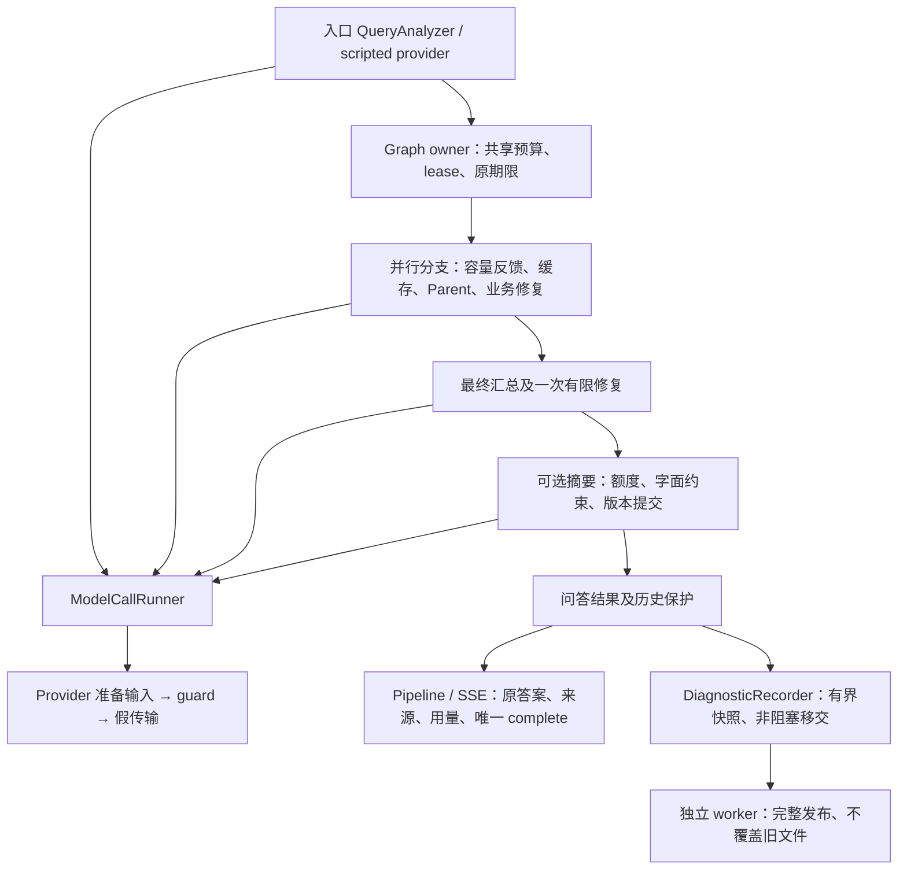

# P2 / D：组合交付验证与工程收尾报告

交付日期：2026-10-21（用户当前时区 Etc/GMT+8）。授权：C 阶段报告后用户要求“继续”；本轮仅执行 D / T034–T039。A–C 原报告及其原日期保持。

**结论：D 工程完成，P2 的 39 项工程任务已收尾、待用户验收。15 项组合检查通过；完整后端 797 passed / 2 failed / 2 deselected，退出 1，两项既有提示词断言失败保留。前端 27 passed、类型检查通过。不是全绿或真实问答质量通过；未运行真实模型。**

## 本轮交付

新增两个测试文件，没有修改阶段开始时已有的任何生产或测试源码：

- [test_model_call_delivery.py](../../backend/tests/unit/test_model_call_delivery.py)：3 项图级组合检查，使用真实 QueryAnalyzer 与 scripted provider，覆盖容量反馈、缓存、Parent 实读、分支修复、汇总修复、可选摘要额度以及迟到摘要历史恢复。
- [test_model_call_delivery_stream.py](../../backend/tests/contract/test_model_call_delivery_stream.py)：12 项聊天 SSE 组合检查，将部分交付/摘要超时分别与正常、关闭、异常、阻塞、队列满和文件冲突诊断组合。首个请求实际运行完整图，随后只重放同一已计算结果与无诊断基准配对，不再次调用模型或提交历史。

组合场景最终实际计数：入口 1，分支 B1 4 / B2 2，最终汇总 1，最终修复 1，摘要 1，共 10 次逻辑调用；工具 5 次，请求限额 12，缓存命中至少 2 次。可选摘要额度设为 0 的图用例为 9 次调用，摘要未发送，backlog 保留。引用上下文保持 CHILD 与 WINDOW 两段原文，拒绝证据和未实读的 Parent 后文不能提升为答案来源。首次非法分支/汇总答复保留在私有记录，业务仍决定有限修复。

另外更新本功能 spec、plan、tasks、quickstart、data-model、两个 contracts 与 docs/repository-guide 的实现状态、接口、生命周期和验证导航。未更改需求范围、配置、依赖、prompt/schema、模型或正式知识库；旧改写未接回主图。两个源码文件的差异见 [changed-files.json](../../output/governance011/engineering/phase-d-20261021/changed-files.json)、[phase-d.diff](../../output/governance011/engineering/phase-d-20261021/phase-d.diff)。

## 隔离、流程与保留证据

按项目内 [speckit-implement](../../.agents/skills/speckit-implement/SKILL.md) 执行单阶段工作。前置脚本 `.specify/scripts/powershell/check-prerequisites.ps1 -Json -RequireTasks -IncludeTasks` 在根目录退出 0，定位功能 011；requirements 门只读检查 16/16 checked。未发现子目录额外 AGENTS；实施前后无 `.specify/extensions.yml`，无 hooks。沿用现有 ignore；没有安装依赖、启动子代理、提交、推送、合并、发布或写 GitHub。

开始前保存 178 个源码副本/hash、完整 Git 状态/diff、原失败清单和相关文档/报告副本，见 [before-manifest.json](../../output/governance011/engineering/phase-d-20261021/before-manifest.json)、[before-git-status.log](../../output/governance011/engineering/phase-d-20261021/before-git-status.log)、[before-git-diff.log](../../output/governance011/engineering/phase-d-20261021/before-git-diff.log)。保留所有既有 dirty/untracked 工作。

所有产品测试均在应用导入前禁用 Settings 默认 dotenv；LLM=fake、deterministic embedding、sparse fallback、DATA_DIR/Qdrant/basetemp 隔离在本阶段 output。显式 ollama/兼容接口配置的测试仍全部注入 scripted provider 或假 client。未读取 backend/.env 内容、调用真实模型、启动外部服务或访问正式索引。

guard 自检 4 passed：故意拒绝 Dense 和普通连接各一次，允许 Windows socketpair，确认 dotenv 禁用。所有产品测试 blocked_attempts 均为 []，见 [guard-summary.json](../../output/governance011/engineering/phase-d-20261021/guard-summary.json)。保护自检的两次预期拒绝不算真实模型或联网调用。

## 实际命令与结果

后端入口为 `python C:/Users/user/AppData/Local/Temp/context011_d_runner.py <label> <test paths>`。运行器展开为当前 Python 的 `-m pytest -q ... --basetemp=<独立路径> -p no:cacheprovider -p context011_d_guard`，实际 cwd 为 `C:/path/agentic-rag/backend`。运行器和 guard 均另存 D output；每个标签的 `.json` 保存完整 argv/cwd/exit/guard hash，`.log` 保存原始输出，旧标签不覆盖。

| 标签 / 实际检查 | 退出 | 结果 |
|---|---:|---|
| guard-proof / 临时保护自检模块 | 0 | 4 passed / 0.09 秒 |
| delivery-graph / 新图级模块 | 0 | 3 passed / 1.45 秒 |
| delivery-stream / 新 SSE 模块首轮 | 1 | 10 passed / 2 failed / 12.77 秒；两项墙钟超时预期不符，原日志保留 |
| delivery-timeout-recheck / SSE 模块 `-k timeout` | 0 | 6 passed / 6 deselected / 7.35 秒；后者是未选的部分交付场景，不算通过 |
| delivery-combined-v2 / 两个新模块 | 0 | 15 passed / 13.48 秒；改为显式控制过期时钟并保持迟到门阻塞 |
| backend-full / tests/unit tests/contract tests/integration tests/security | 1 | **797 passed / 2 failed / 2 deselected，213.25 秒**；[完整命令](../../output/governance011/engineering/phase-d-20261021/backend-full.json)、[原始输出](../../output/governance011/engineering/phase-d-20261021/backend-full.log) |
| frontend-test | 0 | 8 文件 / 27 passed，3.63 秒 |
| frontend-typecheck | 0 | noEmit、incremental false |

后端每轮固定排除两项真实嵌入相关用例，不算通过：`tests/integration/test_v3_1_retrieval.py::test_four_baseline_questions_have_facts_in_top5_child_or_parent`、`tests/unit/test_embeddings.py::test_missing_real_model_does_not_silently_fall_back_to_hash`。定向轮次按实际收集范围记结果，不能将多轮重复用例相加为独立检查数。A–C 的旧成绩仅作对照，不冒充 D 执行。

前端入口为 `python C:/Users/user/AppData/Local/Temp/context011_d_verify.py frontend-test` 和 `... frontend-typecheck`；展开为当前 Node 的 `node node_modules/vitest/vitest.mjs run`、`node node_modules/typescript/bin/tsc --noEmit --incremental false`，cwd 为仓库 frontend。覆盖 sse、Chat、ProcessPanel 等既有消费链；[单测记录](../../output/governance011/engineering/phase-d-20261021/frontend-test.json)、[类型检查记录](../../output/governance011/engineering/phase-d-20261021/frontend-typecheck.json)。前端源码未改，未构建、未运行不存在的 lint、未覆盖用户 buildinfo。

审计命令 `python C:/Users/user/AppData/Local/Temp/context011_d_audit.py` 退出 0，检查完整回归产物、guard、原源码/报告 hash 和调用扫描，且对 RAG Python 源码执行无导入 compile。针对本轮文件的 `git diff --check -- ...` 退出 0。审计脚本另存 output，验证方法可复核。

## 组合、隐私与完整性审计

[delivery-scenarios.json](../../output/governance011/engineering/phase-d-20261021/delivery-scenarios.json) 汇总完整回归内 15 个最终场景，包含 request_id、thread_id、终态/原因、调用 ID/用途/实际可得用量及诊断 job 状态；每项还有独立 `delivery-evidence-*.json` 和公开事件原记录。初次失败与带计时记录的复验位于各自独立 pytest 目录，没有覆盖。

[privacy-and-preservation.json](../../output/governance011/engineering/phase-d-20261021/privacy-and-preservation.json) 实际审查：

- 12 个 SSE 场景各只有一个终态；同一已计算结果配对的 answer/sources/status/reason/usage 与无诊断基准完全一致，未把不同请求 ID 或耗时误要求为字节相等。
- 阻塞诊断仍未释放时 SSE 已收到 complete，正式 JSON 尚不存在；释放后 saved，不追加答复终态或更改历史。
- 4 份声明 saved 的私有 JSON 完整可读，usage/status 与原图一致，首次非法候选在原私有范围保留；未返回的 input/output Token 仍为 null，没有伪造 provider 实测。
- 2 次目标冲突保留原文件字节，状态 failed/conflict；故障异常只返回安全类别。
- 12 份相关结构化日志与公开事件未泄露预置首次候选、拒绝证据、存储异常或私有路径 sentinel。原安全测试还覆盖 prompt/history、密钥、私有推理过滤。
- 受控过期场景在摘要门未释放时返回 timeout，原历史恢复；门释放后图结果和历史不再变化。可选摘要零额度场景不发送、不消费次数、不删除 backlog。

[source-preservation.json](../../output/governance011/engineering/phase-d-20261021/source-preservation.json) 证明阶段开始的 178 个源码文件原 hash 不变（含所有生产、原测试及前端源码），A/B/C 报告和 CURRENT_FAILURES 字节不变。AST 与源码核对只保留 model_provider.complete_model 中一处低层 `provider.complete` 分发；业务消费者无直接 complete/complete_model 调用，runner 通过 executor.submit 分发。

## 逐项需求结论

以下“满足”只指当前隔离工程用例覆盖，不代替真实模型或用户验收。所列已有测试模块在 D 完整回归中实际执行。

| 需求 | 工程核对及证据 |
|---|---|
| FR-001 | 七类用途均经 runner；consumer/governance/attempts 与 D 调用扫描；旧改写保持独立 |
| FR-002 | context_admission/parent/batch/multi-branch 与 attempts 覆盖完整输入、tools/schema 和变更后回退计量 |
| FR-003 | governance/consumers 的容量、预算、期限拒绝不发送；并发首次 reserve 原子计一次，已准入失败不退费 |
| FR-004 | model_loop_budget、governance、consumers 与 D 9/10 次组合验证原 8/12、分支 5/4/3、工具及辅助槽；缓存不加次数 |
| FR-005 | request_deadline、attempts、governance 及 D 受控摘要过期：同一原期限、迟到不提交，保留 300/120 上限 |
| FR-006 | 每次调用 ID 与请求/分支/用途可关联；D 私有样本和公开投影保持真实可得值、估算与 null 口径 |
| FR-007 | runner 不解析语义或拥有历史；D 首次非法引用由原业务修复并保留首答，无新增语义重试 |
| FR-008 | 两真实 adapter 的假 client 测试覆盖格式回退一次逻辑计费、二次准入及普通异常不回退；提供商选择保持 |
| FR-009 | P1 四组准入/对应 SSE、D Child/Parent 原文与缓存重检、批次配对、部分失败均通过 |
| FR-010 | diagnostics_stream 原故障矩阵及 D 配对：诊断关闭/失败/跳过均不改答案、来源、原因、用量、历史 |
| FR-011 | diagnostics 存储测试覆盖中断、竞争及发布清理；D 四份完整保存、两次冲突保留原字节 |
| FR-012 | diagnostics_lifecycle 与 D 阻塞门证明不等待落盘；迟到 worker 不拥有 SSE/历史回调，关闭有界 |
| FR-013 | model_call_privacy、query_rewrite_log_privacy 及 D 12 份公开日志/事件无预置私有 sentinel 泄露 |
| FR-014 | SSE 单终态及既有字段保持；前端 27 项消费检查和 noEmit 通过，未新增 UI |
| FR-015 | 进程内 guard、无 dotenv、临时存储和 fake/假传输；两项真实嵌入排除、历史失败原字节保留 |
| FR-016 | runner/context 与 recorder/store 分别有可替换公共 seam；generator 无伪 loop/state 借用，D 经真实图/API 验证 |
| SC-001 | 各用途受控拒绝矩阵发送次数为 0；已发送 trace 与逻辑计数一致，D 单场景 9/10 次可追溯 |
| SC-002 | 原诊断故障矩阵与 D 配对交付投影 100% 一致，各唯一 complete |
| SC-003 | 受控最终组合中迟到新增终态/历史污染为 0；阻塞诊断未释放前已交付，不以微小墙钟阈值证明 |
| SC-004 | 四份 saved 样本完整，冲突旧字节保持，公开 sentinel 泄露为 0；存储中断/重复标识原测试通过 |
| SC-005 | P1 相关回归通过；全量如实保留两项既有措辞失败，故完整套件不是全绿；未改旧真实失败来达标 |
| SC-006 | 15 场景按请求关联终态、逻辑调用、用量和 job 状态；未调用、调用失败、诊断缺失和资料不足分别保留 |

## 初次失败、既有失败与限制

SSE 首轮两项 `raise-timeout`、`conflict-timeout` 的实际结果为 partial，与短墙钟等待预期的整次 timeout 不符。首轮没有足够计时记录判断绝对期限是否已到，不能据此断言生产截止保护失效。加入 deadline/returned_at 记录后 6 项超时场景复验通过，原偏差未复现、具体原因未确认。最终将过期条件改为在实际摘要函数的 scripted provider 内显式推进单调时钟，并保持迟到门阻塞；15 项组合与完整回归通过。没有更改生产超时逻辑、放宽业务断言或删除首次失败。[首轮输出](../../output/governance011/engineering/phase-d-20261021/delivery-stream.log)、[计时复验](../../output/governance011/engineering/phase-d-20261021/delivery-timeout-recheck.log)、[最终组合输出](../../output/governance011/engineering/phase-d-20261021/delivery-combined-v2.log) 分别保存。

完整后端实际失败仅以下两项，与 A/B/C 记录一致；本轮未修改这些测试或 prompt：

1. `test_query_rewrite_v1.py::test_stage_c_prompt_explains_shared_dependencies_comparison_and_capacity` 期待旧原句“共享型号、电压、持续时间”。
2. `test_v4_query_analysis.py::test_context_prompt_limits_history_and_preserves_unconfirmed_conditions` 期待旧原句“只使用必要历史”。

CURRENT_FAILURES 的 C-FAIL-001、C-FAIL-002 真实问答失败，以及其他旧真实题集结果未复验、未改判。C 阶段曾记录的安全超时旧断言与临时文件权限失败在本轮完整回归未失败，但这不删除 C 的首次证据。

工程结论的边界：输入 Token 沿用既有估算，不宣称精确 tokenizer；缺失用量不冒称实测。future.cancel 不能强杀已获准外部 I/O，关闭 guard 只封闭后续许可与业务使用权。诊断完整发布不承诺断电持久性，非诊断同步日志仍维持原能力。真实 Ollama/兼容端点、语义检索、拆题、回答/推导质量与真实端到端耗时均未测，不因 fake/mock 通过而通过。

T034–T039 工程完成，累计 39/39。后续仅在用户另行指示后开展：验收后的 P3、既有失败诊断或真实模型复验；它们不是本轮自动任务。项目导航以当前 011 报告和实际代码为事实，旧 README 的历史快照不覆盖本报告。

**报告后暂停，等待用户验收。** 不自动进入 P3、真实复验、GitHub 关闭、提交、推送或发布。
