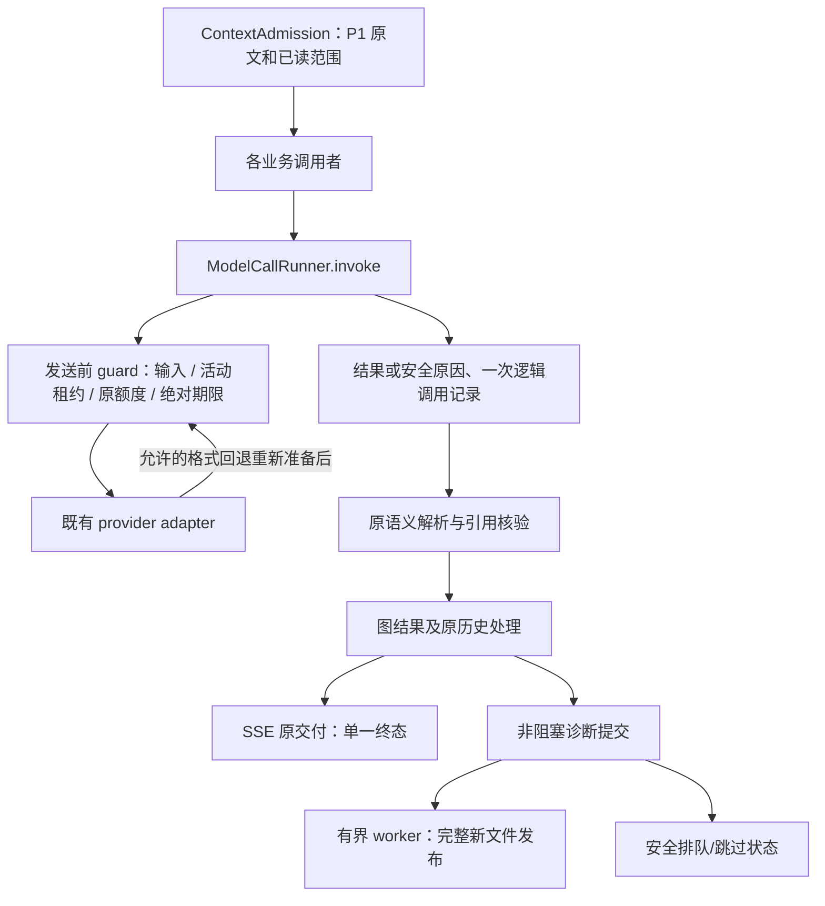

# Implementation Plan: P2 模型调用治理与诊断交付一致性

**Branch**: `codex/model-driven-agent-loop`（实际检出；本轮未创建或切换） | **Date**: 2026-10-21 | **Spec**: [spec.md](spec.md)

**Input**: `specs/011-model-call-governance/spec.md`。原技术规划与 A–D 分阶段实施沿用该规格；最新“继续”只授权 D 验证及收尾。

## Summary

新增两个各自承担完整职责的 module：`rag/model_call.py` 提供共同物理输入计量及 `ModelCallRunner.invoke(spec, context) -> CallOutcome`；`observability/diagnostics.py` 提供有界非阻塞移交和完整新文件发布。前者替代汇总对 loop 私有方法的借用，后者使诊断故障不改写问答。

业务调用者继续负责语义、引用和摘要校验；ContextAdmission 继续负责 P1 证据准入。真实 provider 增加发送前 guard 的可选能力，旧 complete-only fake/scripted adapter 无需增加方法。A–D 工程任务已完成，最新组合与完整回归见 [D 报告](phase-d-report.md)：797 passed / 2 failed / 2 deselected，保留两项既有提示词断言失败；不等于全绿或真实质量验收。历史见 [A 报告](phase-a-report.md)、[B 报告](phase-b-report.md)、[C 报告](phase-c-report.md)。决策见 [research.md](research.md)，细节见 [调用契约](contracts/model-call.md)与[诊断契约](contracts/diagnostics-and-sse.md)。

## Technical Context

**Language/Version**: Python 3.11+；前端 React 18 / TypeScript。只读源码和配置默认值，未加载 .env。

**Primary Dependencies**: 复用 FastAPI、LangGraph、Pydantic、现有提供商和 pytest；并发、队列及文件发布用标准库，不新增依赖。

**Storage**: 现有本地 JSON 诊断目录、同目录唯一临时文件、有界内存状态表；不修改文档、Qdrant 或会话持久化。

**Testing**: 图运行和 SSE 为主，补充共同调用 interface、真实 adapter 假传输和临时文件存储。使用 fake/scripted provider、可控时钟和阻塞门，不运行真实模型。

**Target Platform**: 当前 Windows；明确 POSIX 不覆盖发布方式，不扩展为部署工程。

**Project Type**: 既有 Web 后端和前端消费端，不新建服务或用户入口。

**Performance Goals**: 诊断提交不等待磁盘/worker，队列与快照工作量有界；保留原请求总期限，不新增吞吐或质量承诺。

**Constraints**: 默认请求 300 秒、模型等待 120 秒、模型 8/12 次、分支 5/4/3 次及原工具/节点槽均保留配置与语义。native/plain 输入计量保留 P1 的 messages/tools 包；schema、实际格式回退附加内容不得遗漏，不冒充精确 tokenizer。

**Scale/Scope**: 覆盖分析、分支、修复、汇总、普通生成、旧改写接口和摘要；最多新增上述两个职责模块，其余为必要接入和测试。

## Constitution Check

规划前及设计后均检查，结果均为满足；不是产品测试成绩。

| 原则 | 设计后依据 |
|---|---|
| 单阶段交付 | 规划与 A–D 分别交付暂停，本轮仅 D，报告后仍须用户验收 |
| 单一职责 | 调用治理、诊断存储分离，不吸收业务语义、工具选择或知识库实现 |
| 基于证据 | P1 已读引用、整批准入和部分回答保持，不增加重试/裁剪/语义筛选 |
| 安全一致 | 诊断不覆盖问答、已有文件不覆盖、私有/公开记录范围保持 |
| 可观察可验证 | 调用/尝试/排队/保存明确区分，单终态与隐私随阶段验证 |

沿用已批准的多轮和混合检索能力，不将早期 V1 描述解读为本轮新增能力。无未解决 gate，无需宪章例外。

## Project Structure

### Documentation (this feature)

```text
specs/011-model-call-governance/
  spec.md
  scope-and-evidence.md
  checklists/requirements.md
  plan.md
  research.md
  data-model.md
  contracts/model-call.md
  contracts/diagnostics-and-sse.md
  quickstart.md
  phase-spec-20261021-report.md
  phase-plan-20261021-report.md
  tasks.md                         # A–D 工程完成，验收以阶段报告为准
```

### Source Code (repository root)

以下为最终实现位置；本轮 D 新增组合测试和文档，未修改生产源码：

```text
backend/app/
  rag/model_call.py                  # 新：调用 interface / 共同物理计量
  rag/model_provider.py              # 真实 adapter 发送前 guard
  rag/cost_control.py                # 共享预算构造和严格活动预占
  rag/context_admission.py           # 只委托共同物理计量，保留证据职责
  rag/agent_loop.py
  rag/generator.py
  rag/query_analysis.py
  rag/query_planner.py
  rag/conversation_summary.py        # 已接入 runner，不恢复旧图逻辑
  rag/graph.py                       # 共享上下文及原历史保护
  rag/pipeline.py                    # 诊断提交与原事件交付
  observability/diagnostics.py       # 新：队列/快照/状态/不覆盖发布
  main.py                           # lifespan 管理诊断生命周期
backend/tests/{unit,contract,security}/
frontend/src/api/                    # 兼容验证，不计划新增 UI
```

**Structure Decision**: 保持唯一 RAG 包；调用类型就近在 model_call / model_provider，不拆纯转发文件。诊断归属 observability，pipeline 不承担并发与文件实现。

## 目标结构



## 设计决策与兼容迁移

### 调用治理

- 图拥有预算，runner 借用活动上下文，不 start/finish 别人的请求。独立服务方法通过 owned context 包住整个操作，答案修复共用该上下文。
- 单次期限为 `min(request_deadline, invoke_started + llm_timeout_seconds)`，包含排队和回退。每次发送重算剩余时间；返回前关闭 guard，阻止迟到 worker 在请求 finish 后再次发送。
- 内置 provider 完成纯准备后过 guard；首个获准 attempt 原子预占一次逻辑额度，允许的格式回退只重检。预算需在同一锁内核验活动请求及 lease_id 代次，严格拒绝缺失/已结束/旧租约，不能依赖当前“不存在 request 返回 True”的兼容路径。
- 旧 complete-only adapter 通过内部适配在调用前过相同 guard；真实内置 adapter 必须明确支持发送前准备，不自动降级为遗漏回退检查。
- 调用记录保留准入快照估算，不再被 messages-only token_details 覆盖；调用前拒绝不加入已发生用量。提供商实测与 model_calls 的原逻辑语义保持。
- 所有现有接口迁移；旧改写不接回主图。首答非法保留原输出，修复仍由业务决定，不由 runner 自动重试。

### 诊断移交

- 请求线程只做限定字段的有界内建值复制和 put_nowait；不 mkdir、不 JSON 序列化、不做磁盘写入或等待 future/worker。
- 选择 1 个 daemon worker、最多 8 个待办；单快照最多 2,000,000 字符、100,000 个容器/值节点及 64 层。字符串复用不可变值，容器脱离原对象。超限整体 skipped，不裁剪后冒称完整；这些仅是诊断资源策略。
- 有界状态表保留最近 256 个任务；锁内不做 I/O，不承诺无限历史或精确 RSS 上限。
- 临时文件同目录独占创建，完整序列化/写入/flush/close 后 publish_new；Windows 用不覆盖的 os.rename，POSIX 用 os.link 后解除自己的临时链接。不做 exists()+replace 或降级覆盖复制。
- queued 不等于 saved；私有诊断 JSON 既有字段保持。安全提交回执复用 node，实际落盘状态留在存储状态 seam 和成功文件；complete 后不追发。
- lifespan 启动 worker，关闭时停止接收、丢弃待办并最多 join 1 秒；模块导入不启动新 worker。活动 I/O 无法安全强杀，允许强制退出丢失未完成诊断。
- 诊断告警不调用共享同步 StructuredLogger 或 pipeline.execution，避免再次阻塞和递归。非诊断普通日志不做全局重构，不能宣称任意日志故障都已解决。
- 完整发布不承诺断电持久性；只清理本次未发布临时文件，不自动扫描删除历史证据。

## 分阶段实施与 tasks Phase 对应

本计划定义拆分约束，[tasks.md](tasks.md)按此映射保留停止点。本轮仅执行 D；P2 工程已收尾、待用户验收，完整回归仍有两项既有失败，不包含真实模型质量结论。

| 阶段 | 未来 tasks.md Phase | 交付行为 | 验证及停止点 |
|---|---|---|---|
| A：诊断故障隔离 | Phase 1 | 非阻塞移交、生命周期、不覆盖发布，故障不改问答 | 存储故障/慢写、单终态、隐私、原文件/会话一致；phase-a-report 后暂停 |
| B：核心调用治理 | Phase 2 | runner、真实 adapter guard、loop/汇总/修复接入，去掉私有借用 | fake/假传输、回退容量/期限、单次预占、迟到 guard、P1 核心；phase-b-report 后暂停 |
| C：全部调用者接入 | Phase 3 | 分析、普通生成、旧改写、摘要及独立上下文迁移 | 各用途准入、缓存、可选槽、独立修复共享额度；phase-c-report 后暂停 |
| D：组合交付回归 | Phase 4 | 入口—分支—汇总—摘要—诊断组合和文档收尾 | 完整隔离后端、SSE/隐私、前端消费/类型及必要构建；phase-d-report 后暂停 |

笼统执行只授权第一个未完成阶段。A/B 各可独立演示；依赖由 tasks 固化，不增加临时默认双引擎或额外 feature flag。

## 需求覆盖与验收

| 需求 | 设计 | 主要证据 |
|---|---|---|
| FR-001–FR-008、FR-016 调用部分 | runner、guard、shared/owned context | 各用途拒绝/成功/失败，假传输，记录及原预算 |
| FR-009 | 保留 P1，native/plain 估算基线 | Child/Parent/batch/multi-branch 图运行和 SSE |
| FR-010–FR-012、FR-016 存储部分 | snapshot / submit / publish_new / close | 不可写、中断、慢写、冲突、关闭及迟到任务 |
| FR-013–FR-014 | 白名单、安全 node、原事件 | sentinel、消费端、单终态及问答/历史一致 |
| FR-015、SC-001–SC-006 | quickstart 与阶段报告 | 模型保护、隔离回归、实际命令和原失败保留 |

## 风险与限制

future.cancel 不能停止已运行的提供商或文件 I/O；guard 封闭权限与状态，不保证撤回已经开始的网络请求。

格式准备附加内容纳入计量后，原先遗漏内容的临界请求可能更早失败；保留原限额、估算算法和原文，不扩大窗口制造兼容。native/plain P1 行为保持。

诊断异步后，不能假设 complete 到达即文件已存在；测试经存储状态 seam 有界等待，产品不等待。治理修复不证明真实模型语义或旧失败题已通过。

## Complexity Tracking

无宪章违规例外。两个新增 module 消除现存共享知识与副作用耦合；不引入通用框架、新服务或依赖。替代方案见 research.md。
