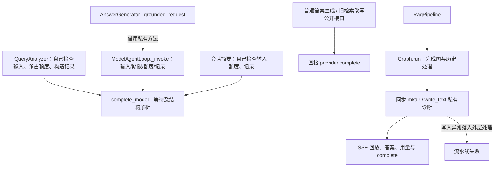

# P2 范围及当前代码证据

日期：2026-10-21。性质：只读核对，未运行故障注入、测试、模型或应用。

P2 的定位来源为 [P1 规格的范围排除项](../010-context-admission/spec.md)：调用治理整理、诊断写入一致性。P1 的 T1–T4 继续按 [T4 工程报告](../010-context-admission/phase-t4-20261021-report.md)视为已经交付，不为进入 P2 增设真实复验前置阶段。本稿不把“审查严重度 P2”或旧功能故事的 P2 优先级混作本次范围。

## 当前结构

图中旧检索改写接口仍存在，但当前模型循环没有调用它。不能用它的直接调用方式推断当前主图已绕过所有保护；也不应为了本次治理把它重新接回模型决策流程。

## 证据、影响与优先级

| 项目 | 实际代码证据 | 影响与证明边界 | P2 内处理优先级 |
|---|---|---|---|
| E1：诊断故障可覆盖图结果 | [pipeline.py](../../backend/app/rag/pipeline.py#L154) 先 graph_service.run，161–172 行同步建目录、序列化和写文件；402–417 行外层异常统一返回流水线失败；[nodes.py](../../backend/app/rag/nodes.py#L204) 已在图内处理历史 | 静态控制流表明：图内已完成后发生 I/O 或序列化异常，仍可转为公开失败；历史与交付可能矛盾。未注入故障，不声称已观察到真实线上事故 | 高：先固定“诊断附属、结果一致”的验收行为 |
| E2：汇总借用模型循环私有治理 | [generator.py](../../backend/app/rag/generator.py#L65) 创建仅用于调用的 loop 和 state，79 行调用 loop._invoke；[agent_loop.py](../../backend/app/rag/agent_loop.py#L115) 同时持有期限、完整输入、预算、记录与执行规则 | 汇总必须了解循环内部 state 形状和私有方法，公共约束难以独立使用和验证；当前保护存在，问题是归属与耦合，不是声称汇总没有容量检查 | 高：明确共同 interface 的职责与验收 seam |
| E3：输入与调用记录知识分散 | [query_analysis.py](../../backend/app/rag/query_analysis.py#L185) 独立计算带 schema 的估算并构造调用记录；[conversation_summary.py](../../backend/app/rag/conversation_summary.py#L36) 另行计量与调用；[agent_loop.py](../../backend/app/rag/agent_loop.py#L125) 构造含 tools 的估算后再合并 token_details | 共同规则在三处维护；[model_provider.py](../../backend/app/rag/model_provider.py#L339) 的 token_details 只按 messages 生成输入估算，同名估算字段可能与容量判定的计量范围不同。它不证明提供商实测用量错误 | 高：统一约束、记录含义与回归矩阵 |
| E4：仍存在直接调用入口 | [generator.py](../../backend/app/rag/generator.py#L38) 普通生成方法直接 provider.complete；[query_planner.py](../../backend/app/rag/query_planner.py#L78) 预占后直接调用，未走 complete_model 的整次等待 | 普通生成还用于非图流水线/既有 fake 路径；检索改写当前未在主循环启用。治理需清点并保留公开能力，不以删除旧依赖或接回旧逻辑解决 | 中：作为调用覆盖清单，避免扩大为 P3 清理 |
| E5：格式回退发生在提供商内部 | [model_provider.py](../../backend/app/rag/model_provider.py#L244) strict 请求被明确拒绝后增加 schema 指令并再次发送 | 统一治理不能只记录调用者最初 messages 而遗漏回退后输入或重置等待；保持既有格式兼容及逻辑调用计费，不增加语义重试 | 中：技术方案明确准备输入和底层尝试的约束位置 |

## 职责取舍

- 共同调用 module 应隐藏物理输入、额度预占、同一截止时间、执行和安全调用记录的共同约束；业务调用者仍决定问题理解、工具动作、答案解析、引用修复及摘要内容是否合法。
- P1 的 ContextAdmission 继续负责工具证据的原文准入与已读登记，调用治理不能把该职责吞并成跨分支证据池。
- 诊断存储应有可替换 seam，便于用临时写入器构造不可写、序列化失败、中断、重复标识和慢写。它的实现不属于模型语义执行，也不承担会话状态管理。
- 以上是职责约束和当前问题证据，不是已经选定类名、接口参数、线程模型、文件拆分或实施阶段的技术计划。后续按 Spec Kit plan 形成可审阅方案。

## 验证取证入口

主体验证复用现有 AgentGraphService.run、必要的独立服务 interface 和聊天 SSE。现有参考用例为 model_call_deadline、model_loop_budget、request_deadline、query_rewrite_log_privacy，以及 P1 的 context/parent/batch/multi_branch_context_admission 用例。新共同 interface 的聚焦检查可以补充，不能只断言调用私有方法的次数。

先用受控故障证明 E1 等行为，再实施修复；本轮只核对静态代码，没有运行红测或修改断言。P1 最终回归 646 通过、两项既有失败、两项真实嵌入相关测试排除是前阶段记录，不算本轮运行结果。
