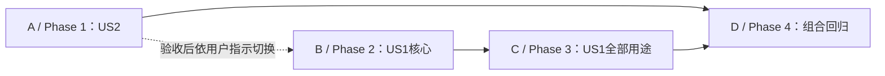

# Tasks: P2 模型调用治理与诊断交付一致性

**Input**: [spec.md](spec.md)、[plan.md](plan.md)、[research.md](research.md)、[data-model.md](data-model.md)、[调用契约](contracts/model-call.md)、[诊断契约](contracts/diagnostics-and-sse.md)、[quickstart.md](quickstart.md)。

**Status**: A–D / T001–T039 共 39 项工程完成、待用户验收；见 [A 报告](phase-a-report.md)、[B 报告](phase-b-report.md)、[C 报告](phase-c-report.md)、[D 报告](phase-d-report.md)。最新完整后端 797 passed / 2 failed / 2 deselected；勾选不代表全绿、用户验收或真实模型质量通过。

**Tests**: 规格 FR-015 和验收场景明确要求工程验证，故包含测试任务。实施时按可观察行为切片红—绿推进，不要求先写完整阶段全部测试；collection/import 错误不冒充业务红测。主 seam 为 graph.run / chat SSE，新的公共 interface 测试作补充，不断言私有函数调用顺序。

**Organization**: US2=诊断故障不改问答；US1=一致的模型调用治理，两者在规格内均为 P1。保留已交付计划的 A–D 阶段及 Phase 1–4 映射；模板的初始化/基础工作并入对应故事，不新增无交付价值的横向阶段。US1 分 B/C 接入，B 完成不等于整个 US1 已完成。

## Format 与执行边界

任务格式为 `- [ ] Tnnn [P?] [USn?] 描述与文件路径`。[P] 仅表示满足前置条件后文件互不冲突的技术机会，不是跨阶段、子代理或自动并行的授权。

所有路径相对仓库根目录。新测试文件是待创建位置；output 为每阶段证据目录，实际运行必须另设不会覆盖旧记录的子目录。

本轮“继续”仅实施 D（T034–T039），报告保存后停止，不自动进入 P3 或真实复验。不得提交、推送、发布 GitHub ticket 或运行真实模型。

## Phase 1 / A：US2 诊断故障隔离（MVP）

**Goal**: 用户得到原有问答与历史结果，诊断保存不阻塞、不覆盖旧文件，故障仅影响诊断状态。

**Independent Test**: 同一受控问答配对运行诊断关闭、正常、不可写、序列化/写入失败及慢写，比较 answer/sources/status/reason/调用用量和历史；worker 未释放时 SSE 已有唯一 complete。临时存储检查完整发布和原文件字节不变。

### 任务

- [x] T001 [US2] 在 output/governance011/engineering/phase-a/ 保存本轮源码与 Git 基线、原失败清单和真实模型保护；从 P1 修正版准备 context011_guard.py 及运行器，验证拒绝真实 Dense/普通连接、允许 Windows socketpair；不加载 .env 或正式索引。
- [x] T002 [P] [US2] 在 backend/tests/contract/test_diagnostics_stream.py 通过既有 chat SSE 注入诊断写入异常，先保存“图已完成但流水线失败”的行为红测；同一切片覆盖原问答失败不被诊断原因覆盖、单终态、答案/来源/用量/历史一致，不比较不同请求的耗时或 ID 字节相等。
- [x] T003 [P] [US2] 在 backend/tests/unit/test_diagnostics.py 设计 recorder 公共 interface 的受控存储测试，覆盖关闭、非法快照、队列饱和、中断/冲突和慢写；使用 Event 门与临时数据，新增 interface 的最小可导入脚手架不算业务实现或通过证据。
- [x] T004 [US2] 在 backend/app/observability/diagnostics.py 实现类型及有界快照，落实 data-model 的“嵌套值不与业务状态共享可变引用”“非法类型/循环/过大/过期时整体放弃，不做证据裁剪”；精确内建类型、拒绝子类，限制 2,000,000 字符/100,000 节点/64 层，原顶层字段白名单保持，不执行对象自定义转换或复制方法（依赖 T002、T003）。
- [x] T005 [US2] 在 backend/app/observability/diagnostics.py 实现 submit/status/close、1 daemon worker/8 待办/256 状态；落实“唯一任务身份，状态表主键”“重复 request_id 允许形成不同 job，不覆盖旧状态”“queued / writing / saved / failed / skipped”“固定安全类别，不保存异常正文或私有文件路径”“安全状态观测，不修改模型耗时或总调用用量”；支持 writing→skipped/closed、状态淘汰返回 None，锁内不 I/O（依赖 T004）。
- [x] T006 [US2] 在 backend/app/observability/diagnostics.py 实现同目录独占临时文件、完整序列化/写入/flush/close 后发布；Windows rename、POSIX link 后清理本次临时链接，禁止覆盖及 exists()+replace；发布后清理失败不得删除成功文件或误报未保存，保持 UTF-8、拒绝非有限数值及 request_id 路径校验（依赖 T005）。
- [x] T007 [US2] 在 backend/app/rag/pipeline.py、backend/app/main.py 装配 recorder 与 lifespan，移除主答复路径同步诊断 I/O；queued 回执复用安全 node，避开同步 logger/execution helper，告警再失败不递归；没有 recorder 时 skipped，不恢复同步 fallback；worker 不接收 graph/memory/SSE 回调（依赖 T006）。
- [x] T008 [US2] 在 backend/tests/unit/test_diagnostics.py、backend/tests/unit/test_diagnostics_lifecycle.py 和 backend/tests/contract/test_diagnostics_stream.py 完成阶段故障矩阵：队列满/容器子类、两个同 ID job、发布冲突、中断与清理、未启动/关闭/1 秒有界 close、关闭后发布限制、慢写先 complete；只用受控门和时钟，关闭前已进入系统调用不假装能撤回（依赖 T007）。
- [x] T009 [US2] 在 backend/tests/security/test_query_rewrite_log_privacy.py、backend/tests/contract/test_diagnostics_stream.py 验证私有 sentinel 与原始首答留在原私有范围、公开回执不泄露；将“complete 后立即读文件”改为仅测试中经 status 的有界完成通知，运行相关旧日志/SSE/前端 node 消费用例并保存 output/governance011/engineering/phase-a/ 记录（依赖 T008）。
- [x] T010 [US2] 更新 specs/011-model-call-governance/tasks.md 的实际工程状态，保存 specs/011-model-call-governance/phase-a-report.md，列实际命令/退出码、红绿与限制、旧失败、下一阶段；报告写“报告后暂停，等待用户验收”，不得自动进入 B（依赖 T009）。

**Checkpoint**: US2 可独立演示；阶段 A 完成只代表诊断工程交付，调用治理仍未完成。MVP 不需要真实模型或新 UI。

## Phase 2 / B：US1 核心调用治理

**Goal**: loop、汇总和答案修复经同一个调用 interface，两个真实 adapter 的每次发送都受原约束，保留旧 fake 注入及 P1 行为。

**Independent Test**: 受控 graph.run 与假传输证明输入/预算/期限拒绝、strict 与回退、一次逻辑计数、关闭 guard 和租约竞争；汇总不再构造 loop/state 借用私有方法。

### 任务

- [x] T011 [US1] 在 output/governance011/engineering/phase-b/ 保存新基线、模型 guard、原预算/计量及 P1 结果对照，读取阶段 A 报告；本阶段测试仍为 fake/假传输，不接真实模型、不把 A 的成绩记为本轮运行。
- [x] T012 [P] [US1] 在 backend/tests/unit/test_model_call_governance.py 以 graph.run 和 runner 目标 interface 建立核心拒绝/失败/成功行为红测，覆盖 P1 native/plain 物理估算、拒绝不发送/不计用量、循环与最终汇总/修复槽；不以 _invoke 调用次数作为验收（依赖 T011）。
- [x] T013 [P] [US1] 在 backend/tests/unit/test_model_call_attempts.py 通过真实 adapter 的假 client 建立 strict 成功、格式回退后超限/超时、鉴权/传输异常不回退及首答非法保留的用例；所有网络调用由假传输完成，格式回退共用逻辑 ID（依赖 T011）。
- [x] T014 [US1] 在 backend/app/rag/model_call.py 和 backend/app/rag/cost_control.py 实现 CallContext/共同预算构造及活动租约，落实“非空系统标识；lease 识别活动生命周期，过期不复活”“引用既有 ModelCallBudget，所有分支共享，不复制计数”“原 monotonic 绝对期限；不得由后续 node 重置”“分支为 B1/B2/B3；最终汇总记录可为 final，但预算作用域是请求”“shared 或 owned；只有 owner finally finish”；严格 reserve 在同锁核验存在、期限及代次（依赖 T012、T013）。
- [x] T015 [US1] 在 backend/app/rag/model_call.py 实现共同物理计量与 invoke/outcome 核心，并让 backend/app/rag/context_admission.py 仅委托物理计量；落实“tools 与 schema 互斥”“completed / rejected / failed / skipped；completed 仅表示提供商执行结果已返回，不表示答案正确”，不可传跳过保护开关；证据准入、原文及阈值不变（依赖 T014）。
- [x] T016 [US1] 在 backend/app/rag/model_provider.py 接入两个真实 adapter 的 PreparedAttempt/before_attempt 和旧 complete-only 内部适配；落实“不是通用重试列表”，按原允许的 response_format 拒绝回退至多一次，单次 deadline 包含排队/准备/回退；首获准 attempt 预占，后续只重检，退出先 close guard（依赖 T015）。
- [x] T017 [US1] 在 backend/app/rag/agent_loop.py 和 backend/app/rag/graph.py 接入 runner/context，保留图的 owner 及独立 run 能力、业务动作/工具/P1 准入/分支修复；关闭后的 attempt 不得新获许可，旧调用 context 不因同 ID 新 start 复活，不宣称能撤回关闭前已许可的 I/O（依赖 T016）。
- [x] T018 [US1] 在 backend/app/rag/generator.py 将最终汇总与其有限引用修复接入共同 interface，去掉伪 loop/state 及私有 _invoke 借用，保持原 payload、validate/render、部分回答保留及修复上限；落实“completed 时为现有 ModelResult；结构非法仍保留原始 content，由业务验证”（依赖 T017）。
- [x] T019 [US1] 在 backend/app/rag/model_call.py 和 backend/app/rag/cost_control.py 完成 CallRecord 与统计映射，落实“首次发送准入成功为 true；此前拒绝为 false，不算已发生用量”“与既有事件和统计可关联；格式 attempts 共用逻辑 ID”“monotonic / perf_counter 计时；不假装墙钟时间精确测量”“当前最后已发送输入的完整估算，不累计历次空间，不被 messages-only 覆盖”“提供商确实返回的值；缺失为 null，不伪造 0”“attempts 只记录安全 metadata，缺失底层用量明确不可得”；旧无 attempted 的 trace 兼容，拒绝不伪装 model_call（依赖 T018）。
- [x] T020 [US1] 在 backend/tests/unit/test_model_call_governance.py、backend/tests/unit/test_model_call_attempts.py 补并发/迟到验收：排队过期不再获许可、回退重检、旧 lease 同 ID 重用、关闭与首 reserve 竞争、单一逻辑计费；验证 outcome“返回后不再可被迟到线程更新”，不强杀外部线程（依赖 T019）。
- [x] T021 [US1] 运行 backend/tests/unit/test_context_admission.py、backend/tests/unit/test_parent_context_admission.py、backend/tests/unit/test_batch_context_admission.py、backend/tests/unit/test_multi_branch_context_admission.py 及对应 SSE 模块，证明 P1 原文、窗口、缓存、多回复和分支槽保持；schema 附加计量造成的合理边界变化单独举证，不扩大窗口改测试造通过（依赖 T020）。
- [x] T022 [US1] 在 backend/tests/security/test_model_call_privacy.py 和 backend/tests/contract/test_model_call_stream.py 验证当前/失败/拒绝调用的公开 metadata、原文私有范围、原因/用量及单终态，真实 adapter 仍是假传输，不新增原始 HTTP/schema 回退正文落盘（依赖 T021）。
- [x] T023 [US1] 核对 frontend/src/api/client.ts、frontend/src/types/api.ts 和 frontend/src/components/ProcessPanel.test.tsx 的现有消费兼容，运行必要前端测试与 noEmit 类型检查；如确实修改前端源码再构建，命令和状态保存 output/governance011/engineering/phase-b/，不新增 UI（依赖 T022）。
- [x] T024 [US1] 更新 specs/011-model-call-governance/tasks.md 并保存 specs/011-model-call-governance/phase-b-report.md，明确仅核心调用已接入、C 尚未完成，记录实际红绿/失败/guard/限制；报告后暂停，等待用户验收（依赖 T023）。

**Checkpoint**: 核心调用链独立可演示。分析、普通生成、旧改写和摘要尚待 C，不能在 B 宣称所有调用均已治理。

## Phase 3 / C：US1 全部调用者接入

**Goal**: 范围内每一种调用用途均遵守共同约束，独立服务与可选摘要不能遗漏；保留原业务能力，不重新接入旧检索决策。

**Independent Test**: 同一用途矩阵分别构造成功、输入过大、额度不足、期限耗尽、提供商异常和缓存命中；独立回答与修复共享 owned context，显式失效 context 拒绝而不创建新请求。

### 任务

- [x] T025 [US1] 在 output/governance011/engineering/phase-c/ 保存阶段 B 后基线及 guard，核对当前 backend/app/rag/ 内所有实际 complete/complete_model 调用与主图消费者，不把尚未启用的旧接口当成已在线绕过。
- [x] T026 [US1] 在 backend/tests/unit/test_model_call_consumers.py 对分析、普通生成、旧改写、摘要及 standalone operation 参数化写行为红测，包含各自结果形状/业务校验和缓存不产生调用（依赖 T025）。
- [x] T027 [US1] 在 backend/app/rag/query_analysis.py 接入 runner，保留缓存身份、问题/schema/唯一对象业务、AnalysisOutcome 和原结构状态；容量/额度/期限/安全 trace 统一，原始首次答复不被调用层修复（依赖 T026）。
- [x] T028 [US1] 在 backend/app/rag/generator.py、backend/app/rag/query_planner.py 迁移普通生成和旧改写公开接口的直接调用，保留空上下文及原 tuple/去重/缓存行为；只统一治理，不删除公开能力或将旧改写接回主图（依赖 T027）。
- [x] T029 [US1] 在 backend/app/rag/conversation_summary.py 接入可选调用策略，保留 backlog 选择、字面约束和版本提交校验；拒绝/失败为 deferred、不抢回答/汇总槽，迟到结果不写摘要、不删除原历史（依赖 T028）。
- [x] T030 [US1] 在 backend/app/rag/model_call.py、backend/app/rag/graph.py 及相关服务操作完成 shared/owned scope 装配，落实“一次答案及其修复共用上下文，不为每次 invoke 新建额度”“已传入 request_id / context 却失效时拒绝”；空上下文 owned 与已失效 supplied context 必须区分，不 start/finish 他人的请求（依赖 T029）。
- [x] T031 [US1] 在 backend/tests/unit/test_model_call_consumers.py 和 backend/tests/unit/test_request_deadline.py 验证全部用途矩阵、默认 8/12 与分支 5/4/3、原工具/节点槽、单请求 300 秒及单次配置上限、owned 修复、缓存/可选槽和迟到历史/待澄清恢复，统计与记录保持约束（依赖 T030）。
- [x] T032 [US1] 运行 backend/tests/unit/test_query_analysis_structured_output.py、backend/tests/unit/test_v4_conversation_summary.py、backend/tests/unit/test_model_loop_budget.py 及相关图/SSE/隐私检查，核对 backend/app/rag/ 真实生产调用不再绕开 runner；直接 complete_model 的低层假传输测试保留，不做 P3 清理；证据存 output/governance011/engineering/phase-c/（依赖 T031）。
- [x] T033 [US1] 更新 specs/011-model-call-governance/tasks.md 并保存 specs/011-model-call-governance/phase-c-report.md，列用途覆盖、实际次数/失败/原成绩及未测真实质量；报告后暂停，等待用户验收（依赖 T032）。

**Checkpoint**: US1 的各服务用途均接入；US2 保持独立。最终组合与完整回归尚待 D。

## Phase 4 / D：跨故事组合验证与收尾

**Goal**: 证明入口—并行分支—汇总—可选摘要—诊断的组合交付一致，所有限额、来源、用量和隐私保留，完成 P2 工程结论。

**Independent Test**: 一次受控多分支请求组合容量反馈、缓存、Parent/多工具与部分失败，同时阻塞或拒绝诊断；最终 SSE 和历史符合原问答，诊断后续状态不补发成功终态。

- [x] T034 在 backend/tests/contract/test_model_call_delivery_stream.py、backend/tests/unit/test_model_call_delivery.py 建立并运行组合用例，包含真实入口预算路径的 scripted provider、分支反馈/修复、汇总/可选摘要、慢诊断、原 timeout 与单终态；每个场景记录 request_id/逻辑次数/可得用量/诊断 job 状态到 output/governance011/engineering/phase-d/，如发现本阶段范围内缺口先保存失败再修复。
- [x] T035 在 output/governance011/engineering/phase-d/ 运行 quickstart.md 的完整后端隔离回归与 guard，明确排除两项真实嵌入相关用例且不算通过，保留两项既有提示原句断言和其他实际失败；失败不覆盖旧日志，不将 fake 通过改判为真实模型质量（依赖 T034）。
- [x] T036 在 frontend/src/api/sse.test.ts、frontend/src/pages/Chat.test.tsx、frontend/src/components/ProcessPanel.test.tsx 所代表的消费链运行前端测试和 noEmit 类型检查，必要修改才构建，保存 output/governance011/engineering/phase-d/ 实际命令/退出状态，不虚构 lint 或覆盖用户 buildinfo（依赖 T035）。
- [x] T037 核对 backend/tests/security/、当前公开事件及私有诊断样本，审查断言/文件原字节、首次结果、guard 与实际用量；确认无私有正文/路径泄露、无重复终态、无历史污染、无不可得用量伪造，在 output/governance011/engineering/phase-d/ 保存对应证据（依赖 T036）。
- [x] T038 按最终实现更新 specs/011-model-call-governance/quickstart.md、specs/011-model-call-governance/plan.md 和必要的 docs/repository-guide.md 导航，记录已实现 interface/生命周期与限制；不重写 CURRENT_FAILURES.md 的真实失败结论，不把旧 README 数值当实际生效值（依赖 T037）。
- [x] T039 更新 specs/011-model-call-governance/tasks.md 并保存 specs/011-model-call-governance/phase-d-report.md，逐项对照 FR-001–FR-016 / SC-001–SC-006，给工程结论、实际命令/退出码、既有失败与真实未测范围；报告后暂停，等待用户验收，不自动进入 P3、真实复验、GitHub 关闭、提交或推送（依赖 T038）。

## Dependencies & Execution Order

### 阶段及故事依赖

A 与 B 技术上可独立产生价值，但默认交付顺序为 A→B→C→D；跨阶段并行不是本计划默认授权。C 技术上依赖 B 的 runner/adapter，D 依赖 A 和 C 的完整能力。两个故事同为规格 P1，先交付 US2 符合原方案明确的 A 阶段，不重编号故事。

### 阶段内前置

- A：T001 → {T002,T003} → T004 → T005 → T006 → T007 → T008 → T009 → T010。
- B：T011 → {T012,T013} → T014 → T015 → T016 → T017 → T018 → T019 → T020 → T021 → T022 → T023 → T024。
- C：T025 → T026 → T027 → T028 → T029 → T030 → T031 → T032 → T033。
- D：T034 → T035 → T036 → T037 → T038 → T039；另须先完成 A/C 并获得 D 执行指示。

T004/T014 不是单独的“建模型”交付，必须在同阶段通过完整行为链验证；阶段报告任务依赖本阶段所有必要证据，不以 tasks 勾选替代验收。

## Parallel Examples

**US2**：T001 完成后，可分别准备 T002 的 SSE 行为红测和 T003 的存储 interface 测试，文件不同，无未完成的相互依赖；共享测试 helper 如需修改则先串行协调。随后实现仍按同一行为切片红绿推进。

**US1**：T011 完成后，可分别准备 T012 的 graph/runner 行为用例和 T013 的真实 adapter 假 client 用例；它们不共享待改源码。不能在 B 核心契约未稳定时跨入 C，也不因为标记 [P] 自动启用多代理或并发全量测试。

## Requirements / Model Constraints Coverage

| 范围 | 任务 | 验证 |
|---|---|---|
| FR-010–FR-012、FR-016 存储；SC-002–SC-004 | T001–T010 | 快照/队列/完整发布/生命周期及原问答配对 |
| FR-001–FR-008、FR-016 调用；SC-001 | T011–T020、T025–T032 | runner、真实 adapter guard、全部用途与 owned/shared scope |
| FR-009、SC-005 | T021、T031–T035 | P1 原准入、引用、缓存、多工具/分支，完整隔离回归 |
| FR-013–FR-014、SC-004/SC-006 | T009、T019、T022–T023、T034、T036–T037 | 白名单、调用/诊断关联、前端消费和单终态 |
| FR-015、原失败与预算边界 | T001、T011、T025、T031–T039 | guard、隔离、配置语义、实际命令和历史保留 |

实体约束：DiagnosticSnapshot/Receipt/Status 对应 T004–T008；CallContext/租约对 T014/T017/T030；CallSpec/PreparedAttempt/Guard 对 T015–T016/T020；CallOutcome/CallRecord 对 T015/T018–T019；问答与诊断副本的职责对应 T007–T009/T034。字段约束在相关任务中引用原文，其余完整契约仍为实施必读输入。

## Implementation Strategy 与完成标准

MVP 为 Phase 1 / A 的 US2，完成即可独立演示诊断不破坏问答。后续每次只进入获准阶段，保持已有公开 interface 可用，不增加临时双引擎、格式语义重试、旧检索决策或云端兜底。

39 项任务分布：A/US2 10 项、B/US1 14 项、C/US1 9 项、D 跨故事 6 项工程完成（共 39 项）；共 4 项 [P]。阶段报告保存后暂停。勾选不代表全绿或质量验收；任务生成、格式自检和需求覆盖核对不算产品测试或实现。
