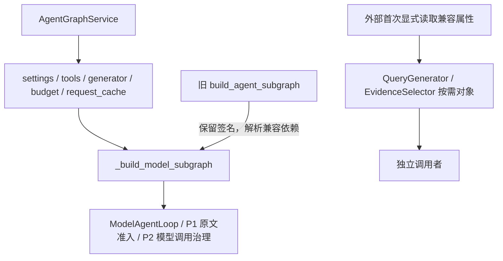

# P3 / 012 A 阶段工程报告

日期：2026-10-22。阶段结论：**A 工程完成、待用户验收；P3 整体未完成。报告后暂停，等待用户验收。**

用户本轮“执行”承接规划报告，按项目单阶段规则只授权首个未完成阶段 A。执行前依照项目 speckit-tasks 补齐 20 项任务，随后按 speckit-implement 完成 T001–T010；未另开任务阶段或跨入 B。T011–T020 全部未勾选。没有提交、推送或 GitHub 写入。

## 结果与文件

- [graph.py](../../backend/app/rag/graph.py)：同文件私有 `_build_model_subgraph` 只接收 settings、tools、generator、budget、request_cache。正常构造/运行不读取旧兼容属性，也不创建 QueryGenerator、旧 rewrite cache、EvidenceSelector。保留仍活动的 analysis_cache。
- [test_inactive_graph_dependencies.py](../../backend/tests/unit/test_inactive_graph_dependencies.py)：6 个展开用例，验证两种配置的构造计数/实际 scripted 问答、旧 builder 两种调用形状、generator.settings 原优先级、无绑定预算的独立旧入口及生命周期。
- [test_graph_compatibility.py](../../backend/tests/unit/test_graph_compatibility.py)：13 个展开用例，覆盖按需读取、赋值/None、8 线程首次读取、注入身份/原绑定、原 provider/模式/缓存策略捕获、异常局部性、兼容对象不配置主图及原 falsy 选择语义。
- [tasks.md](tasks.md) 新增并记录 A 的 10 项完成、B 的 10 项待执行；[spec.md](spec.md)、[plan.md](plan.md) 同步实际状态。规格/规划原报告、质量清单、research/data-model/contracts/quickstart 保持原文。

生产变化只有 graph.py；新测试两份。相对本阶段源码快照，既有 200 个 Python/TS/TSX 文件中仅 graph.py 改动，其余 199 个未改。工作区原来已有大量未提交/未跟踪修改，本报告的差异以阶段快照而非 Git HEAD 为准。见 [阶段 diff](../../output/cleanup012/engineering/phase-a-20261022/phase-a.diff)、[范围审计](../../output/cleanup012/engineering/phase-a-20261022/source-preservation.json)。

## 构造、兼容和行为证据

| 正常问答配置（均 scripted provider） | 清理前旧 QueryGenerator / EvidenceSelector / BoundedCache | 清理后 |
|---|---|---|
| fake | 1 / 1 / 2 | 0 / 0 / 1 |
| ollama | 1 / 1 / 2 | 0 / 0 / 1 |

剩余 BoundedCache 是当前入口分析缓存，不是 rewrite cache。上述 ollama 仅验证配置分支，没有调用 Ollama。两组均实际执行受控检索→回答，改动前后答案、原文、来源、状态/原因、用量和普通历史投影完全一致：model_calls=2、tool_calls=1、model_call_limit=8；排除动态请求 ID、记录 ID 和耗时。见 [前后配对原始结果](../../output/cleanup012/engineering/phase-a-20261022/paired-behavior.json)。不据此承诺性能或真实模型答题质量。

旧 `build_agent_subgraph` 签名 AST 与基线相同；6 个旧无效参数只在适配边界保留，不新增业务语义。共享 budget/cache 不复制计数。正常图保留 AnswerGenerator 使用 generator.settings 的原优先级。旧 selector 的 request_cache 在旧 builder 构建时解析，已批准的隐式内部热替换关系不再承担主图配置作用。

两个兼容属性由实例锁保护，首次显式读取才创建并保存对象，访问不执行 generate/select；赋值（含 None）原样保留。构造期显式注入 ModelQueryGenerator 仍只绑定原 graph budget/request_cache，保留原 provider/cache/index_version；后续 setter 不新增重绑定。默认 lazy 对象捕获原 settings/store/budget/cache/provider 引用以及模式/TTL/容量，避免延迟创建改变原共享关系。构造失败仅影响显式访问，未发布半成品。

## 实际验证与命令

工作区根目录执行 `.specify/scripts/powershell/setup-tasks.ps1 -Json` 和 `check-prerequisites.ps1 -Json -RequireTasks -IncludeTasks`，退出均 0。临时运行器 `python C:/Users/user/AppData/Local/Temp/context012_a_runner.py <label> <测试选择>` 调用下面各轮；pytest 工作目录均为 backend。完整实际 argv、cwd、退出状态、guard hash 分别保存在同名 JSON，完整 stdout 在同名 log；[实际命令展开](../../output/cleanup012/engineering/phase-a-20261022/actual-commands.md) 包含每条完整 pytest 命令，不以示例替代实际记录。

| 运行 label | 选择及目的 | 实际结果 / 退出码 | 原始记录 |
|---|---|---|---|
| guard-proof | 拒绝 Dense/普通连接，禁 dotenv，允许 socketpair | 4 passed / 0，0.10s | [log](../../output/cleanup012/engineering/phase-a-20261022/guard-proof.log) / [argv](../../output/cleanup012/engineering/phase-a-20261022/guard-proof.json) |
| red-assembly | 两份新测试首轮 13 例，在旧实现保存行为红测 | 8 failed、5 passed / 1，3.44s | [log](../../output/cleanup012/engineering/phase-a-20261022/red-assembly.log) / [argv](../../output/cleanup012/engineering/phase-a-20261022/red-assembly.json) |
| green-assembly | 新测试首轮矩阵 + graph/model_agent_loop/governance | 49 passed / 0，7.15s | [log](../../output/cleanup012/engineering/phase-a-20261022/green-assembly.log) / [argv](../../output/cleanup012/engineering/phase-a-20261022/green-assembly.json) |
| compatibility | 新测试扩充为 19 例 + query_planner/v3_4_evidence/rag_architecture | 33 passed / 0，4.43s | [log](../../output/cleanup012/engineering/phase-a-20261022/compatibility.log) / [argv](../../output/cleanup012/engineering/phase-a-20261022/compatibility.json) |
| known-failures | 两项原提示词断言独立复核 | 2 failed / 1，2.31s | [log](../../output/cleanup012/engineering/phase-a-20261022/known-failures.log) / [argv](../../output/cleanup012/engineering/phase-a-20261022/known-failures.json) |
| p1-p2-regression | 最新 19 例、P1 四组准入及 SSE、P2 governance/attempts/consumers/delivery、循环预算/协议/修复、期限、多分支、诊断及隐私 | 251 passed / 0，63.92s | [log](../../output/cleanup012/engineering/phase-a-20261022/p1-p2-regression.log) / [argv](../../output/cleanup012/engineering/phase-a-20261022/p1-p2-regression.json) |

红测失败来自默认旧构造、eager 属性、首次并发读取、注入时多余 cache、旧构造异常阻断主图，并非导入/收集错误。各轮存在重叠，不相加声称独立用例总数。兼容轮后加强独立入口预算释放断言，已在最后 251 项中通过；其后没有再改生产/测试代码。

`python C:/Users/user/AppData/Local/Temp/context012_a_audit.py`、运行器 `diff` 及限定范围的 `git diff --check` 退出均 0。审计验证旧签名、五项显式依赖、正常路径旧构造/属性读取为零、3 份变动 Python 可编译、两组行为配对及原报告/失败保留。`.specify/extensions.yml` 不存在，无 before/after hooks 可执行。requirements 16 项全勾选，本轮只读。

## 失败、隔离与限制

两项既有失败仍为：`test_query_rewrite_v1.py::test_stage_c_prompt_explains_shared_dependencies_comparison_and_capacity`（旧短语“共享型号、电压、持续时间”）；`test_v4_query_analysis.py::test_context_prompt_limits_history_and_preserves_unconfirmed_conditions`（旧短语“只使用必要历史”）。未删断言或改 prompt。CURRENT_FAILURES.md、功能指针和 P2 D 报告与基线逐字节相同，真实首答失败未复测、未改判。

使用 fake/scripted、假传输、deterministic 嵌入与 sparse fallback。dotenv 在应用导入前禁用，数据/basetemp 均在本阶段 output 内。保护自检刻意触发一次 Dense 与一次普通连接拒绝；所有产品测试的 blocked_attempts 均为空，见 [guard 汇总](../../output/cleanup012/engineering/phase-a-20261022/guard-summary.json)。未运行真实模型、真实 Dense 或真实检索质量评估，未操作正式 PDF/Qdrant。

运行器固定携带两个真实嵌入用例的 deselect 选择器；本轮定向集合没有收集这些用例，不能把它们算作通过或额外宣称“2 deselected”。完整后端及前端单测/类型检查留在 B，本轮未运行。P2 历史 797/2/2 仅为导航，不是本轮成绩。没有测量性能改进。

## 需求进度与下一阶段

E1/E2/E3 的正常装配清理和兼容边界已落实，对应 FR-001–FR-006 的 A 部分及 SC-001/SC-002 的装配证据；FR-007/FR-008 由定向行为/SSE/隐私/期限回归支持。FR-009–FR-012 的阶段证据与保护已保存。SC-003 的两组前后投影一致；SC-004 的独立能力完整矩阵、SC-005 最终组合回归和 SC-006 整体交付仍需 B，不能把 A 勾选视为整个 P3 验收通过。

B 仅在后续明确验收并指示继续后执行：移除 nodes/edges 的 procedure 无效传递，保留 TypedDict/Outcome/生成参数和旧配置解析，补兼容说明，核对独立能力，完成完整后端与前端最终回归及导航更新。B 的生产文件本轮全部保持基线。

**报告后暂停，等待用户验收。**
