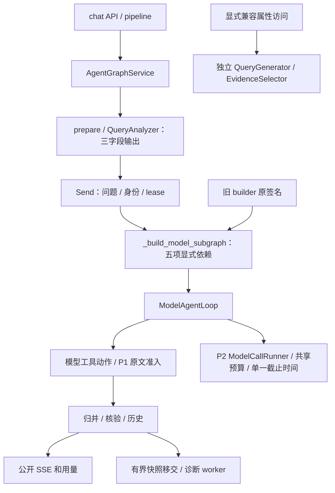

# P3 / 012 B 阶段与工程收尾报告

日期：2026-10-22。授权：用户在 A 阶段报告后明确“继续”；本轮只实施 B / T011–T020。**A/B 共 20 项工程任务完成，待用户验收；报告后暂停，等待用户验收。** 不是全绿或真实问答质量通过，不自动进入新的架构阶段、真实复验或 GitHub 操作。

最终隔离后端：**802 passed / 2 failed / 24 skipped / 2 deselected**；两项失败均为既有提示词断言，24 项依赖正式 PDF 的检查未运行，另两项真实嵌入检查排除。前端 **27 passed**，noEmit 类型检查退出 0。完整时间/命令见下面原始记录。没有运行真实模型或真实嵌入，也未重建/修改正式知识库、索引或 .env。

## 实施结果与清单

问题证据是原 prepare 固定写入 False，随后路由和分支节点继续复制两个无接收者使用的标记。此次只移除这五处关联，保留独立能力和外部兼容形状。

| 条目 | 实际结果 | 验证 |
|---|---|---|
| E1/E2 旧 QueryGenerator、rewrite cache、EvidenceSelector 默认装配 | A 已解除；B 不再修改 graph.py，不删旧服务本体 | A 测试原样保留、最终完整轮重跑；正常旧构造 0，analysis cache 仍活动 |
| E3 旧 builder 六参数 | A 已隔离在同文件适配，五项实际依赖显式传入 | 原签名、位置/关键字、独立预算生命周期和 settings 优先级测试保持 |
| E4 procedure 主图传递 | B 删除 nodes 的 3 行、edges 的 2 行 | prepare/Send/agent 单、三分支红绿，旧调用输入 True 也不再配置分支策略 |
| E4/E5 独立契约 | 保留可选 TypedDict 字段、Outcome 默认/缓存属性、三字段 schema、生成两个 bool 及三元组 | 四组合×有效/修复成功/修复拒绝/空证据；独立证据和 replay 反例测试 |
| E6 旧 Parent 配置 | 保留名称、环境名、默认 240 与解析，仅补当前无主图作用说明 | 默认/环境解析、阈值 1 与 100000 的实际 scripted 问答一致，无额外 Parent 读取 |
| 独立能力与延期 | query_planner/evidence/procedure/source 转换全部保留；BUDGET_FALLBACK_PREFIX 和预存低收益残留延期 | 独立调用与 P2 消费测试；不恢复旧分类、自动 Parent 或证据筛选路径 |

本阶段文件：

- [nodes.py](../../backend/app/rag/nodes.py)、[edges.py](../../backend/app/rag/edges.py)：五处状态写入/转发移除。
- [graph_state.py](../../backend/app/rag/graph_state.py)、[query_analysis.py](../../backend/app/rag/query_analysis.py)、[config.py](../../backend/app/config.py)：只补注释，AST 与阶段基线相同。
- [generator.py](../../backend/app/rag/generator.py)：只补兼容 docstring，移除该 docstring 后 AST 与基线相同。
- [配置示例](../../backend/.env.example)：只补注释，原配置值逐项保持；没有读取覆盖 .env。
- [失效依赖测试](../../backend/tests/unit/test_inactive_graph_dependencies.py)与[兼容测试](../../backend/tests/unit/test_graph_compatibility.py)：B 新增 10 个展开用例，合计 29 例；A 原测试函数 AST 未改。
- [仓库导航](../../docs/repository-guide.md)、[spec](spec.md)、[plan](plan.md)、[tasks](tasks.md)、[兼容契约](contracts/compatibility.md)、[状态模型](data-model.md)、[隔离指南](quickstart.md)：同步当前结构、保留项、实际成绩与未测范围。

已有 202 个 Python/TS/TSX 源码中，本阶段改动 8 个（6 个生产文件、2 个测试文件），其余 **194 个**保持基线。graph、ModelAgentLoop、P1 ContextAdmission、P2 model_call/provider/budget/memory/diagnostics、生产提示/schema、前端 src 均未变。原 A/规格/规划报告、requirements 清单、scope/research、CURRENT_FAILURES、功能指针和 P2 D 报告保持原文。工作区此前已有大量修改，本阶段以独立快照而非 Git HEAD 为差异基准。见 [差异](../../output/cleanup012/engineering/phase-b-20261022/phase-b.diff)和[源码核对](../../output/cleanup012/engineering/phase-b-20261022/source-preservation.json)。

## 当前结构

主图不读取兼容属性。旧 selector 的内部 cache 热替换不再是主图配置协议；合法独立方法和显式读写仍支持，完整边界见兼容契约。没有新增生产模块、依赖或通用工厂。

## 行为与验证

[10 组前后配对](../../output/cleanup012/engineering/phase-b-20261022/paired-behavior.json)：fake/scripted ollama 配置的两组检索→回答、两个阈值配置、四类生成场景，以及单/三分支状态传递。前八组答案、引用/来源、状态/原因、provider 输入、逻辑次数和普通历史投影保持；后两组问题/分支身份保持，差异正是 procedure 字段消失。动态 ID、时间戳、耗时不作字节等同比较。正常检索问答仍为模型 2 次、工具 1 次，模型总额 8；并非真实 Ollama 调用或性能实测。

根目录实际运行 `check-prerequisites.ps1 -Json -RequireTasks -IncludeTasks`，退出 0；指向 012。requirements 16/16 只读通过，无嵌套 AGENTS；ignore 覆盖缓存、依赖、配置与 output，未改。`.specify/extensions.yml` 不存在，无 before/after hooks 可运行。按项目 speckit-implement 执行 B，未重新规划或创建新功能。

后端 cwd 为 backend；`python C:/Users/ifhgz/AppData/Local/Temp/context012_b_runner.py <label> <测试选择>` 负责环境与 guard。前端 cwd 为 frontend，经保存的运行器调用 node。每轮独立标签、数据/basetemp/JSON/log，不覆盖早期结果；[完整实际 argv/cwd/exit 展开](../../output/cleanup012/engineering/phase-b-20261022/actual-commands.md)包含所有轮次。

| 轮次 | 结果与退出码 | 原始记录 |
|---|---|---|
| guard-proof | 初始保护 4 passed，0，0.07s | [log](../../output/cleanup012/engineering/phase-b-20261022/guard-proof.log) |
| red-procedure | 2 failed / 27 passed，1，5.46s；真实字段转发红测，无导入/收集失败 | [log](../../output/cleanup012/engineering/phase-b-20261022/red-procedure.log) |
| green-compatibility | 112 passed，0，7.55s | [log](../../output/cleanup012/engineering/phase-b-20261022/green-compatibility.log) |
| guard-proof-hardened | Python 正式数据 I/O 保护，5 passed，0，0.14s | [log](../../output/cleanup012/engineering/phase-b-20261022/guard-proof-hardened.log) |
| full-backend | 人工中止补齐原生 PDF 保护，子进程 4294967295，无完整 pytest 总结 | [部分 log](../../output/cleanup012/engineering/phase-b-20261022/full-backend.log) / [原因](../../output/cleanup012/engineering/phase-b-20261022/full-backend-aborted.json) |
| guard-proof-native | 增加 fitz.open 保护，6 passed，0，0.18s | [log](../../output/cleanup012/engineering/phase-b-20261022/guard-proof-native.log) |
| full-isolated | 3 failed / 802 passed / 23 skipped / 2 deselected，1，240.23s | [log](../../output/cleanup012/engineering/phase-b-20261022/full-isolated.log) |
| guard-proof-final | 明确剩余正式 PDF 依赖，6 passed，0，0.15s | [log](../../output/cleanup012/engineering/phase-b-20261022/guard-proof-final.log) |
| full-final | 2 failed, 802 passed, 24 skipped, 2 deselected in 221.36s (0:03:41)；退出 1，仅两项旧失败 | [log](../../output/cleanup012/engineering/phase-b-20261022/full-final.log) |
| frontend-tests | node vitest run：8 文件、27 passed；子进程 0，28.60s | [log](../../output/cleanup012/engineering/phase-b-20261022/frontend-tests.log) / [子进程 JSON](../../output/cleanup012/engineering/phase-b-20261022/frontend-tests.json) |
| frontend-types | node tsc --noEmit --incremental false：退出 0 | [log](../../output/cleanup012/engineering/phase-b-20261022/frontend-types.log) |

112 项定向包括两份 P3 测试、v3_7_procedure_evidence、v3_4_evidence、query_planner、prompt_consumers、v4_query_schema、v3_6_q3_regression。脚本只通过测试中固定 provider/隔离数据的 replay_counterexample 调用核对，未执行真实 capture/main。最终完整轮覆盖 unit/contract/integration/security，包括 P1 四组准入与 SSE、P2 生命周期/额度/修复/摘要、期限与迟到历史、私有首答、诊断慢写/失败/冲突和公开投影。不同轮存在重叠，不将通过数相加。

`context012_b_audit.py`、`context012_b_runner.py diff` 和限定范围 `git diff --check` 退出 0。8 份改动 Python 可编译；精确五处传递差异、仅文档变化和历史保留均有独立核对。前端 src、包/锁文件、tsconfig 与原有 tsbuildinfo 未改变，未构建或安装依赖。

## 保护演进、原失败与未测范围

两项旧失败保留：`test_query_rewrite_v1.py::test_stage_c_prompt_explains_shared_dependencies_comparison_and_capacity` 仍要求旧短语“共享型号、电压、持续时间”；`test_v4_query_analysis.py::test_context_prompt_limits_history_and_preserves_unconfirmed_conditions` 仍要求“只使用必要历史”。未改 prompt、schema、额度或断言来制造通过。CURRENT_FAILURES 的真实失败未复测、未改判。

初始定向轮沿用旧测试，其中 `test_v3_6_q3_regression.py` 含可选本机 parents.json 只读核对；当时保护尚未拦截这类文件读取，不能声称整个阶段所有轮次均未访问正式数据。没有修改正式数据。发现后增加 Python open/io.open 与文件可用性屏蔽，再补原生 fitz.open 保护；不再次读取正式文件来追认该轮。首个 full-backend 在完成前主动停止，原日志和退出状态保留。

首个完整保护轮的第三个失败来自 `test_candidate_provenance_is_valid_but_not_formally_approved`：validator 尝试读正式 PDF 的 bytes 被保护拒绝，返回 pdf_unreadable。不是本次产品行为回归。该轮及拒绝记录保留；随后在 guard setup 明确跳过该用例，不修改原测试或其断言。

最终跳过的是 **24 项**：上述完整候选溯源校验 1 项，加 `test_optional_facts_also_have_exact_pdf_provenance[Q1..Q23]` 共 23 项。早期说明/中止原因中的“15 项”为未核对参数化数量的估计，实际采集为 23+1，最终以本报告及 guard 的逐项 nodeid 为准。另两项真实嵌入相关测试仍 deselect，不计通过。可选 parents.json 本机核对被屏蔽，固定 fixture 断言运行。正式 PDF 溯源和真实语义检索均未新增验收结论。

最终产品轮 blocked_attempts 为空；保护自检刻意触发 Dense、普通连接、正式数据读/写和原生 PDF 拒绝。初始 full-isolated 的一次正式 bytes 拒绝单列，见 [保护汇总](../../output/cleanup012/engineering/phase-b-20261022/guard-summary.json)。不同版本 guard/proof/runner 源码及 hash 随记录保留。只设置 fake 不能替代这些边界。

前端测试子进程退出 0、完整输出/JSON 已保存；运行器随后向默认 GBK 控制台打印勾号时抛 UnicodeEncodeError，包装进程退出 1，见 [编码记录](../../output/cleanup012/engineering/phase-b-20261022/frontend-wrapper-encoding.json)。已将运行器 stdout 设为 UTF-8；没有重跑/覆盖测试或把包装器错误隐去。

## 逐项需求核对

| 需求 | 工程证据与限制 |
|---|---|
| FR-001 | scope E1–E6 与本报告逐条清理/保留/延期表、源码差异和契约 |
| FR-002 | A 默认旧构造/专用缓存为 0；B 最终重跑保留这些断言 |
| FR-003 | 五项实际依赖、旧 builder 适配、五处 procedure 转发删除；活动 Settings 限制保持 |
| FR-004 | 共享 budget/cache、原设置优先级与 owner/lease 测试；未复制计数或重置期限 |
| FR-005 | 独立 query_planner/evidence/procedure/生成/replay 合法调用与返回保持 |
| FR-006 | 旧属性、Outcome、可选字段、生成参数与旧阈值保留并说明；没有 warning 或恢复旧策略 |
| FR-007 | prompt/schema/tool/SSE 代码不改；完整工程轮验证修复、归并、历史及摘要 |
| FR-008 | P1 准入/Parent 实读/批次/cache 与 P2 输入计量/预算/lease/deadline/诊断测试仍覆盖 |
| FR-009 | 红测、保护失败/中止、首答与原失败记录保留；无删断言、改提示或扩大额度 |
| FR-010 | 无真实模型/嵌入或正式写入；初始旧测试可选只读缺口如实披露，后续保护和跳过完整记录 |
| FR-011 | 本阶段仅五处内部传递删除、局部兼容说明、测试与文档；无目录再拆、升级或前端改版 |
| FR-012 | 前后快照/10 组配对、完整命令/结果、结构图和未测范围均已保存 |
| SC-001 | 每个移除关联对应 E 条目与差异/行为证据，未按搜索结果整模块删除 |
| SC-002 | 正常旧构造 0、rewrite 专用资源 0；活动缓存保持，procedure 不再写/转发 |
| SC-003 | 10 组受控配对符合预期；动态身份/时间与真实质量不作等同推断 |
| SC-004 | 已列独立契约矩阵保持，未知外部内部突变不作无限兼容承诺 |
| SC-005 | 最终隔离集合无新增产品失败，两项旧断言仍失败；24+2 项未测明确列出，历史证据未破坏 |
| SC-006 | 文件/范围/命令/限制与阶段报告齐全；真实模型调用 0、正式数据修改 0，质量未测 |

## 交付停止点

P3 的两阶段工程工作已交付，任务勾选不代表用户验收。下一步由用户审阅报告并决定是否另行授权已知提示词断言维护、正式数据溯源检查、真实模型失败题复验或其他架构工作；本轮不自动执行这些事项。

**报告后暂停，等待用户验收。**
