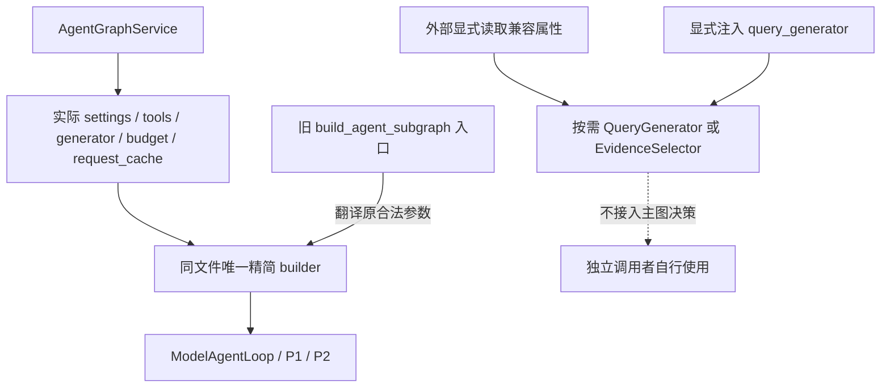

# Implementation Plan: P3 失效依赖清理

**Branch**: `codex/model-driven-agent-loop`（实际检出，未切换） | **Date**: 2026-10-22 | **Spec**: [spec.md](spec.md)

**Input**: 用户在规格报告后要求“继续”，技术规划已交付；随后明确要求“执行”，前轮按首个未完成阶段 A 实施；用户在 A 报告后要求“继续”，本轮仅 B 实施。规格的 16/16 质量门保持，只读未改。

**Implementation Status**: A / T001–T010 与 B / T011–T020 共 20 项工程完成、待用户验收。B 最终隔离后端 802 passed / 2 failed / 24 skipped / 2 deselected；前端 27 passed、noEmit 通过。两项既有提示词断言保留；24 项正式 PDF 依赖测试跳过、两项真实嵌入测试排除，未测不计通过。见 [tasks.md](tasks.md)、[A 报告](phase-a-report.md)和[B 报告](phase-b-report.md)。

## Summary

正常主图显式装配实际依赖，停止默认构造旧 QueryGenerator、rewrite cache 和 EvidenceSelector。旧 `build_agent_subgraph` 调用形状保留，在同一个 graph.py 内作为兼容适配，委托唯一的精简 builder；不新增模块或通用工厂框架。

保留 AgentGraphService 的 query_generator 构造参数与两个可读写兼容属性。默认属性仅在外部首次显式读取时创建并缓存，主图不读取；显式注入 ModelQueryGenerator 的原 budget/cache 绑定保持。删除正常图中的 procedure 无效写入/转发，保留兼容声明、独立参数及旧配置解析能力。具体约束见 [research.md](research.md)、[兼容契约](contracts/compatibility.md)与[状态模型](data-model.md)。

## Technical Context

**Language/Version**: Python 3.11+；既有 React 18/TypeScript 前端只核对消费兼容。

**Primary Dependencies**: 复用 LangGraph、Pydantic、现有 Settings/ModelCallBudget/RequestToolCache；按需属性使用普通 property、私有值和实例锁，不新增依赖。

**Storage**: 不新增数据库或持久化状态；仅将来工程证据写入当阶段隔离 output。ThreadState、正式 PDF/Qdrant 和诊断结构不迁移。

**Testing**: graph.run / 旧 builder / 独立服务 / chat SSE 行为，补构造计数、兼容属性身份及并发首次读取；使用 fake/scripted、假传输、受控时间和模型 guard。

**Target Platform**: 当前 Windows；不改变提供商或诊断发布实现。

**Project Type**: 既有 Web 后端局部整理，无新端点、服务或 UI。

**Performance Goals**: 正常图旧服务/旧专用缓存默认构造为 0；不承诺未测的启动耗时、内存节省或吞吐提升。

**Constraints**: P1 原文/Parent/批次/缓存/部分回答及 P2 共同治理、活动 lease、原绝对期限、诊断附属交付保持。模型 8/12、分支 5/4/3、请求至多 300 秒、单次默认 120 秒与配置覆盖语义保持。

**Scale/Scope**: graph 装配及 procedure 的正常图内转发；独立 query_planner/evidence/procedure/generator 能力保留。未知外部使用不推定可删除。

## Constitution Check

规划前与设计后均满足，无需例外；这些是设计门，不是产品测试。

| 原则 | 前后核对结论 |
|---|---|
| 单阶段交付 | 规划已交付；本轮仅 B 实施，A/B 分别报告暂停，不笼统全量执行 |
| 单一职责 | graph 只装配，兼容集中同文件；ModelAgentLoop、ContextAdmission、ModelCallRunner 和诊断职责不搬动 |
| 基于证据 | 删除无效关联，不恢复旧查询/自动 Parent/证据筛选；原文及来源边界保持 |
| 安全一致 | 无配置删除、数据迁移、模型切换或真实数据操作，原失败记录与私有范围不变 |
| 可观察可验证 | 构造边界、兼容形状、实际行为和全量结果分别有证据，不以静态无引用或勾选替代验收 |

## Project Structure

### Documentation (this feature)

```text
specs/012-inactive-dependencies/
  spec.md
  scope-and-evidence.md
  checklists/requirements.md
  plan.md
  research.md
  data-model.md
  contracts/compatibility.md
  quickstart.md
  phase-spec-20261022-report.md
  phase-plan-20261022-report.md
  tasks.md
  phase-a-report.md
  phase-b-report.md
```

tasks.md 已按项目 speckit-tasks 生成 20 项；A/B 各 10 项工程完成，勾选不等于用户验收。

### Source Code (repository root)

以下是整个 P3 的实施位置；A 修改 graph.py 并新增两个 unit 测试文件，B 仅删除 nodes/edges 的五处无效传递，其余生产位置只补兼容说明：

```text
backend/app/rag/
  graph.py                 # 精简 builder、旧 builder 适配、按需兼容属性
  nodes.py / edges.py      # 去掉正常图 procedure 写入和转发
  graph_state.py           # 只为保留的可选兼容声明补说明
  query_analysis.py        # requires_procedure 兼容说明，行为保持
  generator.py             # 两个旧关键字兼容说明，生成行为保持
backend/app/config.py      # 旧 Parent 字段仅补兼容说明，不改变解析/默认值
backend/.env.example       # 仅说明旧字段无主图作用，不变名称/值；不碰 .env
backend/tests/unit/         # 新构造/兼容用例及相关旧回归
backend/tests/contract/     # 复用 SSE 与 P1/P2 交付矩阵
docs/repository-guide.md    # 最终导航/接口说明
```

**Structure Decision**: 不新增生产模块、注册表或转发包。唯一 builder 实现在 graph.py；旧接口薄适配保留同文件，代价是一个小函数以避免扩大旧签名或创建两套图逻辑。

## 清理、保留与延期清单

| 条目 | 决策 | 验证边界 |
|---|---|---|
| E1 默认 QueryGenerator/rewrite cache | A 从正常 ctor 和子图依赖移除；兼容属性显式访问时按需创建 | fake/ollama 配置均注入 scripts，旧组件默认构造 0；analysis_cache 仍存在，不能断言所有 BoundedCache 为 0 |
| E2 默认 EvidenceSelector | A 从当前图移除，settings/cache 由实际所有者显式提供；独立属性按需保留 | 模型工具与缓存/预算对象身份保持；不能删 evidence.py/source_from_record |
| E3 旧 builder 6 个未读参数 | A 不再由正常图传递，原签名只在兼容入口保留；精简 builder 只接受五项实际依赖 | 旧合法位置/关键字调用可用，原无效参数不新增语义，正常路径不访问旧 selector |
| E4 procedure 图内转发 | B 删除 prepare→Send→agent 的固定 False/复制；TypedDict 可选字段保留并标注兼容 | Outcome 默认 False 与三字段模型 schema 保持；外部声明可接受不代表图继续生成这些内部字段 |
| E5 生成旧参数 | B 保留 procedure_required/include_fact_citations 的默认值和结果三元组，注明当前生成不使用 | 四组合、空证据、非法引文有限修复、首次候选及 provider 输入保持 |
| E5 常量/预存未用导入 | BUDGET_FALLBACK_PREFIX 与其他预存低收益残留延期；只清理本次移除关联直接造成的无效引用 | 不按单次搜索删除公开模块符号，不顺手做全仓清理 |
| E6 Parent 阈值旧配置 | B 保留字段、环境名、默认 240 和解析；只去正常图无效传递并加说明 | 改值不触发旧自动读取；当前工具 offset/max_chars、P1 准入保持 |
| 独立 query_planner/evidence/procedure/helper | 全部保留 | 旧测试/脚本调用形状、有限修复与 P2 治理保持，不恢复成主图策略 |

## 装配与兼容设计



精简 builder 已在 A 实现为同文件私有 `_build_model_subgraph(*, settings, tools, generator, budget, request_cache)`。正常图保留旧有效 settings 优先级：AnswerGenerator 使用 generator.settings，否则使用图 settings；不借 P3 统一冲突配置。共享预算/cache 使用同一对象，不新建副本。旧 builder 按原规则取得 generator/selector 的 settings、generator budget 或原预算工厂及 selector.request_cache，转给唯一实现；旧六项参数仍不驱动策略。

兼容属性只支持独立访问/赋值，主图不再从它们取得运行期设置。修改兼容 selector 的 cache 等内部属性曾可能间接影响旧图，这类隐式配置联动是本次明确解除的关系；不声称仓库外任意内部突变均逐字兼容。公开构造和方法契约按 [compatibility.md](contracts/compatibility.md)验证。

## 分阶段实施与 tasks Phase 映射

这是两阶段设计；对应 tasks 已完成，本轮执行范围仅为 B。

| 阶段 | tasks Phase | 目标/范围 | 验证与停止点 |
|---|---|---|---|
| A：主图实际依赖与兼容装配 | Phase 1 / US1 为主 | 去默认旧服务和 rewrite cache；唯一精简 builder；旧 builder、ctor 注入与按需属性保留 | 构造零次红绿、注入不执行、旧调用闭环、并发属性、单/多分支及 P1/P2 定向；phase-a-report 后暂停 |
| B：无效状态与兼容收尾 | Phase 2 / US2 与最终组合 | procedure 正常图转发移除、兼容字段/参数/配置说明；独立能力回归、完整验证及最终导航 | 四种参数组合、独立证据/脚本形状、P1/P2/SSE/隐私/期限、完整隔离后端、前端单测/noEmit；phase-b-report 后暂停 |

默认 A→B，每轮只做获准阶段。A 可独立验证，不等待 B 才证明主图不依赖旧服务；B 的最终回归以 A 结果为前置。真实复验、GitHub 操作和提交/推送均非自动后续。

## 验证与需求映射

| 需求 | 主要设计/验收 |
|---|---|
| FR-001–FR-004 / SC-001–SC-002 | 候选表、五项显式依赖、正常构造零次、共享对象和有效设置保留 |
| FR-005–FR-006 / SC-004 | 原 builder/ctor/属性读写、独立公开能力、兼容参数和配置契约 |
| FR-007–FR-008 / SC-003、SC-005 | 当前图/工具/原文/预算/租约/期限/历史/诊断行为对照与 SSE |
| FR-009–FR-012 / SC-001、SC-005–SC-006 | 阶段基线、guard、原失败保留、逐项交付报告和最终静态审计 |

命令、场景和对照方法见 [quickstart.md](quickstart.md)。P2 的 797/2/2 只是历史起点；未来两项旧措辞失败继续明示，不删改来达标。

## 风险与限制

按需属性需区分未初始化与用户赋值 None，串行协调首次读取和赋值；访问只构造对象，不启动模型或调用 generate/select。默认 ModelQueryGenerator 保留 ctor 时捕获的 provider 引用，避免延迟读取改变原对象共享关系。

静态无调用不能排除外部使用，因此保留合法旧调用与对象访问；不能保证依赖修改兼容对象内部属性来配置主图的非文档用法。本次无性能实测，也不证明真实模型质量。发现范围外问题保存证据，不借机扩大清理。

## Complexity Tracking

无宪章例外。一个同文件精简 builder 加已有接口适配、两个普通按需属性及一个实例锁，是保留兼容同时移除正常图无效依赖的明确代价；不引入新生产模块或抽象框架。


## B 的实际验证边界

B 发现旧回归除两项真实嵌入外，还依赖正式 PDF：23 个可选事实溯源参数化用例及 1 个候选题集溯源校验。模型保护之外增加 Python I/O 与原生 PDF 打开保护，并在测试 setup 显式跳过这 24 项；没有把它们算通过，也未放宽正式数据边界。原可选 parents.json 本地核对被屏蔽。首个完整轮保留 802/3/23/2（第三项为保护拒绝导致），最终保护轮为 802/2/24/2；两项失败均为既有提示词措辞。完整命令、保护演进、首轮中止和限制见 B 报告。

无生产/测试代码在最终完整轮开始后继续修改；源文件与原失败逐字节/AST 核对。无真实模型质量或性能实测。P3 工程交付已完成，不自动开展真实复验、GitHub 写入或后续架构阶段。
