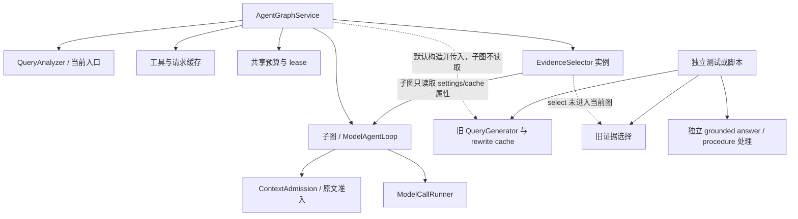

# P3 范围与静态代码证据

日期：2026-10-22。只读静态核对；没有导入应用、运行测试或调用模型。本稿是候选清单，不是删除清单或实施方案。

## 路线来源与当前起点

原路线将 P3 定义为“失效依赖清理”，见 [P1 排除项](../010-context-admission/spec.md#out-of-scope)和[P2 排除项](../011-model-call-governance/spec.md)。P2 [D 报告](../011-model-call-governance/phase-d-report.md)已交付：39/39 工程任务，完整后端 797 passed / 2 failed / 2 deselected；本轮不重跑、不重判。

当前主图已经由模型控制工具决策，证据容量由 ContextAdmission 处理，模型执行由 ModelCallRunner 治理；P3 不应通过恢复旧改写、自动 Parent 加载或旧证据筛选来消除无效参数。

## 当前依赖关系

虚线只表示当前主图未执行相应策略，不表示模块没有其他使用者；设置与缓存的实线仍有效。

## 候选与保留边界

| 条目 | 实际证据 | 影响与优先级 | 本规格边界 |
|---|---|---|---|
| E1 旧改写的主图装配 | [graph.py](../../backend/app/rag/graph.py#L111)创建 rewrite cache，113–120 构造默认 QueryGenerator，125–127 注入 budget/cache，142 传入子图；子图函数体没有读取 query_generator | 高：读者容易误判当前图仍按旧候选策略改写；存在非必要装配和专用缓存创建。未测启动耗时，不声称它已额外调用模型 | 优先核对解除主图无效关联；保留 [query_planner.py](../../backend/app/rag/query_planner.py) 独立接口和 P2 治理，不将其接回图 |
| E2 旧 EvidenceSelector 作为属性载体 | [graph.py](../../backend/app/rag/graph.py#L131)创建对象，子图仅在 43/47 行读取 settings/request_cache；[nodes.py](../../backend/app/rag/nodes.py#L21)创建 ModelAgentLoop，不调用 select | 高：业务策略依赖与必要基础依赖混在一起。对象仍被读取，不能简单称为完全未用 | 后续方案需保留必要设置/cache，解除旧策略装配；不删除整个 evidence.py |
| E3 子图未读取的参数 | [graph.py](../../backend/app/rag/graph.py#L36)函数体 AST 未读取 context_builder、retrieval_top_k、max_tool_calls、max_iterations、parent_threshold_chars、query_generator，共 6 项 | 高：装配签名暗示参数参与执行，实际限制从 Settings 及当前工具/循环取得 | 只核对重复装配关系；[tools.py](../../backend/app/rag/tools.py#L87)的检索 top_k、[agent_loop.py](../../backend/app/rag/agent_loop.py#L255)的迭代及共享预算工具限额仍活动，不得误删 |
| E4 procedure 状态传递 | [nodes.py](../../backend/app/rag/nodes.py#L81)固定写 False；[edges.py](../../backend/app/rag/edges.py#L26)转发，nodes 96–97 继续复制；ModelAgentLoop 无这两个字段的读取 | 中：当前主图的旧状态传递候选，不代表全部 procedure 能力无效 | 先核对状态/序列化/脚本；[query_analysis.py](../../backend/app/rag/query_analysis.py#L97)的 requires_procedure 是兼容字段且有断言，不自动删除 |
| E5 独立生成的兼容参数和局部残留 | [generator.py](../../backend/app/rag/generator.py#L104)的 procedure_required、include_fact_citations 未在函数体读取；BUDGET_FALLBACK_PREFIX 仅定义，部分导入待核对 | 中/低：可明确兼容语义或整理局部残留；不是恢复旧流程生成的理由 | 现有 [test_v3_7_procedure_evidence.py](../../backend/tests/unit/test_v3_7_procedure_evidence.py)和[replay_v3_6_q3.py](../../backend/scripts/replay_v3_6_q3.py#L71)仍传入参数；默认保留调用形状，局部删除需逐项证明 |
| E6 Parent 旧阈值配置 | [config.py](../../backend/app/config.py#L66)与[.env.example](../../backend/.env.example#L43)仍暴露 agent_parent_threshold_chars，但图只把它传给未读取的子图参数 | 中：配置兼容与真实执行含义需说明；不能声称它仍决定当前模型读取 Parent | 本轮不删除配置或改 .env。后续技术方案明确兼容策略；不改变当前工具参数及 Parent 实读准入 |

### 必须保留或不能按整模块移除的能力

- **query_planner 独立能力**：test_query_planner、P2 consumer/cost 测试仍验证候选、去重、缓存和预算；图级测试仍传入兼容 query_generator。未进入主图不构成删除依据。
- **evidence.py 当前能力**：[source_from_record](../../backend/app/rag/evidence.py#L79)仍被 agent_loop 和 nodes 调用；EvidenceSelector.select、find_numeric_conflict/format_conflict_answer 有独立测试。不得整文件删除或将旧筛选恢复为主图规则。
- **procedure_evidence 独立能力**：evidence.py 调用 read_saved_markdown/recover_paragraphs，独立回归直接使用 recover_paragraphs。不能把主图 procedure 标志失效推断成模块完全无人使用。
- **context_compression 当前能力**：虽然文件名沿用旧名，[estimate_tokens 与 dynamic_token_threshold](../../backend/app/rag/context_compression.py)是 P1/P2 活动计量逻辑；不按旧“压缩”命名删除。
- **生成/模型提供商公开能力**：普通生成、grounded helper、complete-only 注入和低层假传输测试是 P2 保留范围；不在 P3 用删接口换取较短调用链。

## 证据方法与限制

原始引用扫描、源码 hash 和 AST 结果存于 [output/cleanup012/spec-20261022](../../output/cleanup012/spec-20261022)。[静态参数审计](../../output/cleanup012/spec-20261022/static-parameter-audit.json)只计算函数体内的 Name/Load，不把注解引用当运行使用，未导入任何应用；它不能识别仓库外消费者或证明可以破坏兼容。

本轮保存并核对 200 个 backend/app、tests、scripts 和 frontend/src 源码 hash，生产/测试源码未改；没有测量初始化性能，没有构造真实服务或故障注入。技术方案应根据这些证据确定最终清理条目、兼容承诺、隔离测试和分阶段边界，不按扫描结果直接执行删除。
