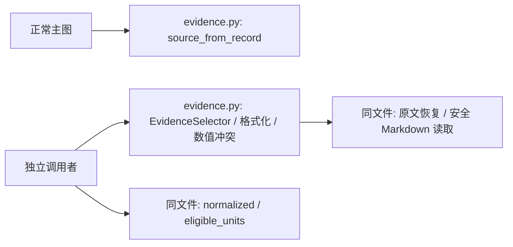

# 第一组证据能力合并：阶段 A 报告

2026-10-22。用户已选择第一组、接受移除旧模块入口，并明确要求直接执行计划。本轮完成必要 Spec Kit 产物和唯一实施阶段 A；没有开展另外两组合并。

## 结果与文件

- `backend/app/rag/procedure_evidence.py` 已删除，不保留兼容转发；全部五函数、四常量原样移至 [evidence.py](../../backend/app/rag/evidence.py)。rag Python 源文件 **29→28**。
- [test_v3_7_procedure_evidence.py](../../backend/tests/unit/test_v3_7_procedure_evidence.py) 导入迁至 app.rag.evidence；新增 14 个参数化用例，覆盖安全读取、错误与完整单元筛选。
- normalized、_matching_section、recover_paragraphs、read_saved_markdown、eligible_units 均保留；既有 evidence 函数/类及全部旧测试定义 AST 一致。局部 normalized 变量未改名。
- 正常图不恢复旧 procedure 分类或 EvidenceSelector.select。P1/P2、提示、工具、预算、SSE、前端、依赖、配置保持本轮前源码；未重启现有服务。
- 生成 [规格](spec.md)、[计划](plan.md)、[任务](tasks.md)、research/data-model/quickstart、兼容契约与 requirements。功能导航指向 013；012 原计划、报告和失败不覆盖。

## 结构与兼容

旧 app.rag.procedure_evidence 导入路径失效，用户已明确接受。仓库内 app/tests/scripts 的直接导入已迁移并经 AST 扫描确认为零；仓库外调用者需改为 app.rag.evidence。没有删除独立能力、增加新抽象或声称性能提升。

## 实际验证与原始证据

根目录使用 `D:/newsoft/python.exe`；测试子进程 cwd 为 backend。运行器完整 argv/cwd/exit 见各 JSON 与 [命令汇总](../../output/merge013/phase-a/actual-commands.md)。全部在独立 output/bootstrap/basetemp 中运行，禁止 dotenv、真实 Dense、普通网络连接、正式数据 I/O 与原生 PDF 打开；Windows 内部 socketpair 仅允许创建事件循环唤醒通道。

| 实际根目录命令 | 结果 | 退出码 | 原始证据 |
|---|---|---|---|
| setup-plan.ps1 -Json | 生成计划模板，功能目录 013；非分支切换 | 0 | plan.md 与实际分支核对 |
| setup-tasks.ps1 -Json | 解析 013 文档和模板 | 0 | tasks.md |
| check-prerequisites.ps1 -Json -RequireTasks -IncludeTasks | 013 前置产物齐全 | 0 | spec/plan/tasks/design 文档 |
| python output/merge013/phase-a/run.py guard-proof | 6 passed，0.17s | 0 | [log](../../output/merge013/phase-a/guard-proof.log) / [JSON](../../output/merge013/phase-a/guard-proof.json) |
| python output/merge013/phase-a/run.py before | 合并前 55 passed，6.04s | 0 | [log](../../output/merge013/phase-a/before.log) / [JSON](../../output/merge013/phase-a/before.json) |
| python output/merge013/phase-a/run.py after | 合并后 69 passed，6.92s | 0 | [log](../../output/merge013/phase-a/after.log) / [JSON](../../output/merge013/phase-a/after.json) |
| python output/merge013/phase-a/run.py related | 调用链 41 passed，9.55s | 0 | [log](../../output/merge013/phase-a/related.log) / [JSON](../../output/merge013/phase-a/related.json) |
| python output/merge013/phase-a/audit.py | 八项保留/范围审计通过，两份改动 Python 可编译 | 0 | [audit.json](../../output/merge013/phase-a/audit.json) |
| git diff --check -- backend/app/rag/evidence.py backend/tests/unit/test_v3_7_procedure_evidence.py | 无空白错误 | 0 | 限定本轮相关文件 |

合并后两组共 **110 passed**；合并前 55 和保护自检 6 单列，不累计重复通过数。69 包括原有 55 与新增 14。主集合覆盖 procedure/evidence、八职责架构、P3 默认无效依赖/独立兼容；间接集合覆盖 graph、pipeline、query_planner、Q3 合成回归、grounding 与 chat SSE。

新增读取用例覆盖合法同目录、缺失、跨目录、错误 document_id、超过 10 MiB、非法 UTF-8、OSError、两个空路径；筛选用例覆盖规范化原文、False/非 bool 完整标志及缺少正文/提示内容。没有新增业务规则。

before/after/related 的保护日志均无被拒绝的模型、网络或实际正式数据 I/O 尝试；仅屏蔽了环境探测路径和 related 中可选的 backend/data/parents.json 可用性探测，未打开正式文件。[前](../../output/merge013/phase-a/before-guard.json)、[后](../../output/merge013/phase-a/after-guard.json)、[间接](../../output/merge013/phase-a/related-guard.json)。保护自检故意触发拒绝单列，不是产品测试访问。

## 范围审计与需求核对

[原始源码基线](../../output/merge013/phase-a/baseline.json) 覆盖 202 份 app/tests/scripts/frontend 源文件；仅预期的两个修改和一个删除。旧模块原文件为未跟踪文件，故另行保存 [完整本轮差异](../../output/merge013/phase-a/phase-a.diff) 和 before 副本，不依赖普通 git diff 展示删除。全部原 evidence 定义和搬移九个符号 AST 保持，原测试定义保持，CURRENT_FAILURES.md 字节保持。

| 需求 | 验证 |
|---|---|
| FR-001 / SC-002 | 五函数四常量和 evidence 原定义 AST 保持，55 项旧集合继续通过 |
| FR-002 / SC-001 | 旧文件删除、无转发、旧直接导入零，29→28 |
| FR-003 | 独立兼容、主图及相关调用回归通过，图源码保持 |
| FR-004 | manifest 限定三处源码变化，无其他候选或协议改动 |
| FR-005 / SC-003–004 | 110 项隔离工程检查与保护证据，无真实模型调用 |
| FR-006 | 7/7 任务完成、原失败字节保持、报告/命令/限制齐全 |

requirements 为 16/16，实施时未修改标记；无嵌套 AGENTS，ignore 已覆盖 output/配置/依赖/缓存，不改 ignore。`.specify/extensions.yml` 不存在，specify/plan/tasks/implement 无可运行前后 hooks。没有创建/切换 Git 分支、提交、推送、发布 issue 或 PR。

## 失败、限制与停止点

本次所选测试无失败、无跳过；没有运行完整后端或前端，不把定向通过称为全量通过。012 原有两项提示措辞失败本轮未运行/修复，CURRENT_FAILURES 真实失败保持。本轮无真实模型、真实嵌入、正式 PDF/索引操作，不证明真实问答质量或性能。

现有服务未重启，没有重新进行启动/真实问答验证，运行实例不作为新代码已重新加载的证据。另两组合并、原引文问题和历史失败修复均不在本阶段内。若后续需要继续，范围须由用户另行指定。

**阶段 A 工程检查通过，待用户验收。报告后暂停，等待用户验收。**
