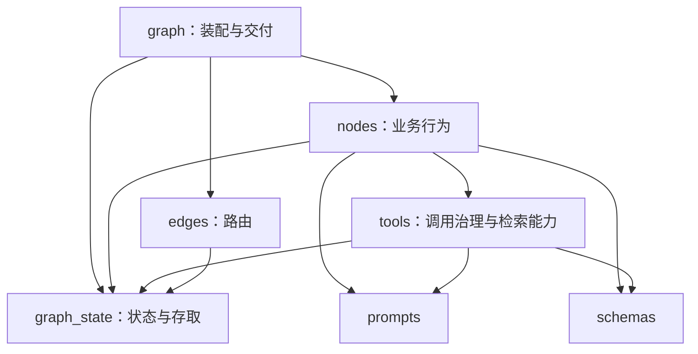

# RAG 八文件收敛：阶段 A 报告

2026-10-22。用户再次明确最终目标为截图八个实际源文件，并要求“继续”。本轮补齐 Spec Kit 规格/计划/任务，完成唯一交付阶段 A。当前工程完成、待用户验收。

## 实际结果

`backend/app/rag/` 从 **28→8** 个 Python 源文件；20 个旧模块删除，无 forwarding 文件、动态 sys.modules 旧模块别名或额外 helper 实现包。

| 实际文件 | 行数 | 职责 |
|---|---|---|
| __init__.py | 1 | 轻量包说明 |
| edges.py | 28 | 路由 |
| graph.py | 709 | 图装配、AgentGraphService 与 RagPipeline 请求交付 |
| graph_state.py | 408 | 图/会话状态、PreparedQuery、内存原子存取 |
| nodes.py | 1376 | 分析、摘要、模型循环、证据、生成、核验、独立查询及节点函数 |
| prompts.py | 194 | 生产提示唯一来源，字节保持 |
| schemas.py | 217 | 模型输出、工具输入、纯调用记录与结果 |
| tools.py | 1840 | 提供商/调用治理、预算、准入、计量、编码、索引、检索与工具 |

现有职责仍通过独立类和函数维护，文件少不等于实现复杂度消失。tools/nodes 较大是八文件布局的明确代价，不声称性能、内存或真实质量提升。

## 改动范围与兼容

161 个原顶层符号都有去向，见 [完整迁移表](contracts/import-migration.md)及 [机器记录](../../output/eight014/phase-a/symbol-map.json)。五份目标模块合并实现；edges/prompts/__init__ 保持原内容。74 份调用文件完成导入/patch 定位迁移，非 rag 生产文件仅 main.py 的导入改变。入口采集脚本另同步源码指纹文件路径。

主图/独立能力均保留，未恢复旧 procedure 路径。P1 原文准入、Parent 实读、批次/cache，P2 共同调用、预算/lease/期限、迟到隔离、历史及诊断仍由原类实现；未新增依赖、功能、配置或前端改动。

旧模块路径直接移除，仓库外调用者按表迁移；没有以转发文件保留文件数量。采集器使用 nodes/schemas/tools/prompts 和自身源码指纹；历史采集文件不改，新布局不能混用旧冻结批次，仍由 continuation_code_mismatch 拒绝。

## 实际验证

根目录启动运行器，Python 为 D:/newsoft/python.exe，pytest 子进程 cwd=backend。完整 argv/cwd/exit/hash 见 [命令记录](../../output/eight014/phase-a/actual-commands.md)。每轮独立标签、bootstrap/basetemp/log/JSON，不覆盖失败。真实模型/网络/正式数据被 guard 拒绝，dotenv 禁用，仅允许 Windows 内部 socketpair 创建事件循环唤醒通道。

| 根目录实际命令 | 结果 | 子进程退出码 | 原始记录 |
|---|---|---|---|
| setup-plan.ps1 -Json / setup-tasks.ps1 -Json / check-prerequisites.ps1 -Json -RequireSpec -RequireTasks -IncludeTasks | 014 设计产物齐全；未切换 Git 分支 | 0 | spec/plan/tasks/design |
| python output/eight014/phase-a/run.py before-full | 2 failed, 816 passed, 24 skipped, 2 deselected in 211.00s (0:03:31) | 1，仅原两项失败 | [log](../../output/eight014/phase-a/before-full.log) |
| run.py import-smoke tests/unit/test_rag_architecture.py | 3 passed，0.17s | 0 | [log](../../output/eight014/phase-a/import-smoke.log) |
| run.py focused（12 个定向测试文件） | 150 passed，83.18s | 0 | [log](../../output/eight014/phase-a/focused.log) |
| run.py after-full | 25 failed, 794 passed, 24 skipped, 2 deselected in 210.89s (0:03:30) | 1，包含迁移遗漏 | [原始 log](../../output/eight014/phase-a/after-full.log) |
| run.py migration-fixes（采集器与多分支 SSE） | 35 passed，7.86s | 0 | [log](../../output/eight014/phase-a/migration-fixes.log) |
| run.py guard-proof（误用根目录相对路径） | file not found；未运行测试 | 4 | [log](../../output/eight014/phase-a/guard-proof.log) / [JSON](../../output/eight014/phase-a/guard-proof.json) |
| run.py guard-proof-absolute（绝对路径） | 6 passed，0.18s | 0 | [log](../../output/eight014/phase-a/guard-proof-absolute.log) |
| python output/eight014/phase-a/run.py final-full | 2 failed, 817 passed, 24 skipped, 2 deselected in 227.81s (0:03:47) | 1，仅原两项失败 | [log](../../output/eight014/phase-a/final-full.log) |
| python output/eight014/phase-a/audit.py final | 八项范围/保留审计通过，全部当前 app/tests/scripts Python 编译通过 | 0 | [audit-final.json](../../output/eight014/phase-a/audit-final.json) |
| git diff --check -- backend/app/rag backend/app/main.py backend/tests backend/scripts README.md docs/repository-guide.md | 无空白错误，既有 CRLF 提示单列 | 0 | 受影响范围检查 |

不同轮有重叠，不累计通过数。最终完整轮覆盖 unit/contract/integration/security，包括图、状态、提示绑定、提供商、schema/格式回退、额度/租约、期限、原文/批次/Parent、混合检索/索引、会话、摘要、首答保护、采集续测、SSE 与隐私。新结构检查要求精确八文件（含递归源文件）及静态依赖无环；原业务断言保留。

## 初轮遗漏及修正

第一次合并后完整轮保留了 25 个失败：两项原失败，加 22 项采集器检查和一个 timeout 契约检查。采集器清单仍读已删除的 query_analysis/model_provider/cost_control 文件，随后改为实际 canonical 文件并合并重复 tools 指纹项；对应“代码变化拒绝续测”探针跟随 nodes.py。没有放宽续测校验或修改旧批次。

timeout 测试原仅替换 cost_control.time，合并后 tools.time 同时供调用记录计时。其只有 monotonic 的模拟对象缺少 perf_counter_ns，导致发送前失败、用量为零。给模拟时钟补原 perf_counter_ns，保持原超时注入时机、用量/SSE/私有边界断言；生产算法未改。35 项定向通过后才启动 final-full，原 25 失败日志保留。

保护自检首条命令把 root 相对路径交给 cwd=backend 的 pytest，未收集测试；改为绝对路径新标签通过。原命令、退出 4 与零运行记录保留，不冒充红测。

## 保留与差异审计

201 份源码基线及 before 副本、Git status/完整 diff 保存在 output；当前源文件改动/删除共 99 处，主要为导入迁移。全部 161 个原符号/方法 AST 在去除已迁移 import 后保持，无算法差异。调用文件除导入/patch 路径外，只允许上述源码指纹路径和模拟时钟接口补齐；审计逐条列明，未弱化断言。

生产 prompts 字节、前端源文件 hash、CURRENT_FAILURES.md 字节保持。没有新增生产模块，非 rag 生产改动仅 main 导入；无依赖升级、模型设置改变或正式索引重建。[最终差异](../../output/eight014/phase-a/phase-a-final.diff)、[最终审计](../../output/eight014/phase-a/audit-final.json)、[前后失败对照](../../output/eight014/phase-a/comparison.json)。

根 instructions/README/宪章、当前功能与原失败已核对；按项目 specify/plan/tasks/implement 流程完成，requirements 16/16 实施时只读，9/9 工程任务完成。无嵌套指令，无 extensions.yml hooks；ignore 覆盖 output/环境/缓存，未修改。实际分支仍 codex/model-driven-agent-loop；setup-plan 输出目录回退值不代表切换。

## 失败与未测范围

最终两项失败与合并前完全相同：test_stage_c_prompt_explains_shared_dependencies_comparison_and_capacity 要求“共享型号、电压、持续时间”；test_context_prompt_limits_history_and_preserves_unconfirmed_conditions 要求“只使用必要历史”。提示及断言均保留，未修复或改判原真实质量。

24 项正式 PDF 溯源检查仍跳过（23 个可选事实参数项及 1 个候选溯源校验），两项真实 Dense 检查仍排除，均不算通过。前后 skip 集合一致。产品轮 blocked_attempts 为空，只有被屏蔽的正式数据可用性探测，未读取正式 PDF/索引/.env；保护自检的故意拒绝另列。[最终 guard](../../output/eight014/phase-a/final-full-guard.json)、[自检 guard](../../output/eight014/phase-a/guard-proof-absolute-guard.json)。

未运行真实模型或真实嵌入，没有真实问答/性能验收。前端源码未改，不重跑前端或构建。现有服务未重启，运行实例不作为新代码重新加载证明。无提交、推送、合并或发布。

## 需求核对与停止点

FR-001/002、SC-001：精确八文件、旧运行导入零、迁移清单；FR-003、SC-002：161 符号及算法保持；FR-004/005：完整工程回归、提示/前端 hash 与业务断言；FR-006、SC-003/004：最终仅原两失败、24+2 未测及 guard；FR-007：产物、命令、历史与报告齐全。后续真实启动/问答或大型文件的进一步设计均需用户指定，本轮不继续。

**阶段 A 工程完成，未新增最终产品失败，待用户验收。报告后暂停，等待用户验收。**
