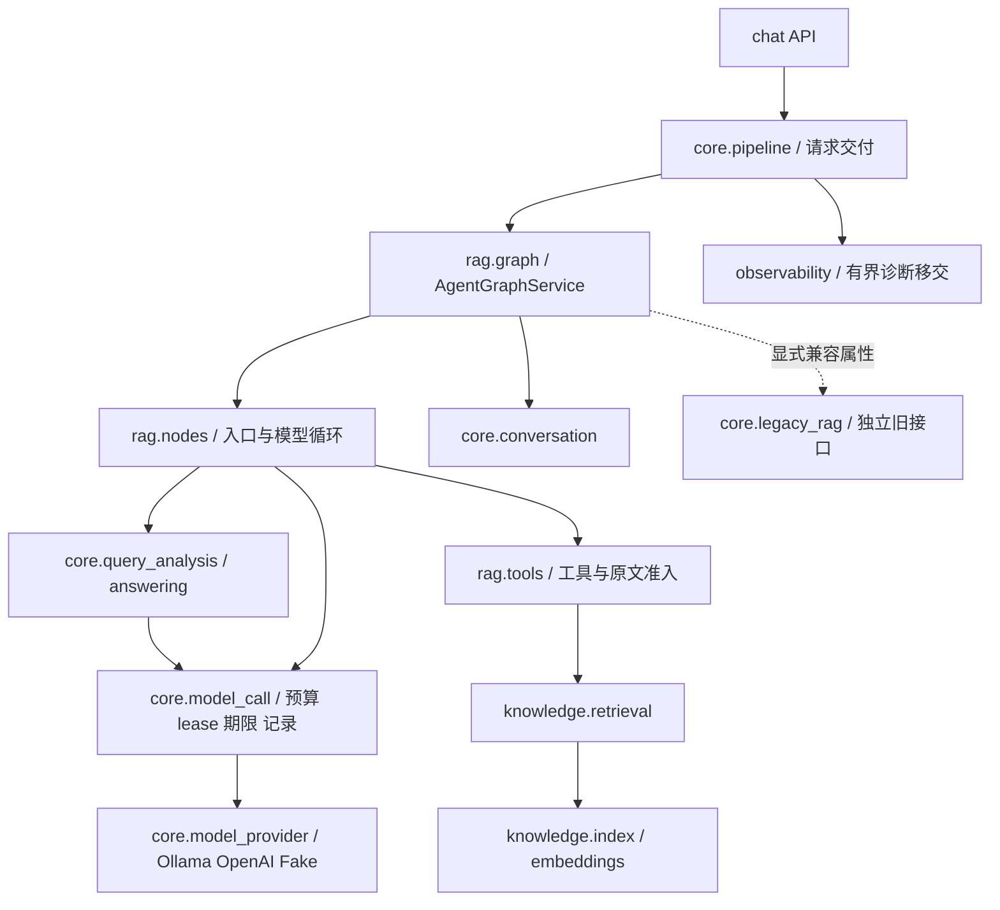

# 015 阶段 A：Agent 核心与基础能力归属

日期：2026-10-22。用户“继续”授权本阶段职责迁移、必要调用适配、隔离验证与报告。A 工程完成，待用户验收；B 未执行。分支保持 codex/model-driven-agent-loop，没有提交、推送或服务重启。

## 实际结果

`rag/` 仍是八个实际 Agent 核心文件；模型循环、节点和工具准入真实位于其中。模型提供商、共同调用、知识存取与会话/交付各有明确模块，没有转发文件或动态模块别名。

| 文件 | 迁移前行数 | 当前行数 | 当前职责 |
|---|---:|---:|---|
| rag/tools.py | 1840 | 285 | 工具适配、原文准入、请求单飞缓存 |
| rag/nodes.py | 1376 | 548 | 模型循环、会话摘要与实际节点 |
| rag/graph.py | 709 | 277 | 图装配和执行服务 |
| rag/graph_state.py | 408 | 219 | 图状态、Evidence、图结果 |
| rag/schemas.py | 217 | 110 | Agent 输出和工具输入 |
| rag/prompts.py | 194 | 194 | 生产提示唯一来源，字节保持 |

八个核心文件加七个 core 实现及轻量 core/__init__、三个 knowledge 实现，共 19 个相关文件。相关总行数从 4773 变为 4801（import/模块说明调整）；全部 161 项定义 AST 相同，没有功能或算法削减。A 修复职责，B 才审查真正减码。完整规模见 [实际行数](../../output/clarity015/phase-a/related-lines.json)。

```text
backend/app/
  rag/        __init__, edges, graph, graph_state, nodes, prompts, schemas, tools
  core/       __init__, model_provider, model_call, query_analysis,
              answering, conversation, pipeline, legacy_rag
  knowledge/  embeddings, index, retrieval + 原有 PDF/分块/文档生命周期模块
```



该图展示主要职责调用；完整静态依赖见 [应用导入图](../../output/clarity015/phase-a/final-static-audit-dependencies.json)。唯一提示仍在 rag/prompts；core.__init__ 只有说明，不自动装配全应用。

## 改动与保留

- [完整归属表](symbol-ownership.md)的 161 项能力全部保留；provider 的 Token 估算、answering 的解析/引文格式化、retrieval 的查询规范化消除了设计阶段指出的回边。
- [main.py](../../backend/app/main.py)、脚本和测试迁移到实际模块；保留原合法参数、结果、P1/P2、共享预算/lease、绝对期限、迟到隔离、原文/来源、会话、SSE 和诊断逻辑。
- 采集器两处源码冻结清单覆盖实际 query_analysis/conversation/model_call/model_provider/schema/prompt；旧清单缺少新文件时仍在任何调用及输出创建前拒绝续跑。新增拒绝用例，原批次不改。
- 结构守护检查八个真实核心文件、支持实现唯一归属、全应用静态无环及提示唯一来源。模块 patch、提示绑定与时钟替身适配实际归属，没有修改原失败断言。
- README、仓库导航和当前状态更新；[设计报告](phase-plan-report.md)、014 及更早报告、CURRENT_FAILURES 保持。提示、非敏感配置/依赖和前端源码哈希保持；原 backend/.env 未读取或覆盖。

## 实际验证与命令

工作目录为仓库根 C:/path/agentic-rag；Python 为 D:/newsoft/python.exe。运行器的 pytest 子进程工作目录为 backend，完整 argv、退出码、guard 哈希分别保存在同名 JSON。

| 实际命令（Python 命令前均为 `& D:/newsoft/python.exe`） | 退出码 | 结果 |
|---|---:|---|
| .specify/scripts/powershell/setup-tasks.ps1 -Json | 0 | 生成任务上下文；共25项，A20/B5 |
| .specify/scripts/powershell/check-prerequisites.ps1 -Json -RequireTasks -IncludeTasks | 0 | 指向015；需求检查表只读16/16，无extension hooks |
| output/clarity015/phase-a/setup.py | 0 | 181源码与设计基线一致，418份文件快照、Git diff与未跟踪清单 |
| output/clarity015/phase-a/run.py before-full | 1 | 817 passed / 2 failed / 24 skipped / 2 deselected |
| output/clarity015/phase-a/run.py before-ownership（两项职责守护） | 1 | 2 failed，按预期暴露核心中的基础实现 |
| output/clarity015/phase-a/relocate.py | 0 | 161定义迁移；生成17模块并迁移76调用文件 |
| output/clarity015/phase-a/group_imports.py | 0 | 对35份已迁移文件合并同源导入，不改业务 |
| output/clarity015/phase-a/run.py after-focused（7份测试文件） | 0 | 96 passed，26.06 s |
| output/clarity015/phase-a/run.py after-guard-proof C:/path/agentic-rag/output/clarity015/phase-a/test_guard_proof.py | 0 | 6 passed；7次故意禁止操作均在真正访问前拒绝 |
| output/clarity015/phase-a/run.py after-imports C:/path/agentic-rag/output/clarity015/phase-a/test_imports.py | 0 | 1 passed，遍历71个应用/脚本模块 |
| output/clarity015/phase-a/run.py after-full | 1 | 820 passed / 2 failed / 24 skipped / 2 deselected |
| output/clarity015/phase-a/audit.py final-static-audit | 0 | 161定义AST相同、144调用文件逻辑相同、51模块无环、244份受保护文件哈希保持 |
| output/clarity015/phase-a/finish.py（首次收尾） | 1 | 清单计数误包含格式示例，保存报告前中断；改为只计任务行，未改产品代码 |
| output/clarity015/phase-a/finish.py（修正收尾） | 0 | 验证哈希/保护/任务状态与文档链接后保存报告并暂停 |

原始 [迁移前完整日志](../../output/clarity015/phase-a/before-full.log)、[迁移后完整日志](../../output/clarity015/phase-a/after-full.log)、[定向日志](../../output/clarity015/phase-a/after-focused.log)、[静态审计](../../output/clarity015/phase-a/final-static-audit.json)及 [before/after](../../output/clarity015/phase-a/) 独立保存，不覆盖失败。源码搜索遇到旧 pytest 临时目录访问拒绝，随后限定实际受影响的 app/tests/scripts/015 目录补查，没有清理或改动这些目录。

收尾脚本第一次计数错误记录见 [原始错误](../../output/clarity015/phase-a/finish-first-error.log)；修正仅涉及报告生成工具，未重跑或改写测试成绩。

两项完整回归的既有失败相同：

1. `tests/unit/test_query_rewrite_v1.py::test_stage_c_prompt_explains_shared_dependencies_comparison_and_capacity`：要求旧措辞“共享型号、电压、持续时间”。
2. `tests/unit/test_v4_query_analysis.py::test_context_prompt_limits_history_and_preserves_unconfirmed_conditions`：要求旧措辞“只使用必要历史”。

通过数增加3，来自两项新增职责守护和一项缺少 core 指纹的拒绝用例。无新增产品失败；测试套件仍有上述两项失败，不能写成全部通过。三份有意改变的调用文件（架构守护、采集器及其测试）完整差异保存在 output 中；其他144份调用文件去除导入并规范路径后 AST 相同。

## 隔离、失败与限制

使用 fake/scripted provider、deterministic embedding、独立 DATA_DIR/pytest basetemp 和测试 Qdrant；禁用 dotenv。保护仍禁止真实 Dense、普通 socket 连接、正式目录读写及原生 PDF 打开，仅放行 Windows asyncio 内部 socketpair。[最终保护源码](../../output/clarity015/phase-a/after-guard-source.py)与迁移前相比只有 EmbeddingService 导入位置不同；保护证明的7次预期拒绝与普通回归中的零越界记录分开。

迁移前/后完整、定向、模块导入的 guard 记录均无禁止操作尝试。24项正式PDF出处测试跳过，2项真实Dense测试排除；未运行真实模型、真实语义检索、真实平台问答或正式题集。原005/006真实质量失败与最近启动测试的引用限制未改判。本阶段没有启动/停止服务，现有进程未重新加载验证，不以隔离测试宣称当前运行进程已使用新代码。

## 任务状态与下一步

[tasks.md](tasks.md) 的 A / T001–T020 工程完成，待用户验收；B / T021–T025 未执行。下一阶段仅在验收并明确指示后，逐项验证单节点调用壳、事件投影和现有 SDK 复用；不自动删除独立旧接口或切换模型/依赖。

**报告后暂停，等待用户验收。**
