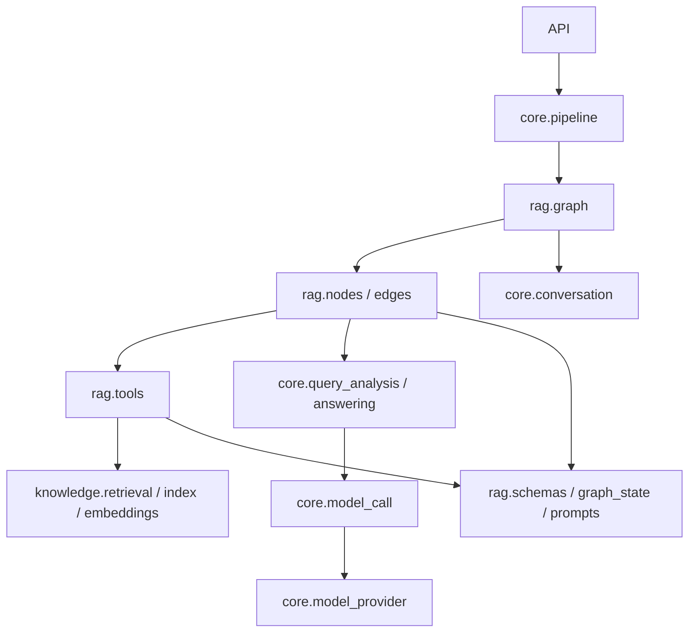

# Implementation Plan: 清楚的 Agent 核心与基础能力归属

**Date**: 2026-10-22 | **Spec**: [spec.md](spec.md)
**Status**: A 工程完成，待用户验收；完整隔离回归无新增产品失败，原两项提示断言保留；B 未执行。
**Branch**: 实际检出 codex/model-driven-agent-loop，未创建/切换。

## Summary

按参考项目的职责分布纠正 014 的过度归并。rag 保留八个 Agent 核心文件；core 提供清楚命名的应用/模型能力，knowledge 承担编码和索引。现有类仍可独立测试，所有 161 个符号有唯一实现归属，不建转发模块。A 只修复职责，B 才验证真正减码。

## Technical Context

**Language/Version**: 既有 Python 3.11+，当前环境 3.12。
**Primary Dependencies**: 原 FastAPI/LangGraph/Pydantic/Qdrant/fastembed/模型 SDK，不增加或升级。
**Storage**: 无正式数据、索引或会话持久化迁移。
**Testing**: static AST/import/hash + fake/scripted/临时数据下完整后端回归。
**Target Platform**: 当前 Windows，保护 socketpair 与模型/正式数据边界。
**Project Type**: 内部职责调整，无产品功能改变。
**Performance Goals**: 不承诺性能或总行数下降；核心 tools 约 250–300、nodes 约 500–650 行为静态估算。
**Constraints**: 不改原提示/模型/预算/协议；保留独立兼容能力和所有失败记录。
**Scale/Scope**: 八个核心文件 + 七个明确职责的 core 实现 + 三个 knowledge 实现；core 的轻量 __init__ 另计，总体约 19 个相关文件，不将全后端限制为八文件。

## Constitution Check

规划前与设计后通过：单阶段交付；索引/检索/生成/治理/传输职责分离；保留基于证据回答、安全一致与可观察性。无宪章例外。

本方案重新打开 007 A3 与 014 的“全部 RAG 实现集中 rag”决定：新目标保留唯一 Agent 图/节点包，但基础实现按职责移出。014 八文件报告是历史事实，不修改为另一结论；新的职责目标需在本方案验收后生效。

## Project Structure

```text
backend/app/
  rag/                         # Agent 核心
    __init__.py
    graph.py                   # 图装配与执行入口
    nodes.py                   # 模型循环、摘要与节点业务
    edges.py                   # 路由
    graph_state.py             # Agent/Main 状态与图结果
    prompts.py                 # 生产提示唯一来源
    schemas.py                 # Agent 模型输出与工具输入
    tools.py                   # 工具适配、原文准入、请求单飞缓存
  core/
    __init__.py
    model_provider.py          # Ollama/OpenAI/Fake adapters 与协议转换
    model_call.py              # 调用输入、记录、预算/lease/期限与用量
    query_analysis.py          # 问题理解、约束保留与入口缓存
    answering.py               # 生成、逐字引用核验与答案格式化
    conversation.py            # 会话状态、PreparedQuery 与原子存取
    pipeline.py                # 请求事件交付、公开投影与诊断移交
    legacy_rag.py              # 明确保留的旧独立查询/证据能力
  knowledge/                   # 复用现有目录及文档生命周期实现
    embeddings.py              # Dense/Sparse 两个 adapter
    index.py                   # 索引清单、持久化与向量存储生命周期
    retrieval.py               # 混合检索、Parent/context 构建
    ...                        # 原 parser/chunker/manager/stores 等保持
```

这些是唯一实现位置，不在 rag 留成套 re-export/兼容实现。核心不是八个薄转发文件：模型循环、节点动作、路由、工具准入和提示仍实际位于 rag；其余模块分别提供明确 interface。

## 具体归属与静态规模

161 项符号的源位置与目标见 [完整归属表](symbol-ownership.md)和 output/clarity015/plan/proposed-symbol-map.json。按 AST 原函数/类/常量正文计量：nodes 496、tools 263、graph 229、graph_state 199；core 各模块正文约 174–475 行，knowledge 各模块 116–434 行。加 import/说明后才是实际行数，当前只是估算，不以行数阈值压缩排版。

- model provider 自含 ModelResult/PreparedAttempt；core.model_call 自含 CallSpec/CallRecord/CallOutcome，避免把通用调用记录放 Agent schemas。
- estimate_tokens 及其两个正则随 provider 的用量回退/消息计量保留；RAG 证据窗口的 dynamic_token_threshold 归 rag.tools。不能让 provider 为估算 token 反向导入 model_call。
- ConversationTurn/ThreadState/PreparedQuery/存储归 conversation；图状态不承担存储或模型摘要。
- parse_json/validate_answer/render_answer/FAILURE_TEXT 归 answering，nodes 调用它；answering 不回导 nodes。
- normalize_query 归 knowledge.retrieval，避免检索依赖旧查询生成。
- source_from_record/format_evidence_records 归 answering；旧 EvidenceSelector、恢复/数值冲突及旧 QueryGenerator 留 legacy_rag，正常图不调用它们。
- core 的 __init__ 保持轻量，不自动导入 pipeline 或整套图；TYPE_CHECKING 只用于类型，不通过动态模块别名掩盖环。

## 依赖与 seam



core 是职责目录，不是可整体反向导入的巨型 module；禁止 answering→nodes、retrieval→legacy、conversation→模型摘要这三条已知回边。索引写入/关闭与 provider 选择仍通过真实 adapter seam 测试。

## 阶段与 tasks 映射

| 阶段 | 目标与实施范围 | 需要的验收 | 报告与停止点 |
|---|---|---|---|
| A / US1 | 按归属表恢复职责；保留算法/类/独立能力；迁移 main、脚本、测试、patch 与源码指纹；更新结构守护 | 完整符号/AST、模块无环、提示/前端/历史保持；隔离完整后端无新增失败 | phase-a-report.md 后暂停 |
| B / US2 | A 验收后，审查单节点子图壳、消息/事件重复构建与 SDK 可复用点；只实现已证明等价的削减 | fake 前后对照、失败路径、调用次数/顺序、原期限与工具消息；记录实际删减量 | phase-b-report.md 后暂停 |

已按 speckit-tasks 生成 [tasks.md](tasks.md)：A 对应 Phase 1–4，20 项工程任务完成；B 对应 Phase 5–6，5 项未执行。A 实际结果见 [阶段报告](phase-a-report.md)。B 不自动删除独立接口，不承诺 ToolNode 可替代原文准入或两种模型协议；SDK 方案先以本机安装版本和假调用原型验证，不能照搬上游模型/嵌入配置。

## Validation / 需求映射

FR-001/002、SC-001：目标职责表、静态依赖与核心实现审阅；FR-003/004、SC-002/003：161 符号、前后 AST、独立和完整隔离回归；FR-005/007：提示/配置/前端 hash、最终 guard、原失败和未测单列；FR-006：调用/patch/指纹清单迁移；FR-008、SC-004：B 的逐项行为证据；FR-009、SC-005：阶段报告及停止点。

A 的本轮迁移前完整基线为 817 passed / 2 failed / 24 skipped / 2 deselected；迁移后为 820 passed / 2 failed / 24 skipped / 2 deselected，无新增产品失败。新增两项职责守护与一项旧冻结清单拒绝用例；96 项定向、6 项隔离保护证明及全部应用/脚本导入检查通过。复用最终 guard 且只迁移 EmbeddingService 导入，禁止 dotenv/真实模型/网络/正式数据；原两项提示措辞失败与未测范围保留。详见阶段 A 报告。

## Complexity Tracking

A 改善代码相邻性和 interface 归属，预计总实现量仍接近当前；B 才报告真正删减量。legacy_rag 明示为保留的独立能力，不藏入含混 helper。没有证据时不新建抽象层、卸载依赖或删接口。
