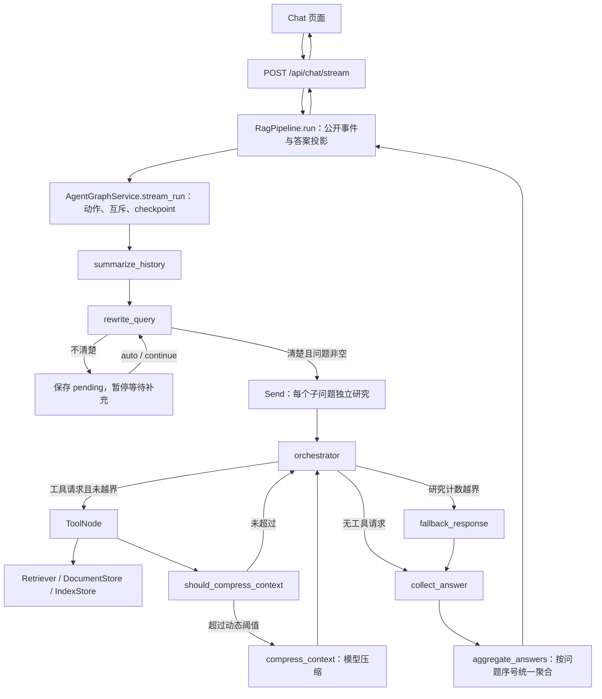

# 016 框架与调用链静态审阅

日期：2026-10-28（America/Phoenix）。用户指出目标是修改框架、随后要求“继续”，本轮承接框架代码和调用链审阅；只读产品源码、改造前快照及原计划，保存本报告。没有运行测试、模型请求、服务或修改产品代码，不新增实施阶段或任务。

**结论：框架主体已实际替换，并且接入正式聊天入口。当前代码的主图、研究子图和 checkpoint 会话与 016 设计一致；发现两项明确收尾：架构指南仍描述旧链，启动装配残留未使用对象。本轮是静态审阅，不是新的运行通过声明。报告后暂停，等待用户验收。**

## 审阅发现

### F1 / P2：架构指南仍把旧决策链描述为当前实现

位置：[docs/repository-guide.md](../../docs/repository-guide.md)第 30、34–51 行。

指南称所有模型用途都经 `ModelCallRunner.invoke`，`AgentGraphService` 使用 `_build_model_subgraph`，图为 prepare/QueryAnalyzer → ModelAgentLoop → 共享预算与截止 → 核验。与当前 `main.py` 第 49 行装配、新 `reference_session.py` 第 14/80 行和 `rag/graph.py` 第 9 行不符：正常入口实际使用原生模型、显式参考图和唯一 checkpoint，不经旧治理/核验链。

影响：该文档是根 AGENTS 明确指定的架构入口，后续维护者按它定位或修改框架时会得到错误调用关系，可能把已移出的旧机制当作当前依赖。

建议：把当前入口、职责表和图更新为本报告已核对的链；旧 `ModelCallRunner`、QueryAnalyzer 等只描述其独立 legacy 消费范围，保留历史实现和记录。此项尚未修改。

### F2 / P3：启动装配仍创建未使用的 ContextBuilder

位置：[backend/app/main.py](../../backend/app/main.py)第 14、45 行。

`build_services` 仍导入并执行 `context_builder = ContextBuilder(settings, documents)`，但新 RagPipeline/AgentGraphService 构造参数和 Services 返回字段均不使用该对象。当前 ContextBuilder 构造只保存 settings/document_store，因此未看到它导致问答行为变化；它是旧装配残留，会让读者误以为正常图还经过固定上下文构建器。

建议：在实施收尾时仅移除这里的闲置导入/实例化，保持 `knowledge/retrieval.py` 的 ContextBuilder 类及独立 legacy 消费方。此项尚未修改，不应通过删除整个兼容实现处理。

## 当前正式调用链

图对应当前源码装配，不代表本轮重新运行了这些路径。模型工厂、工具 Adapter 与被动观测由外围 Module 提供，图的业务路由集中在 rag；不通过日志或 UI 决定下一步模型行为。

## 文件与职责对应

本次使用 codebase-design 技能，以 Module（模块）的 Interface（调用接口及使用约束）、Implementation（实现）和 Seam（可替换位置）核对职责，不用减少行数推断架构改进。

| Module / 位置 | Interface 与职责 | 当前可确认的实现 |
|---|---|---|
| [main.py](../../backend/app/main.py) 第 34–59 行 | 统一装配依赖 | 构造知识基础设施、模型/会话图、公开交付和诊断；正常 pipeline 使用 core.reference_session.AgentGraphService |
| [api/chat.py](../../backend/app/api/chat.py) 第 25 行起 | 认证后的聊天 HTTP/SSE | 接收请求、请求/线程标识、worker/事件队列、断开消费清理；不做语义改写或检索决策 |
| [core/pipeline.py](../../backend/app/core/pipeline.py) 第 48 行起 | run(question, request_id, thread_id, action) | 把真实图事件转为公开流，只展示最终聚合答案，按本次工具记录匹配 Sources，统计用量及安全错误 |
| [core/reference_session.py](../../backend/app/core/reference_session.py) 第 13/80 行起 | stream_run、get_state；同线程互斥与动作约束 | 唯一 checkpoint 会话；auto/continue/new/cancel、失败清理；显式可注入 model 的 Seam，不额外复制第二套图 |
| [rag/graph.py](../../backend/app/rag/graph.py) 第 9 行起 | create_agent_graph(llm, tools_list) | 五个主图节点、六个研究子图节点、ToolNode 和 InMemorySaver；依赖通过 llm/tools 注入 |
| [rag/edges.py](../../backend/app/rag/edges.py) 第 6/16 行起 | 基于状态选择路由 | 清楚问题用 Send 扇出；无工具先收集，有工具才检查研究计数；图上限来自 reference 常量 |
| [rag/nodes.py](../../backend/app/rag/nodes.py) | 每个节点返回状态更新或 Command | 历史摘要 77、改写 110、研究决策 173、压缩判断 222、模型压缩 259、分支收集 298、最终聚合 313 行 |
| [rag/graph_state.py](../../backend/app/rag/graph_state.py) | 主图与研究状态/reducer | messages、摘要、pending、按序分支答案、检索标识和计数；没有在线旧预算对象 |
| [rag/tools.py](../../backend/app/rag/tools.py) 第 31 行起 | search_child_chunks / retrieve_parent_chunks | 调用既有检索/文档存储，返回模型可读字符串及真实 artifact；Parent 返回完整已存章节 |
| [core/reference_model.py](../../backend/app/core/reference_model.py) 第 75 行起 | create_reference_model；原生 invoke/bind_tools/structured output | 本地/兼容模型 Adapter；兼容入口 function_calling，精确 deepseek-flash 默认关闭思考；其他模型及旧独立路径不因此改变 |
| [core/reference_observation.py](../../backend/app/core/reference_observation.py) | 请求级回调观测 | 记录实际调用、工具与来源，公开白名单，不增加调用许可或语义决策 |
| [frontend Chat](../../frontend/src/pages/Chat.tsx) / [ProcessPanel](../../frontend/src/components/ProcessPanel.tsx) | 消费公开事件 | 直接补充待办、累计答案覆盖、真实工具正文、null 用量分母；保留旧展示类型不等于恢复旧推理链 |

## 改造前后实际差别

对比基准为 [A 前 graph 快照](../../output/reference016/phase-a/before/backend/app/rag/graph.py)、[A 前 nodes 快照](../../output/reference016/phase-a/before/backend/app/rag/nodes.py)与当前文件。Git HEAD 的累计 diff 跨多个历史阶段，因此没有把全部 Git 变化当作本轮修改。

| 关注点 | 改造前快照 | 当前正常框架 |
|---|---|---|
| 主控制流 | prepare_query、run_agent、reduce_results、evaluate、persist_memory 等自建协调 | summarize_history → rewrite_query → 显式研究子图 → aggregate_answers |
| 研究实现 | ModelAgentLoop 类及单 model_loop 包装节点 | orchestrator/tools/should_compress_context/compress_context/fallback_response/collect_answer 在图中可直接看见 |
| 会话 | 独立 ConversationMemory 与额外准备/持久化步骤 | LangGraph checkpoint 作为历史/摘要/pending 事实来源，外围处理互斥与动作 |
| 模型与旧治理 | QueryAnalyzer/AnswerGenerator/ModelCallBudget 等共同参与正常链 | 正常节点使用原生模型 Interface；旧能力保留给独立消费方 |
| 上下文 | 旧原文准入/治理机制与研究耦合 | 工具后按参考动态阈值触发模型压缩，保留首问和检索标识 |
| 最终输出 | 归并、核验、记忆/状态步骤和旧回退 | 单问/多问均统一聚合；事件 Adapter 只投影可见答案、来源和只观测用量 |

这些是调用关系、状态与决策位置的变化，足以确认确实修改了执行框架；本报告没有将文件数量、代码行数或测试数量作为等价性证明。

旧模块仍存在是 016 FR-009 的要求。正常 rag 核心没有导入旧 query_analysis、answering、conversation、model_call 或 legacy 决策栈；main 的闲置 ContextBuilder 是本报告单独列出的收尾，不代表旧主图仍在实际装配。

## 已批准行为与本轮未作的推断

- 每分支 8 个工具请求、10 次研究迭代，图递归 50 和研究压缩 2000/0.9 属于保留的参考行为；旧总模型配额、应用 300/120 秒截止、输入准入和在线核验已退出正常决策链。不是所有约束都被移除。
- 最多三个子问题由原提示引导，没有代码截断；模型决定检索/继续/回答，工具首次检索要求也是提示引导。完整 Parent 没有程序先搜索前置条件，但仍有 UUID/文档 ready 校验。
- checkpoint 在进程内，重启后会话丢失；SSE 断开不承诺当前 SDK 立刻退出；来源匹配不证明答案推理完整；精确 DeepSeek 标识策略不推广到其他别名。这些在当前规格中已声明，不作为本轮新缺陷。
- A/B/R 的测试、真实模型记录仅引用既有报告。本轮没有重新验证模型行为、正式知识库召回、浏览器或 Parent 质量，也没有把既有通过数再次计数。

## 本轮操作、限制与停止点

成功执行的只读命令包括 `git status --short`、`git diff --stat`、`git diff -- backend/app/rag/graph.py backend/app/main.py`（退出 0），以及针对本报告文件的 Get-Content 和具体路径 rg 定位。一次 rg 使用 Windows 通配路径未被接受，随后已按具体文件复核位置；不作为代码缺陷。完整阅读根 AGENTS/README、规格/计划/任务/最新报告和相关失败导航，保留所有既有修改及未跟踪文件。

本轮新增文件仅本报告；未修改产品、旧报告、模型配置、知识库或任务勾选。pytest/npm/真实模型/Judge/服务启动/重启/提交/推送均未执行。两项发现尚未修复；本次没有建立运行复现，因此不声称排除了全部运行缺陷。

后续收尾范围可限定为更新过时架构说明、移除 main 的两处闲置装配引用；不删除独立兼容实现、不增加产品能力。若用户指示实施，应沿用项目 Spec Kit 流程记录范围，本轮不自动实施。

**报告后暂停，等待用户验收。**
